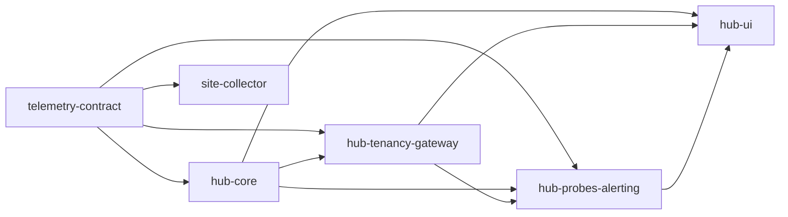

# Capability Map: NS8 Central Monitoring Service

Diese Capability Map zerlegt das Gesamtprojekt (`NS8-CentralMonitoringService`) gemäß Spec-Driven Development (Phase 0) in **sechs klar abgegrenzte, zyklenfreie und unabhängig testbare Fähigkeiten (Capabilities)**. Jede Capability erhält nach Freigabe dieser Map ihre eigene Spezifikation (`SPEC-<module-id>.md`) im Projektwurzelverzeichnis.

| Module id | Responsibility | Depends on |
| :--- | :--- | :--- |
| `telemetry-contract` | Verbindlicher Daten-, Label- & API-Vertrag zwischen Hub und Collectoren: Pflicht-Labels (`customer`, `site`, `device_role`), Ingest-Endpunkte (`/api/v1/write`, `/loki/api/v1/push`), Token-Auth-Schema, gemeinsame MSP-Standard-Alarmregeln (`promtool`-geprüft) & Grafana-Starter-Dashboards (`shared/`). | — |
| `hub-core` | Eigenständiges Rootless-NS8-Modul `central-monitoring-hub` (`hub/`): Podman-Pod-Lebenszyklus, Traefik-FQDN/TLS, Restic Backup/Restore/Clone, **Prometheus**, **Loki**, **Grafana** & **Alertmanager** inkl. umschaltbarem Speicher-Backend (**Lokaler Speicher** oder **S3/MinIO** via nativem Loki-S3 + **Thanos** für Prometheus-Langzeitdaten). | `telemetry-contract` |
| `hub-tenancy-gateway` | Internes Auth- & Mandanten-Gateway im Hub-Pod: Token-Validierung & erzwungenes Label-/Tenant-Stamping beim Metrik- & Log-Ingest, strikte Read-Only-Kunden-Isolation (automatische Grafana-Orgs + **`prom-label-proxy`** + Loki `X-Scope-OrgID`), NS8-LDAP/AD-Anbindung für MSP-Techniker sowie der **Standalone-Agent-Generator** (Grafana Alloy Pakete/Configs für Windows, Linux & Docker). | `telemetry-contract`, `hub-core` |
| `hub-probes-alerting` | Zentrale Pull- & Probe-Dienste sowie Alert-Engine im Hub: Dynamisches `file_sd`-Management ohne Neustart (NS8-Federation & direkte Exporter), integrierter **Blackbox Exporter** (Web/HTTPS/SSL-Ablauf/DNS/TCP) & **SNMP Exporter**, Ausrollen der Standard-Alarmpakete, **Wartungsfenster (Silences)** sowie Multi-Channel-Routing (NS8-Smarthost-Mail, Webhook/PSA, Teams/Slack, Push/Ntfy/Telegram & Kunden-Mail). | `telemetry-contract`, `hub-core`, `hub-tenancy-gateway` |
| `hub-ui` | NS8-Cockpit-Verwaltungsoberfläche (`@nethserver/ns8-ui-lib`, Vue/Carbon, DE/EN) für `central-monitoring-hub`: Status-/Speicher-/S3-Ansicht, Mandanten- & Token-Verwaltung (inkl. Kunden-Login-Schalter & 1-Klick-Agent-Onboarding), Pflege zentraler Pull-/Blackbox-/SNMP-Ziele, Alerting-Kanäle & Wartungsfenster. | `hub-core`, `hub-tenancy-gateway`, `hub-probes-alerting` |
| `site-collector` | Eigenständiges Rootless-NS8-Modul `central-monitoring-collector` (`collector/`) inkl. kompakter Cockpit-UI für Kunden-NS8-Cluster (auf Basis von **Grafana Alloy**): Automatische Erfassung lokaler NS8-Node-/Backup-/Container-Metriken & Logs, lokale Kunden-LAN-Abfrage (Proxmox VE, Windows/Linux, SNMP für Switches/USVs/NAS/Firewalls & lokaler Syslog-Empfänger), lokale WAL-Ausfallpufferung & HTTPS-Push an den Hub. | `telemetry-contract` |

---

## Abhängigkeitsgraph & Bau-Reihenfolge

**Build order:** `telemetry-contract` → `hub-core` → `hub-tenancy-gateway` → `hub-probes-alerting`, `site-collector` *(parallelisierbar)* → `hub-ui`

---

## Geplante Monorepo-Struktur (Überblick)

- `shared/` — Gemeinsame Schemata, Standard-Alarmregeln, Dashboard-JSONs & Alloy-Templates (`telemetry-contract`)
- `hub/` — NS8-Modul `central-monitoring-hub` (`imageroot/`, `ui/`, Containerfiles, `build-images.sh`)
- `collector/` — NS8-Modul `central-monitoring-collector` (`imageroot/`, `ui/`, Containerfile, `build-images.sh`)
- `docs/` — Intent-Dokumentation, Architektur-Entscheidungen & Betriebshandbuch
