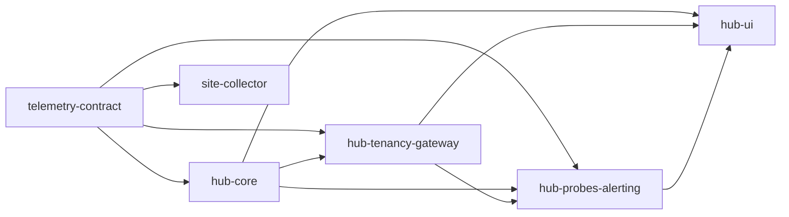

# Capability Map: NS8 Central Monitoring Service (`v1.1.0`)

Diese Capability Map zerlegt das Gesamtprojekt (`NS8-CentralMonitoringService`) gemäß Spec-Driven Development (Phase 0) in **sechs klar abgegrenzte, zyklenfreie und unabhängig testbare Fähigkeiten (Capabilities)**. Jede Capability besitzt ihre verbindliche Spezifikation (`SPEC-<module-id>.md`) im Projektwurzelverzeichnis.

| Module id | Responsibility | Depends on |
| :--- | :--- | :--- |
| `telemetry-contract` | Verbindlicher Daten-, Label-, Schema- & Paket-Vertrag (`shared/`): Pflicht-Labels (`customer`, `site`, `device_role` inkl. `snmp-printer`, `collector_id`), Ingest-Endpunkte (`/api/v1/write`, `/loki/api/v1/push`, `/api/v1/ingest/verify`), **57** selbstenthaltende JSON-Schemata Draft-07 (**56** byte-identische Action-Schemata über **22** Hub-API-Actions + **6** Collector-API-Actions), **6** `promtool`-geprüfte MSP-Alarmpakete (**81** Alarmregeln inkl. `cgroups-v2` Pod-OOM/RAM/Swap, QNAP & RFC 3805 Drucker), **6** deutsche Enterprise-NOC-Grafana-11-Dashboards (**117** Panels) & **6** gehärtete Standalone-Alloy-Onboarding-Templates. | — |
| `hub-core` | Eigenständiges Rootless-NS8-Modul `central-monitoring-hub` (`hub/`, Python 3.9+ Rocky Linux 9 kompatibel): Podman-Pod-Lebenszyklus (**13** `.service`-Units + `hub-ns8-metrics.timer` mit `%E/`-Pfaden & SELinux `:z`-Verzeichnis-Mounts), Traefik-FQDN/ACME, Restic Backup/Restore/Clone (`grafana.db` Online-SQLite-Backup), **Prometheus**, **Loki**, **Grafana 11** & **Alertmanager**, umschaltbares Speicher-Backend (**Lokaler Speicher** oder **S3/MinIO** via Loki-TSDB-S3 + **Thanos** Sidecar/Store/Query) sowie **Rootless Linux `cgroups v2` Hub-Self-Monitoring** (`hub-ns8-node` über `:9097/metrics/ns8-node`). | `telemetry-contract` |
| `hub-tenancy-gateway` | Internes Auth- & Mandanten-Gateway im Hub-Pod (`:8080` Ingress + `:9097` interner Relay/Metrics-Loopback): Token-Validierung & serverseitiges Protobuf/Snappy-Label-Stamping, strikte Kunden-Isolation (eigene Grafana-Orgs mit Multi-User-Verwaltung `Viewer`/`Editor`, gesperrten Read-Only-Datasources, **`prom-label-proxy`** `:9095`, Loki `X-Scope-OrgID` & Read-Only-Proxy-Allowlist), **1-Klick MSP-Kundenansicht (`?orgId=<id>`)**, **Live AD/LDAPv3 Gruppen- & Benutzer-Mehrfachauswahl** (`NsMultiSelect`, `LDAP_*_PRINCIPALS_B64`, `member_of = "distinguishedName"`/`"dn"`) inkl. Login-Tester sowie **Standalone-Agent-Generator** (Windows, Linux & Docker). | `telemetry-contract`, `hub-core` |
| `hub-probes-alerting` | Zentrale Pull- & Probe-Dienste sowie Alert-Engine im Hub: Unterbrechungsfreies `file_sd`-Management (NS8-Federation & Exporter inkl. SSRF-Schutz), integrierter **Blackbox Exporter** (HTTP/HTTPS/Phasen-Latenz/SSL-Ablauf/DNS/TCP) & **SNMP Exporter** (`if_mib`, `apcupsd`, `synology`, `qnap`, `mikrotik`, `fortigate`, `printer` RFC 3805, `generic` inkl. `ifSpeed`/`ifHighSpeed`), Ausrollen der **6** Regelpakete (**81** Regeln), **Wartungsfenster (Silences)** sowie Multi-Channel-Routing (NS8-Smarthost/SMTP, Webhook/PSA, MS Teams/Slack, Ntfy/Telegram/Gotify & Kunden-E-Mail-Routing). | `telemetry-contract`, `hub-core`, `hub-tenancy-gateway` |
| `hub-ui` | Zweisprachige NS8-Cockpit-Verwaltungsoberfläche (`@nethserver/ns8-ui-lib`, Vue 2/Carbon, `de`/`en`) für alle **22** schema-validierten Hub-Actions (**26** Actions inkl. Lifecycle): Status-Ansicht mit Schnelllinks (`Grafana öffnen`, `NS8-Pods`, `Log-Explorer`), Mandanten-, Multi-User-Portal- & Token-Verwaltung (inkl. Inline-Portal-Aktivierung, 1-Klick-Kundenansicht & Alloy-Onboarding), zentrale Ziele/Probes, Alerting & Silences sowie Einstellungen (S3/Thanos, Hub-Self-Monitoring, Live-AD/LDAP-Multi-Select). | `hub-core`, `hub-tenancy-gateway`, `hub-probes-alerting` |
| `site-collector` | Eigenständiges Rootless-NS8-Modul `central-monitoring-collector` (`collector/`, **10** NS8-Actions inkl. Lifecycle, **4** `.service`-Units + `ns8-collector-textfile.timer`, kompakte `de`/`en` Cockpit-UI) auf Basis von **Grafana Alloy `v1.4.2`** + optionalem `pve-exporter`: Rootless **`cgroups v2` NS8-Pod-/Modul-Harvester** (`ns8_module_*`, `ns8_pod_unit_*`, Restic-Backups & Container über alle lokalen Rootless/Rootful-Module), Kunden-LAN-Abfrage (Proxmox VE, Windows/Linux, SNMP v2c/v3 inkl. `qnap`/`printer`/`ifHighSpeed` & Syslog `5514`), lokale WAL-Pufferung & HTTPS-Push an den Hub. | `telemetry-contract` |

---

## Abhängigkeitsgraph & Bau-Reihenfolge

**Build order:** `telemetry-contract` → `hub-core` → `hub-tenancy-gateway` → `hub-probes-alerting`, `site-collector` *(parallelisierbar)* → `hub-ui`

---

## Monorepo-Struktur & Kennzahlen (`v1.1.0`)

- `shared/` — **57** Draft-07 JSON-Schemata (`shared/schemas/`), **6** Regelpakete mit **81** Alarmregeln (`shared/rules/`), **6** Grafana-11-NOC-Dashboards mit **117** Panels (`shared/dashboards/`) & **6** Standalone-Alloy-Templates (`shared/alloy-templates/`).
- `hub/` — NS8-Modul `central-monitoring-hub` (`26` Actions total / `22` mit Input/Output-Schemata, `13` `.service`-Units + `1` `.timer`-Unit, `hub/gateway/`, `hub/ui/`, Robot-Testsuite `hub/tests/`).
- `collector/` — NS8-Modul `central-monitoring-collector` (`10` Actions total / `6` mit Input/Output-Schemata, `4` `.service`-Units + `1` `.timer`-Unit, `collector/ui/`, Robot-Testsuite `collector/tests/`).
- `docs/` — Intent-Dokumentation, Benutzerhandbuch (`user-guide.md`), Endkunden-Portalhandbuch (`customer-portal-guide.md`), Dashboard- & Alarmkatalog (`dashboards-and-alerts.md`), Architektur (`architecture.md`), Betrieb (`operations-guide.md`) & Migration (`migration-guide.md`).
