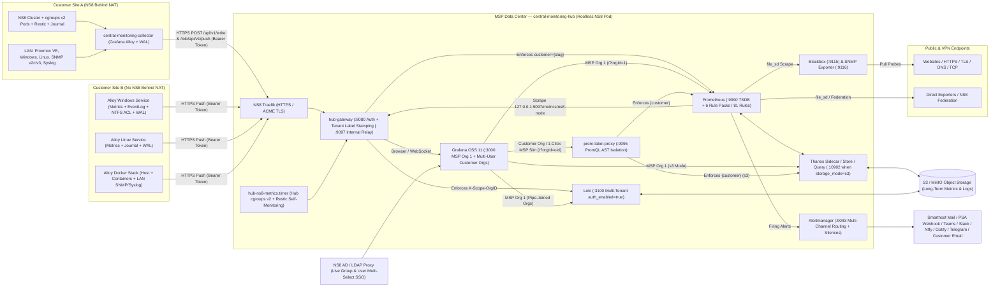

# NS8 Central Monitoring Service (`v1.1.0`)

Multi-tenant open-source observability, metrics, and centralized logging platform for **Managed Service Providers (MSPs)** built on **NethServer 8 (NS8)** — engineered as a drop-in replacement for legacy fleet monitoring systems (**PRTG, Checkmk, and Zabbix**) across **> 1,500 monitored systems**.

This monorepo packages two standalone, **100% rootless** NethServer 8 Software Center modules together with their shared canonical telemetry, alert-rule, schema, and dashboard contract (`shared/`):

1. **`central-monitoring-hub` ([`hub/`](hub/README.md)):** Central monitoring, log aggregation, alerting, and multi-org portal server combining **Prometheus**, **Thanos** (optional S3/MinIO long-term object storage), **Grafana OSS 11** (6 pre-provisioned Enterprise NOC dashboards), **Loki**, **Alertmanager**, **Blackbox Exporter**, **SNMP Exporter**, **`prom-label-proxy`**, a security-hardened **Auth & Tenancy Gateway**, built-in **Rootless Linux `cgroups v2` Hub Self-Monitoring**, live **AD/LDAPv3 Group & User Multi-Select SSO**, and a **1-Click Onboarding Bundle Generator** for standalone **Grafana Alloy** agents (Windows, Linux, and Docker).
2. **`central-monitoring-collector` ([`collector/`](collector/README.md)):** Lightweight rootless NS8 module (powered by **Grafana Alloy** + an on-demand **Proxmox VE Exporter** sidecar) deployed on customer NS8 clusters behind NAT/CGNAT and overlapping RFC1918 subnets (e.g., `192.168.1.0/24`). Automatically harvests cluster-wide NS8 host, **Linux `cgroups v2` pod/module** (`ns8_module_*`, `ns8_pod_unit_*`), container, systemd, and Restic backup telemetry (`ns8.prom`), scrapes LAN systems (Windows, Linux, Proxmox VE, switches, firewalls, UPS units, Synology/QNAP NAS, and RFC 3805 network printers via SNMP v2c/v3 & Syslog), buffers outages locally via disk-backed Write-Ahead-Logs (WAL), and pushes telemetry outbound over HTTPS with bearer-token authentication.

> [!IMPORTANT]
> Both modules run completely unprivileged (`rootless` Podman + `systemd --user`, Rocky Linux 9 Python 3.9 + SELinux Enforcing & Debian 12 compatible) under dedicated NS8 module users and **never** modify or conflict with NethServer 8's built-in core `ns8-metrics` module.

---

## System Architecture



---

## Feature Matrix

| Area | Capability | Technical Implementation |
| :--- | :--- | :--- |
| **Multi-Tenancy & Ingest Protection** | Tamper-proof tenant isolation across overlapping customer LANs (`192.168.1.0/24`) | `hub-gateway` verifies salted SHA-256 token digests (`hmac.compare_digest`), decodes Snappy/Protobuf `WriteRequest` & Loki streams, strips spoofed headers/labels, and stamps `customer` server-side |
| **Multi-User Customer Portals** | Isolated per-customer Grafana portals (`https://<hub-fqdn>/login`) with automatic Org Home Dashboard (`NS8 & MSP Gesamtübersicht`) | Dedicated Grafana Orgs supporting multiple customer accounts (`Viewer` & `Editor` roles, inline portal activation, password generator/reset, suspend/enable, 1-click credentials copy), `editable: false` server-proxied datasources, disabled Grafana alerting/provisioning routes (`403`), `prom-label-proxy` PromQL AST rewriting, and Loki `X-Scope-OrgID` partitioning |
| **MSP Fleet View, 1-Click Simulated Customer View & Live AD/LDAP Multi-Select SSO** | Unified cross-tenant fleet dashboards (`/?orgId=1`), 1-click simulated customer view (`/?orgId=<id>`), and live AD/LDAP group & user multi-select discovery (`NsMultiSelect`) | Grafana Main Org (`Org 1`) + automatic 1-way MSP staff & multi-org `ldap.toml` provisioning (`Admin` for MSP Admins, Read-Only `Viewer` for MSP Editors/Support; `/d/ns8-multi-cluster-overview?orgId=1&var-customer=<slug>` fallback when portal is disabled), live LDAPv3 **group & user** discovery (`discover-ldap-groups` with All / Groups Only / Users Only scope filtering), multi-principal assignment (`ldap_*_principals` combining groups + individual users with automatic short-name -> DN resolution), `member_of = "distinguishedName"` / `"dn"` Grafana `ldap.go` integration, AD nested groups (`1.2.840.113556.1.4.1941`), and quick-pick `test-ldap-user` tester |
| **Scale > 1,500 Systems** | Live-switchable storage backend (`local` vs. `s3`) without data loss | Local Podman volumes for compact deployments; **S3 / MinIO** via native Loki TSDB v13 + **Thanos Sidecar, Store Gateway & Query** for multi-month retention |
| **NS8 Site Collector & Hub Node Self-Monitoring** | Zero-inbound-port LAN monitoring, **Rootless Linux `cgroups v2` NS8 Pod & Module Telemetry**, and built-in Hub Node Self-Monitoring | `central-monitoring-collector` (and built-in Hub `monitor_local_ns8_node` / `local_node_customer`) harvests world-readable Linux `cgroups v2` (`ns8_module_*` & `ns8_pod_unit_*`: CPU, throttling, working-set RAM, swap, Disk I/O, PIDs, OOM kills across both rootless `user-<UID>.slice` and rootful `system.slice` NS8 modules), Restic backup state (`ns8.prom`), Proxmox VE, Windows, Linux, SNMP v2c/v3 (`if_mib`, `apcupsd`, `synology`, `qnap`, `fortigate`, `mikrotik`, `printer`), and Syslog with local disk WAL buffering |
| **Non-NS8 Customer Sites** | 1-Click standalone agent bundles with Windows background service tamper protection | `generate-agent-bundle` renders pre-configured Grafana Alloy configs and idempotent installers for **Windows** (`.ps1` background service with Authenticode check, `SYSTEM`/Admin-only NTFS ACLs prior to writing bearer tokens, and `sc.exe failure` auto-recovery for GPO/Intune rollout), **Linux** (`.sh`), and **Docker Compose** |
| **Enterprise NOC Dashboards & Rule Packs** | 6 pre-provisioned Grafana 11 NOC dashboards (`117` panels, with Org-1 provisioned reload) + 81 `promtool`-verified alert rules | **6 Enterprise NOC Dashboards** and **6 Prometheus rule packs** totaling **81 alert rules** covering NS8 pods/backups, Linux, Windows/AD/DNS/SMB, Proxmox VE, Web/DNS/SSL, and SNMP switches/firewalls/UPS/NAS/printers |
| **Multi-Channel Alerting & Silences** | Targeted escalation & scheduled maintenance windows (e.g., Patch Tuesday) | NS8 Smarthost/SMTP, PSA/Ticketing Webhooks, MS Teams, Slack, Telegram, Ntfy, Gotify, per-customer email routing (`contact_emails`), and Restic-durable Alertmanager v2 Silences |
| **NS8 Restic Backup & In-Place Upgrades** | Fast daily cluster snapshots + zero-touch `update-module` hooks | Online WAL-safe SQLite `.backup` of `grafana.db` + tenants, tokens, portal secrets, targets, custom rules, and silences; `update-module.d/{20pull_images,50update}` refreshes pinned images, configs, and Org-1 dashboards automatically |

---

## Enterprise NOC Dashboards (6 Dashboards / 117 Panels) & Alert Rule Packs (81 Rules)

### Pre-Provisioned Grafana 11 NOC Dashboards (`shared/dashboards/`)

| Dashboard File | UID | Title | Panels | Template Variables & Purpose |
| :--- | :--- | :--- | :---: | :--- |
| `ns8-multi-cluster-overview.json` | `ns8-multi-cluster-overview` | **NS8 & MSP Gesamtübersicht** | `22` (`17` vis + `5` rows) | `$customer`, `$site` — Automatic Org Home Dashboard: fleet health, Restic backups, active alerts, top saturation & drill-down links |
| `ns8-pods-and-modules.json` | `ns8-pods-and-modules` | **NethServer 8 Pods, Module & Container** | `21` (`16` vis + `5` rows) | `$customer`, `$site`, `$instance`, `$module_id` — Rootless & rootful `cgroups v2` CPU, throttling, working-set RAM, swap, Disk I/O, PIDs, OOM kills & per-container units |
| `linux-windows-servers.json` | `linux-windows-servers` | **Linux- & Windows-Server Deep-Dive** | `24` (`18` vis + `6` rows) | `$customer`, `$site`, `$device_role`, `$instance` — CPU, load, memory, disk/inode saturation, network, Windows auto-services, Linux `systemd` units & host logs |
| `proxmox-snmp-infrastructure.json` | `proxmox-snmp-infrastructure` | **Proxmox VE, Netzwerk, USV & NAS** | `27` (`21` vis + `6` rows) | `$customer`, `$site`, `$instance` — PVE quorum/ZFS/storage/VMs, switch/firewall 64-bit interface traffic & errors, UPS battery/runtime, Synology/QNAP NAS & RFC 3805 printers |
| `web-ssl-uptime.json` | `web-ssl-uptime` | **Web, DNS & SSL-Zertifikate (SLA)** | `13` (`10` vis + `3` rows) | `$customer`, `$site`, `$instance` — HTTP/HTTPS availability, response latency breakdown, DNS resolution & TLS certificate expiry countdown |
| `central-log-explorer.json` | `central-log-explorer` | **Zentraler Log- & Security-Explorer** | `10` (`7` vis + `3` rows) | `$customer`, `$site`, `$device_role`, `$instance`, `$job`, `$level`, `$log_search` — Full-text Loki search, log volume histograms, Windows Security EventIDs (`4625`/`4720`/`4740`) & firewall syslog |

### Standard MSP Prometheus Alert Rule Packs (`shared/rules/` — 81 Rules Total)

| Rule Pack | Rules | Monitored Scope & Key Alerts |
| :--- | :---: | :--- |
| `ns8-cluster.yml` | **20** | Node reachability, collector staleness, CPU/RAM/swap, disk 24h fill prediction, `mdadm` RAID, Restic backup failure/staleness, container crash loops, `systemd` failures, and `cgroups v2` pod alerts (`NS8ModuleOOMKilled`, `NS8ModuleMemoryNearLimit`, `NS8ModuleHighSwapUsage`) |
| `linux-node.yml` | **15** | Host down/stale/reboot, sustained CPU & load, memory pressure, kernel OOM kills, filesystem space & inode exhaustion, read-only mounts, disk I/O saturation, `systemd` failures & NTP drift |
| `snmp-network-ups.yml` | **15** | SNMP reachability, critical interface down, packet error/discard rates, UPS on battery / low charge / battery replacement, Synology & QNAP RAID/volume degradation & disk temperatures, and RFC 3805 printer toner/supply levels & critical alerts |
| `windows-node.yml` | **12** | Host down/stale/reboot, CPU & available memory thresholds, logical disk space, stopped automatic Windows services, Active Directory replication, DNS server health & SMB availability |
| `proxmox-ve.yml` | **11** | PVE exporter & node status, cluster quorum loss, host CPU/RAM/I/O-wait saturation, storage pool space/unavailability, ZFS pool degradation & stopped `onboot=1` guests |
| `blackbox-web-ssl.yml` | **8** | HTTP/HTTPS endpoint down, `5xx`/`4xx` responses, slow HTTP latency (`> 3s`), TLS certificate expiry (`< 21d` warning / `< 7d` critical), DNS failure & TCP port probe failure |

---

## Multi-Language Support (`English` & `German`)

- **NethServer 8 Cockpit Admin UIs (`hub/ui` & `collector/ui`):** 100% bilingual (`en` & `de`) with CI-enforced translation key parity (`validate-monorepo.py`), switching automatically with each administrator's NS8 Cockpit language preference.
- **Grafana 11 Portal:** Every MSP engineer and customer portal user can independently switch their personal Grafana UI language (`English` / `Deutsch`) and timezone under **Profile -> Preferences** without affecting other users.

---

## Installation on NethServer 8

### Option A: 1-Click Installation via NS8 Software Center (`BLS-ISP/ns8-nethforge`)

Both modules are published in the central **BLS-ISP NethServer 8 Software Repository** ([`BLS-ISP/ns8-nethforge`](https://github.com/BLS-ISP/ns8-nethforge)) and can be installed and updated graphically from the **NethServer 8 Software Center**:

1. In the **NethServer 8 Cluster Admin** UI, navigate to **Settings -> Software repositories -> Add repository**:
   - **Name:** `bls-isp`
   - **URL:**
     ```text
     https://raw.githubusercontent.com/BLS-ISP/ns8-nethforge/repomd/ns8/updates/
     ```
2. Open **Software Center** and install **Central Monitoring Hub** (on the central MSP cluster) or **Central Monitoring Collector** (on customer NS8 clusters).

### Option B: Direct CLI Installation (`add-module`)

#### 1. Install Central Monitoring Hub (MSP Cluster)

```bash
add-module ghcr.io/bls-isp/central-monitoring-hub:latest 1
```

Then configure the instance in **NS8 Cluster-Admin -> Applications -> Central Monitoring Hub**:
1. Under **Settings**, configure your Traefik FQDN (e.g., `monitoring.msp.example.com`), Let's Encrypt, retention periods, built-in **Local NS8 Node & Pod Self-Monitoring**, and optionally **S3 / MinIO Storage Mode** and **Live AD / LDAP Group & User Multi-Select SSO**.
2. Under **Tenants & Onboarding**, create your first customer tenant (e.g., `acme-corp`, site `hq`), copy the one-time bearer token (`cms_v1_...`), and optionally provision **Customer Portal Accounts** (`Viewer` / `Editor`).
3. Under **Alerting & Maintenance**, enable your notification channels (NS8 Smarthost, PSA Webhook, MS Teams/Slack, Push) and verify end-to-end delivery with **Send Test Alert**.

#### 2. Install Site Collector (Customer NS8 Cluster)

```bash
add-module ghcr.io/bls-isp/central-monitoring-collector:latest 1
```

In the customer cluster's **NS8 Cluster-Admin -> Applications -> Central Monitoring Collector**:
1. Under **Collector Settings**, enter the Hub HTTPS URL (`https://monitoring.msp.example.com`), the copied bearer token (`cms_v1_...`), the customer slug (`acme-corp`), and the site slug (`hq`).
2. Click **Test Hub Connection** to verify TLS and token authentication, then save.
3. Optionally open **Local Customer LAN Targets** to add customer LAN Proxmox VE nodes, Windows/Linux servers, and SNMP v2c/v3 devices (switches, firewalls, UPS units, Synology/QNAP NAS, and RFC 3805 network printers).

> [!TIP]
> For customer sites **without NethServer 8**, open **Central Monitoring Hub -> Tenants & Onboarding -> Alloy Onboarding** to generate a ready-to-run standalone **Grafana Alloy** bundle for **Windows Server/Workstations (PowerShell)**, **Linux (Debian/Ubuntu/RHEL/Rocky)**, or **Docker Compose** in one click.

---

## Local Development, Validation & Testing

All static validators, Draft-07 schema checks, backend/security test suites, and Cockpit UI builds run cross-platform on Linux, macOS, and Windows.

| Command | Description |
| :--- | :--- |
| `python scripts/validate-monorepo.py` | Validates LF line endings (`0` CRLF), UTF-8 without BOM, Python 3.9 compatibility (`[PY39-COMPAT]`), all 57 Draft-07 JSON Schemas, all 8 NS8 Backend Rules, all 3 NS8 Cockpit UI Rules, `LICENSE`, Software Center icons/`metadata.json`, all 6 dashboards, 6 Alloy templates, and 6 rule packs |
| `python scripts/validate-monorepo.py --strict` | Strict CI gate: additionally enforces complete presence and schema parity across `hub/`, `collector/`, both Cockpit UIs, and Software Center assets |
| `python scripts/generate-repomd.py --org bls-isp --tag 1.1.0 --output-dir _site` | Generates a static NS8 Software Center repository (`repodata.json` / `repomd.json` + module icons) for GitHub Pages hosting |
| `python -m pytest tests -v` | Runs the full 261-test Python suite (contract, Hub core, tenancy/gateway security, live AD/LDAPv3, multi-user portals & 1-click MSP view, cgroups-v2 NS8 pod/module harvester, 6 NOC dashboards, probes/alerting, Cockpit UI compliance, site collector, and async E2E lifecycle tests) |
| `npm --prefix hub/ui ci && npm --prefix hub/ui run build` | Installs dependencies and builds the production Hub Cockpit UI bundle into `hub/ui/dist/` |
| `npm --prefix collector/ui ci && npm --prefix collector/ui run build` | Installs dependencies and builds the production Collector Cockpit UI bundle into `collector/ui/dist/` |
| `docker run --rm -v "${PWD}:/w:ro" -w /w --entrypoint promtool quay.io/prometheus/prometheus:v2.54.1 check rules shared/rules/*.yml` | Validates all 6 standard MSP Prometheus alert rule packs (81 rules) using upstream `promtool` |
| `bash hub/test-module.sh <ns8-leader-ip>` / `bash collector/test-module.sh <ns8-leader-ip>` | Executes the NethServer 8 Robot Framework end-to-end test suites against a live NS8 test cluster over SSH/`api-cli` |

---

## Repository Layout

```text
ns8-centralmonitoringservice/
├── .github/workflows/          # GitHub Actions CI (incl. python:3.9-slim), GHCR OCI publishing & Software Center repo
├── collector/                  # Standalone NS8 module `central-monitoring-collector` (Grafana Alloy + PVE Exporter)
│   ├── imageroot/              # NS8 actions, systemd --user units, rootless cgroups-v2 NS8 harvester & Alloy renderer
│   ├── tests/                  # Robot Framework live NS8 VM end-to-end suite (`test-module.sh`)
│   ├── ui/                     # Bilingual (EN/DE) NS8 Cockpit UI (`@nethserver/ns8-ui-lib`, `metadata.json` & icon)
│   ├── Containerfile           # Rootless OCI module image definition
│   ├── README.md               # Complete `central-monitoring-collector` module developer & operator reference
│   └── build-images.sh         # Local / CI OCI image build script
├── hub/                        # Standalone NS8 module `central-monitoring-hub`
│   ├── gateway/                # Python aiohttp Auth & Tenancy Gateway (Snappy/Protobuf stamping & internal relay)
│   ├── imageroot/              # 26 NS8 actions (22 schema-validated), systemd --user units (Prometheus, Loki, Grafana 11, Thanos)
│   ├── tests/                  # Robot Framework live NS8 VM end-to-end suite (`test-module.sh`)
│   ├── ui/                     # Bilingual (EN/DE) NS8 Cockpit UI (`@nethserver/ns8-ui-lib`, `metadata.json` & icon)
│   ├── Containerfile           # Rootless OCI module image definition
│   ├── README.md               # Complete `central-monitoring-hub` module developer & operator reference
│   └── build-images.sh         # Build script for `central-monitoring-hub-gateway` and `central-monitoring-hub`
├── shared/                     # Authoritative `telemetry-contract` shared across Hub, Collector & standalone agents
│   ├── alloy-templates/        # 6 Grafana Alloy River templates & hardened OS installers (Linux, Windows, Docker)
│   ├── dashboards/             # 6 pre-provisioned Enterprise NOC Grafana 11 dashboards (117 panels, schema v39+)
│   ├── rules/                  # 6 MSP Prometheus alert rule packs (81 rules: NS8, Linux, Windows, Proxmox, Web/SSL, SNMP)
│   └── schemas/                # 57 self-contained JSON Schema Draft-07 contracts for all NS8 actions
├── scripts/
│   ├── generate-repomd.py      # NS8 Software Center repository generator (`repodata.json` / `repomd.json` + icons)
│   └── validate-monorepo.py    # Zero-dependency architecture, LF, Python 3.9, Software Center & NS8 rule validator
├── tests/                      # 261 automated unit, contract, security, UI & E2E integration tests (pytest)
├── docs/                       # MSP & customer user manuals, dashboard/alert catalog, Day-2 ops, ADRs & migration guides
├── LICENSE                     # GNU General Public License v3.0 (GPL-3.0-or-later)
├── CAPABILITY-MAP.md           # Capability decomposition & build dependency graph
└── SPEC-*.md                   # Authoritative module specifications across all 6 capabilities
```

---

## Documentation & Manuals Index

| Document | Language | Audience & Scope |
| :--- | :---: | :--- |
| **[Hub Module Reference (`hub/README.md`)](hub/README.md)** | EN | Complete developer & operator reference for `central-monitoring-hub` (pod port map, all 22 NS8 actions, systemd units, env vars, build & Robot tests) |
| **[Collector Module Reference (`collector/README.md`)](collector/README.md)** | EN | Complete developer & operator reference for `central-monitoring-collector` (WAL architecture, cgroups-v2 harvester, all 10 NS8 actions, LAN target profiles) |
| **[MSP Administrator & Support User Manual (`docs/user-guide.md`)](docs/user-guide.md)** | DE | Screen-by-screen UI walkthrough of every Hub & Collector page, AD/LDAP multi-select SSO, multi-user portals, 1-click MSP customer view & Alloy onboarding |
| **[End-Customer Monitoring Portal Guide (`docs/customer-portal-guide.md`)](docs/customer-portal-guide.md)** | DE | Ready-to-share customer handbook: login, `Viewer` vs. `Editor` roles, navigating all 6 dashboards, filtering by `$site`/`$instance`, and searching logs |
| **[Dashboards, Metrics & Alert Rules Reference (`docs/dashboards-and-alerts.md`)](docs/dashboards-and-alerts.md)** | DE | Complete catalog of all 6 Grafana 11 NOC dashboards (`117` panels), canonical metrics (`ns8_module_*`, `node_*`, `windows_*`, `pve_*`, SNMP), and all 81 alert rules with runbook hints |
| **[MSP Day-2 Operations Guide (`docs/operations-guide.md`)](docs/operations-guide.md)** | DE | Sizing for > 1,500 systems, MinIO/S3 & Thanos setup, Windows GPO/Intune deployment & tamper protection, Proxmox VE & SNMPv3, Patchday Silences & Restic DR |
| **[Architecture & Security Reference (`docs/architecture.md`)](docs/architecture.md)** | DE | Podman port maps, ADRs (`ADR-001`–`ADR-007`), Snappy/Protobuf wire stamping, `prom-label-proxy` AST isolation, SSRF/SELinux/Python 3.9 hardening & backup design |
| **[Legacy Migration Playbook (`docs/migration-guide.md`)](docs/migration-guide.md)** | DE | Step-by-step playbook for replacing **PRTG, Checkmk, or Zabbix** (sensor/check mapping tables, 14-day parallel validation protocol & cutover checklist) |
| **[Capability Map (`CAPABILITY-MAP.md`)](CAPABILITY-MAP.md)** & **[Intent (`docs/intent/central-monitoring.md`)](docs/intent/central-monitoring.md)** | EN | System decomposition, dependency graph, and architectural invariants |
| **Authoritative Specifications:** [`SPEC-telemetry-contract.md`](SPEC-telemetry-contract.md), [`SPEC-hub-core.md`](SPEC-hub-core.md), [`SPEC-hub-tenancy-gateway.md`](SPEC-hub-tenancy-gateway.md), [`SPEC-hub-probes-alerting.md`](SPEC-hub-probes-alerting.md), [`SPEC-hub-ui.md`](SPEC-hub-ui.md), [`SPEC-site-collector.md`](SPEC-site-collector.md) | EN | Detailed JSON schemas, action contracts, security boundaries, and acceptance criteria across all 6 capabilities |
| **[License (`LICENSE`)](LICENSE)** | EN | Licensed under the **GNU General Public License v3.0 (`GPL-3.0-or-later`)** |
