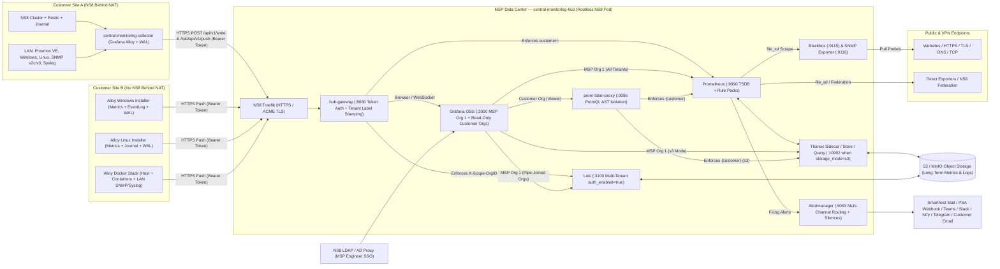

# NS8 Central Monitoring Service

Multi-tenant open-source observability, metrics, and centralized logging platform for **Managed Service Providers (MSPs)** built on **NethServer 8 (NS8)** — engineered as a drop-in replacement for legacy fleet monitoring systems (**PRTG, Checkmk, and Zabbix**) across **> 1,500 monitored systems**.

This monorepo packages two standalone, **100% rootless** NethServer 8 Software Center modules together with their shared canonical telemetry, alert-rule, schema, and dashboard contract (`shared/`):

1. **`central-monitoring-hub` (`hub/`):** Central monitoring, log aggregation, alerting, and multi-org portal server combining **Prometheus**, **Thanos** (optional S3 long-term object storage), **Grafana OSS**, **Loki**, **Alertmanager**, **Blackbox Exporter**, **SNMP Exporter**, **`prom-label-proxy`**, a security-hardened **Auth & Tenancy Gateway**, and an integrated **1-Click Onboarding Bundle Generator** for standalone **Grafana Alloy** agents (Windows, Linux, and Docker).
2. **`central-monitoring-collector` (`collector/`):** Lightweight rootless NS8 module (powered by **Grafana Alloy** + an on-demand **Proxmox VE Exporter** sidecar) deployed on customer NS8 clusters behind NAT/CGNAT and overlapping RFC1918 subnets (e.g., `192.168.1.0/24`). Automatically harvests cluster-wide NS8 host, container, systemd, and Restic backup telemetry (`ns8.prom`), scrapes LAN systems (Windows, Linux, Proxmox VE, switches, firewalls, UPS units, Synology/QNAP NAS, and RFC 3805 network printers via SNMP v2c/v3 & Syslog), buffers outages locally via disk-backed Write-Ahead-Logs (WAL), and pushes telemetry outbound over HTTPS with bearer-token authentication.

> [!IMPORTANT]
> Both modules run completely unprivileged (`rootless` Podman + `systemd --user`) under dedicated NS8 module users and **never** modify or conflict with NethServer 8's built-in core `ns8-metrics` module.

---

## System Architecture



---

## Feature Matrix

| Area | Capability | Technical Implementation |
| :--- | :--- | :--- |
| **Multi-Tenancy & Ingest Protection** | Tamper-proof tenant isolation across overlapping customer LANs (`192.168.1.0/24`) | `hub-gateway` verifies salted SHA-256 token digests (`hmac.compare_digest`), decodes Snappy/Protobuf `WriteRequest` & Loki streams, strips spoofed headers/labels, and stamps `customer` server-side |
| **Multi-User Customer Portals** | Isolated per-customer Grafana portals with multi-account management | Dedicated Grafana Orgs supporting multiple customer accounts (`Viewer` & `Editor` roles, password generator/reset, suspend/enable, 1-click credentials copy), `editable: false` server-proxied datasources, `prom-label-proxy` PromQL AST rewriting, and Loki `X-Scope-OrgID` partitioning |
| **MSP Fleet View & Live AD/LDAP SSO** | Unified cross-tenant fleet dashboards + live AD/LDAP group discovery & login tester | Grafana Main Org (`Org 1`), dynamic multi-tenant Loki header (`t1\|t2\|...`), live LDAPv3 group browser (`discover-ldap-groups`), AD nested group recursion (`1.2.840.113556.1.4.1941`), 3-tier role mapping (`Admin`, `Editor`, `Viewer` via `ldap_viewer_group`), and interactive `test-ldap-user` tester |
| **Scale > 1,500 Systems** | Live-switchable storage backend (`local` vs. `s3`) without data loss | Local Podman volumes for compact deployments; **S3 / MinIO** via native Loki TSDB v13 + **Thanos Sidecar, Store Gateway & Query** for multi-month retention |
| **NS8 Site Collector** | Zero-inbound-port LAN monitoring & **Zero-Root Cluster-Wide NS8 Visibility** | `central-monitoring-collector` harvests all rootless NS8 modules/containers & cluster Restic backups (`node_exporter` + Redis replica -> `ns8.prom`), Proxmox VE, Windows, Linux, SNMP v2c/v3 (`if_mib`, `apcupsd`, `synology`, `qnap`, `fortigate`, `mikrotik`, `printer`), and Syslog with local disk WAL buffering |
| **Non-NS8 Customer Sites** | 1-Click standalone agent bundles generated directly in the Hub UI | `generate-agent-bundle` renders pre-configured Grafana Alloy configs and idempotent installers for **Windows Server** (`.ps1`), **Linux** (`.sh`), and **Docker Compose** |
| **Standard MSP Rule Packs** | Turnkey alerting parity out of the box | 6 `promtool`-verified rule packs totaling **78 alert rules** (`ns8-cluster`, `linux-node`, `windows-node`, `proxmox-ve`, `blackbox-web-ssl`, `snmp-network-ups` incl. QNAP & RFC 3805 printers) |
| **Multi-Channel Alerting & Silences** | Targeted escalation & scheduled maintenance windows (e.g., Patch Tuesday) | NS8 Smarthost/SMTP, PSA/Ticketing Webhooks, MS Teams, Slack, Telegram, Ntfy, Gotify, per-customer email routing (`contact_emails`), and Restic-durable Alertmanager v2 Silences |
| **NS8 Restic Backup** | Fast, consistent daily cluster snapshots | Online WAL-safe SQLite `.backup` of `grafana.db` + tenants, tokens, targets, custom rules, and silences; raw TSDB volume backup (`backup_include_tsdb`) opt-in |

---

## Security & Storage Architecture Highlights

- **Defense-in-Depth Multi-Tenancy:** Every metric series and log stream carries four canonical labels (`customer`, `site`, `device_role`, `collector_id`). Even if an on-premise collector token is compromised, `hub-gateway` (`127.0.0.1:${TCP_PORT}` behind NS8 Traefik) enforces 16 MiB compressed / 64 MiB uncompressed Snappy bomb limits, strips client `X-Scope-OrgID` headers, and rewrites Protobuf/JSON `customer` labels server-side. On the read path, Customer Portal `Viewer` accounts are isolated by Grafana org boundaries, read-only proxy subpath allowlisting, `prom-label-proxy` (`:9095`), and Loki `auth_enabled: true`.
- **Local vs. S3 / Thanos Storage (`storage_mode`):** In `"local"` mode (default), Thanos services stay disabled for minimal memory footprint and Grafana/`prom-label-proxy` query Prometheus (`:9090`) directly. Switching `storage_mode` to `"s3"` enables Loki native S3 TSDB v13 storage plus `thanos-sidecar`, `thanos-store`, and `thanos-query` (`:10902`), transparently routing PromQL across real-time head series and historical 2-hour S3 blocks.

---

## Installation on NethServer 8

### Option A: 1-Click Installation via NS8 Software Center (`BLS-ISP/ns8-nethforge`)

Both modules are published in the central **BLS-ISP NethServer 8 Software Repository** ([`BLS-ISP/ns8-nethforge`](https://github.com/BLS-ISP/ns8-nethforge)) and can be installed and updated graphically from the **NethServer 8 Software Center**:

1. In the **NethServer 8 Cluster Admin** UI, navigate to **Settings -> Software repositories -> Add repository**:
   - **Name:** `bls-isp`
   - **URL:**
     ```text
     https://raw.githubusercontent.com/BLS-ISP/ns8-nethforge/repomd/ns8/updates/
     ```
2. Open **Software Center** and install **Central Monitoring Hub** (on the central MSP cluster) or **Central Monitoring Collector** (on customer NS8 clusters).

### Option B: Direct CLI Installation (`add-module`)

#### 1. Install Central Monitoring Hub (MSP Cluster)

Run as `root` on the leader or target node of the central MSP NethServer 8 cluster:

```bash
add-module ghcr.io/bls-isp/central-monitoring-hub:latest 1
```

Then configure the instance in **NS8 Cluster-Admin -> Applications -> Central Monitoring Hub**:
1. Under **Settings**, configure your Traefik FQDN (e.g., `monitoring.msp.example.com`), Let's Encrypt, retention periods, and optionally **S3 / MinIO Storage Mode** and **NS8 LDAP / AD SSO**.
2. Under **Tenants**, create your first customer tenant (e.g., `acme-corp`, site `hq`) and copy the one-time bearer token (`cms_v1_...`).
3. Under **Alerting**, enable your notification channels (NS8 Smarthost, PSA Webhook, MS Teams/Slack, Push) and verify end-to-end delivery with **Send Test Alert**.

#### 2. Install Site Collector (Customer NS8 Cluster)

Run as `root` on the customer's NethServer 8 cluster:

```bash
add-module ghcr.io/bls-isp/central-monitoring-collector:latest 1
```

In the customer cluster's **NS8 Cluster-Admin -> Applications -> Central Monitoring Collector**:
1. Under **Settings**, enter the Hub HTTPS URL (`https://monitoring.msp.example.com`), the copied bearer token (`cms_v1_...`), the customer slug (`acme-corp`), and the site slug (`hq`).
2. Click **Test Hub Connection** to verify TLS and token authentication, then save.
3. Optionally open **Local Targets** to add customer LAN Proxmox VE nodes, Windows/Linux servers, and SNMP v2c/v3 devices (switches, firewalls, UPS units, Synology/QNAP NAS, and RFC 3805 network printers).

> [!TIP]
> For customer sites **without NethServer 8**, open **Central Monitoring Hub -> Tenants -> Agent Onboarding** to generate a ready-to-run standalone **Grafana Alloy** bundle for **Windows Server (PowerShell)**, **Linux (Debian/Ubuntu/RHEL/Rocky)**, or **Docker Compose** in one click.

---

## Local Development, Validation & Testing

All static validators, Draft-07 schema checks, backend/security test suites, and Cockpit UI builds run cross-platform on Linux, macOS, and Windows.

| Command | Description |
| :--- | :--- |
| `python scripts/validate-monorepo.py` | Validates LF line endings (`0` CRLF), UTF-8 without BOM, Python 3.9 compatibility (`[PY39-COMPAT]`), all 57 Draft-07 JSON Schemas, all 8 NS8 Backend Rules, all 3 NS8 Cockpit UI Rules, `LICENSE`, Software Center icons/`metadata.json`, dashboards, Alloy templates, and rule packs |
| `python scripts/validate-monorepo.py --strict` | Strict CI gate: additionally enforces complete presence and schema parity across `hub/`, `collector/`, both Cockpit UIs, and Software Center assets |
| `python scripts/generate-repomd.py --org bls-isp --tag 1.0.2 --output-dir _site` | Generates a static NS8 Software Center repository (`repodata.json` / `repomd.json` + module icons) for GitHub Pages hosting |
| `python -m pytest tests -v` | Runs the full 238-test Python suite (contract, Hub core, tenancy/gateway security, live AD/LDAPv3 & multi-user portals, probes/alerting, Cockpit UI compliance, site collector, and async E2E lifecycle tests) |
| `npm --prefix hub/ui ci && npm --prefix hub/ui run build` | Installs dependencies and builds the production Hub Cockpit UI bundle into `hub/ui/dist/` |
| `npm --prefix collector/ui ci && npm --prefix collector/ui run build` | Installs dependencies and builds the production Collector Cockpit UI bundle into `collector/ui/dist/` |
| `docker run --rm -v "${PWD}:/w:ro" -w /w --entrypoint promtool quay.io/prometheus/prometheus:v2.54.1 check rules shared/rules/*.yml` | Validates all 6 standard MSP Prometheus alert rule packs (78 rules) using upstream `promtool` |
| `bash hub/test-module.sh <ns8-leader-ip>` / `bash collector/test-module.sh <ns8-leader-ip>` | Executes the NethServer 8 Robot Framework end-to-end test suites against a live NS8 test cluster over SSH/`api-cli` |

---

## Repository Layout

```text
ns8-centralmonitoringservice/
├── .github/workflows/          # GitHub Actions CI, GHCR OCI publishing & GitHub Pages Software Center repo
├── collector/                  # Standalone NS8 module `central-monitoring-collector` (Grafana Alloy + PVE Exporter)
│   ├── imageroot/              # NS8 actions, systemd --user units, zero-root NS8 harvester & Alloy renderer
│   ├── tests/                  # Robot Framework live NS8 VM end-to-end suite (`test-module.sh`)
│   ├── ui/                     # Bilingual (EN/DE) NS8 Cockpit UI (`@nethserver/ns8-ui-lib`, `metadata.json` & icon)
│   ├── Containerfile           # Rootless OCI module image definition
│   └── build-images.sh         # Local / CI OCI image build script
├── hub/                        # Standalone NS8 module `central-monitoring-hub`
│   ├── gateway/                # Python aiohttp Auth & Tenancy Gateway (Snappy/Protobuf stamping & push relay)
│   ├── imageroot/              # NS8 actions, systemd --user units (Prometheus, Loki, Grafana, Thanos, Alertmanager)
│   ├── tests/                  # Robot Framework live NS8 VM end-to-end suite (`test-module.sh`)
│   ├── ui/                     # Bilingual (EN/DE) NS8 Cockpit UI (`@nethserver/ns8-ui-lib`, `metadata.json` & icon)
│   ├── Containerfile           # Rootless OCI module image definition
│   └── build-images.sh         # Build script for `central-monitoring-hub-gateway` and `central-monitoring-hub`
├── shared/                     # Authoritative `telemetry-contract` shared across Hub, Collector & standalone agents
│   ├── alloy-templates/        # 6 Grafana Alloy River templates & idempotent OS installers (Linux, Windows, Docker)
│   ├── dashboards/             # 4 pre-provisioned multi-tenant Grafana dashboards (schema v39+)
│   ├── rules/                  # 6 MSP Prometheus alert rule packs (NS8, Linux, Windows, Proxmox, Web/SSL, SNMP)
│   └── schemas/                # 47 self-contained JSON Schema Draft-07 contracts for all NS8 actions
├── scripts/
│   ├── generate-repomd.py      # NS8 Software Center repository generator (`repodata.json` / `repomd.json` + icons)
│   └── validate-monorepo.py    # Zero-dependency architecture, LF, Software Center & NS8 rule validator
├── tests/                      # Automated unit, contract, security, UI & E2E integration test suites (pytest)
├── docs/                       # Detailed architecture/ADR, Day-2 operations & legacy migration guides
├── LICENSE                     # GNU General Public License v3.0 (GPL-3.0-or-later)
├── CAPABILITY-MAP.md           # Capability decomposition & build dependency graph
└── SPEC-*.md                   # Authoritative module specifications across all 6 capabilities
```

---

## Documentation & License

- **[Architecture & Security Reference (`docs/architecture.md`)](docs/architecture.md):** Podman port maps, ADRs (`ADR-001`–`ADR-005`), Defense-in-Depth multi-tenancy (Snappy/Protobuf wire rewriting & `prom-label-proxy` AST isolation), `local` vs. `s3` Thanos/Loki design, SSRF protection, and Restic backup architecture.
- **[MSP Day-2 Operations Guide (`docs/operations-guide.md`)](docs/operations-guide.md):** Sizing for > 1,500 systems, MinIO/S3 & Thanos setup, NS8 LDAP/AD SSO, onboarding NS8 vs. non-NS8 sites, Proxmox VE & SNMP v2c/v3 (`qnap`, `printer`, `apcupsd`, `fortigate`, `mikrotik`), multi-channel alerting, Patchday Silences, and disaster recovery.
- **[Legacy Migration Playbook (`docs/migration-guide.md`)](docs/migration-guide.md):** Step-by-step playbook for replacing **PRTG, Checkmk, or Zabbix** (sensor/check mapping tables, 14-day parallel validation protocol, threshold tuning, and cutover checklist).
- **[Capability Map (`CAPABILITY-MAP.md`)](CAPABILITY-MAP.md)** & **[Statement of Intent (`docs/intent/central-monitoring.md`)](docs/intent/central-monitoring.md)**.
- **[License (`LICENSE`)](LICENSE):** Licensed under the **GNU General Public License v3.0 (`GPL-3.0-or-later`)**.
