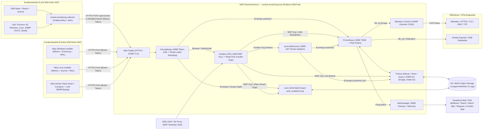

# NS8 Central Monitoring Service

Mandantenfähige Open-Source-Monitoring- und Logging-Plattform für **MSP- und Systemhaus-Umgebungen** auf Basis von **NethServer 8 (NS8)** — konzipiert für die vollständige Ablösung klassischer Monitoring-Systeme wie **PRTG, Checkmk oder Zabbix** über > 1.500 überwachte Systeme hinweg.

Dieses Monorepo bündelt zwei eigenständige, zu **100 % rootless** betriebene NethServer-8-Module sowie deren gemeinsamen Telemetrie-, Regel- und Dashboard-Vertrag (`shared/`):

1. **`central-monitoring-hub` (`hub/`):** Zentraler Monitoring- & Logging-Server mit **Prometheus**, **Thanos** (optional für S3-Langzeitspeicher), **Grafana OSS**, **Loki**, **Alertmanager**, **Blackbox Exporter**, **SNMP Exporter**, **`prom-label-proxy`**, vorgeschaltetem **Auth- & Mandanten-Gateway** sowie integriertem **1-Klick-Onboarding-Generator** für Standalone-Agenten (Grafana Alloy für Windows, Linux und Docker).
2. **`central-monitoring-collector` (`collector/`):** Leichtgewichtiges NS8-Modul (auf Basis von **Grafana Alloy** + optionalem **Proxmox-VE-Exporter**) für Kunden-NS8-Cluster hinter NAT/CGNAT und überlappenden privaten IP-Netzen (z. B. `192.168.1.0/24`). Erfasst automatisch den lokalen NS8-Knoten inkl. Restic-Backups sowie LAN-Systeme (Windows, Linux, Proxmox VE, Switches, Firewalls, USVs und NAS per SNMP v2c/v3 & Syslog), puffert Ausfälle lokal per Write-Ahead-Log (WAL) und überträgt Telemetrie verschlüsselt per HTTPS + Bearer-Token an den Hub.

> [!IMPORTANT]
> Beide Module laufen vollständig unprivilegiert (`rootless` Podman + `systemd --user`) unter eigenen NS8-Modulbenutzern und greifen **nicht** in das eingebaute NethServer-8-Kernmodul `ns8-metrics` ein.

---

## Gesamtarchitektur



---

## Funktionsumfang im Überblick (Feature-Matrix)

| Bereich | Leistungsmerkmal | Technische Umsetzung |
| :--- | :--- | :--- |
| **Multi-Tenancy & Ingest-Schutz** | Manipulationssichere Mandantentrennung trotz überlappender Kunden-LANs (`192.168.1.0/24`) | `hub-gateway` prüft SHA-256-Token-Hashes (`hmac.compare_digest`), dekodiert Snappy/Protobuf `WriteRequest` & Loki-Streams und überschreibt `customer` serverseitig |
| **Read-Only-Kundenportale** | Optionale Kunden-Logins ohne Einsicht in fremde Mandanten | Eigene Grafana-Org (`Viewer`), `editable: false` Proxy-Datasources, `prom-label-proxy` PromQL-AST-Filterung + Loki `X-Scope-OrgID` |
| **MSP Flottenblick & SSO** | Zentrales Dashboard über alle Kunden + Techniker-Single-Sign-On | Grafana Main Org (`Org 1`), dynamischer Multi-Tenant-Loki-Header (`t1\|t2\|...`) & automatische NS8-`Ldapproxy`-Integration (LDAP/AD) |
| **Skalierung > 1.500 Systeme** | Umschaltbares Speicher-Backend (`local` vs. `s3`) ohne Datenverlust | Lokale Podman-Volumes für kleinere Setups; **S3/MinIO** via nativem Loki-TSDB-v13 + **Thanos Sidecar, Store Gateway & Query** für mehrmonatige Aufbewahrung |
| **NS8 Standort-Collector** | Zero-Inbound-Firewall-Monitoring & **Zero-Root Cluster-Wide NS8-Sichtbarkeit** | `central-monitoring-collector` erfasst ohne Root-Rechte alle NS8-Module/Container & Restic-Backups des Clusters (`node_exporter` + Redis-Replikat -> `ns8.prom`), Proxmox VE, Windows, Linux, SNMP v2c/v3 (`if_mib`, `apcupsd`, `synology`, `qnap`, `fortigate`, `mikrotik`, `printer`) & Syslog inkl. WAL-Puffer |
| **Standorte ohne NS8** | 1-Klick-Agent-Pakete direkt aus der Hub-Cockpit-UI | `generate-agent-bundle` erzeugt vorkonfigurierte Grafana-Alloy-Configs & Installer für **Windows Server** (`.ps1`), **Linux** (`.sh`) und **Docker Compose** |
| **Standard-Alarmpakete** | Sofort einsatzbereite Alarmierung ohne manuelles Regel-Scripting | 6 `promtool`-geprüfte Regelpakete mit 78 Alarmregeln (`ns8-cluster`, `linux-node`, `windows-node`, `proxmox-ve`, `blackbox-web-ssl`, `snmp-network-ups` inkl. QNAP & RFC-3805-Drucker) |
| **Multi-Channel-Alerting & Silences** | Zielgerichtete Eskalation & geplante Wartungsfenster (z. B. Patchdays) | NS8-Smarthost/SMTP, PSA-Webhooks, MS Teams, Slack, Telegram, Ntfy, Gotify, mandantenbezogene Kunden-E-Mails sowie persistente Alertmanager-v2-Silences |
| **NS8 Restic-Backup** | Schnelle, konsistente tägliche Clustersicherung | Online-SQLite-Backup (`.backup`) von `grafana.db` + Mandanten, Zielen, Regeln & Silences; Rohdaten-Backup (`backup_include_tsdb`) optional zuschaltbar |

---

## Installation auf NethServer 8

### Option A: 1-Klick-Installation über das NS8 Software Center (GitHub Pages Repository)

Über den mitgelieferten Katalog-Generator (`scripts/generate-repomd.py` + GitHub-Actions-Workflow `publish-repomd.yml`) lassen sich beide Module direkt grafisch im **NethServer 8 Software Center** installieren und aktualisieren:

1. Im **NS8 Cluster-Admin** unter **Einstellungen -> Software-Repositorys -> Repository hinzufügen**:
   - **Name:** `central-monitoring`
   - **URL:** `https://bls-isp.github.io/ns8-centralmonitoringservice/`
2. Anschließend unter **Software Center** mit einem Klick **Central Monitoring Hub** (auf dem MSP-Cluster) bzw. **Central Monitoring Collector** (auf Kunden-NS8-Clustern) installieren.

### Option B: Direkte CLI-Installation (`add-module`)

#### 1. Zentralen Monitoring-Hub installieren (MSP-Cluster)

Auf dem Leader- oder Zielknoten des zentralen MSP-NethServer-8-Clusters als `root` ausführen:

```bash
add-module ghcr.io/bls-isp/central-monitoring-hub:latest 1
```

Anschließend im **NS8 Cluster-Admin (Cockpit)** unter **Anwendungen -> Central Monitoring Hub**:
1. Unter **Einstellungen (Settings)** den gewünschten FQDN (z. B. `monitoring.msp-beispiel.de`), Let's Encrypt, Aufbewahrungsdauer sowie optional den **S3/MinIO-Speichermodus** und **NS8 LDAP/AD-Login** speichern.
2. Unter **Mandanten (Tenants)** den ersten Kundenmandanten (z. B. `muster-gmbh`, Standort `hq`) anlegen und das einmalig angezeigte Bearer-Token (`cms_v1_...`) kopieren.
3. Unter **Alarmierung (Alerting)** die gewünschten Benachrichtigungskanäle (NS8-Smarthost, PSA-Webhook, Teams/Slack, Push) aktivieren und per **Test-Alarm senden** verifizieren.

#### 2. Standort-Collector installieren (Kunden-NS8-Cluster)

Auf dem NethServer-8-Cluster des Kunden als `root` ausführen:

```bash
add-module ghcr.io/bls-isp/central-monitoring-collector:latest 1
```

Im **NS8 Cluster-Admin** des Kundenclusters unter **Anwendungen -> Central Monitoring Collector**:
1. Unter **Einstellungen (Settings)** die Hub-URL (`https://monitoring.msp-beispiel.de`), das kopierte Bearer-Token (`cms_v1_...`), den Mandanten-Slug (`muster-gmbh`) und den Standort (`hq`) eintragen.
2. Über **Verbindung testen** die TLS- und Token-Authentifizierung gegen den Hub prüfen und speichern.
3. Optional unter **Lokale Ziele (Local Targets)** Proxmox-VE-Hosts, Windows-/Linux-Server sowie SNMP-Geräte (Switches, USVs, Firewalls, Synology-/QNAP-NAS und RFC-3805-Netzwerkdrucker) im Kunden-LAN hinzufügen.

> [!TIP]
> Für Kundenstandorte **ohne eigenen NethServer 8** erstellen Sie im Hub unter **Mandanten -> Agent-Onboarding** mit einem Klick ein fertig konfiguriertes Installationspaket für **Windows Server (PowerShell)**, **Linux (Debian/Ubuntu/RHEL/Rocky)** oder **Docker Compose**.

---

## Lokale Entwicklung, Validierung & Tests

Das Repository ist so aufgebaut, dass sämtliche statischen Prüfungen, Schema-Validierungen, Backend-/Gateway-Tests und Cockpit-UI-Builds plattformübergreifend (Linux, macOS und Windows) ausgeführt werden können.

| Befehl | Beschreibung |
| :--- | :--- |
| `python scripts/validate-monorepo.py` | Prüft LF-Zeilenenden (`0` CRLF), UTF-8 ohne BOM, alle 47 Draft-07-JSON-Schemata, alle 8 NS8-Backend-Regeln, alle 3 NS8-UI-Regeln, `LICENSE`, Software-Center-Icons/`metadata.json` sowie Dashboards, Alloy-Templates und Regelpakete |
| `python scripts/validate-monorepo.py --strict` | Vollständigkeitsmodus für CI: erzwingt zusätzlich die lückenlose Präsenz beider Module (`hub/`, `collector/`), UIs, Icons und aller Action-Schemata |
| `python scripts/generate-repomd.py --org bls-isp --tag 1.0.0 --output-dir _site` | Erzeugt ein vollständiges statisches NS8 Software-Center-Repository (`repodata.json` / `repomd.json` + App-Icons) für GitHub Pages |
| `python -m pytest tests -v` | Führt die gesamte automatisierte Python-Testsuite (Contract-, Hub-Core-, Security-/Gateway-, Alerting-, UI-, Collector- und E2E-Tests) aus |
| `npm --prefix hub/ui ci && npm --prefix hub/ui run build` | Installiert Abhängigkeiten und baut das Produktions-Bundle der Hub-Cockpit-UI nach `hub/ui/dist/` |
| `npm --prefix collector/ui ci && npm --prefix collector/ui run build` | Installiert Abhängigkeiten und baut das Produktions-Bundle der Collector-Cockpit-UI nach `collector/ui/dist/` |
| `docker run --rm -v "${PWD}:/w:ro" -w /w --entrypoint promtool quay.io/prometheus/prometheus:v2.54.1 check rules shared/rules/*.yml` | Prüft alle 6 Standard-Alarmpakete mit dem offiziellen Upstream-`promtool` |
| `bash hub/test-module.sh <ns8-leader-ip>` / `bash collector/test-module.sh <ns8-leader-ip>` | Führt die NethServer-8-Robot-Framework-End-to-End-Tests gegen einen Live-NS8-Testcluster über SSH/`api-cli` aus |

---

## Repository-Struktur

```text
NS8-CentralMonitoringService/
├── .github/workflows/          # GitHub Actions CI, GHCR Image-Publishing & GitHub Pages Software-Center-Repo
├── collector/                  # Eigenständiges NS8-Modul `central-monitoring-collector` (Grafana Alloy + PVE Exporter)
│   ├── imageroot/              # NS8 Actions, systemd --user Units, Zero-Root NS8-Harvester & Alloy-Renderer
│   ├── tests/                  # Robot-Framework-End-to-End-Tests für Live-NS8-VMs (`test-module.sh`)
│   ├── ui/                     # Zweisprachige (DE/EN) NS8-Cockpit-UI inkl. `metadata.json` & App-Icon
│   ├── Containerfile           # Rootless OCI-Modul-Image-Definition
│   └── build-images.sh         # Lokales / CI-Build-Skript für das Collector-Image
├── hub/                        # Eigenständiges NS8-Modul `central-monitoring-hub`
│   ├── gateway/                # Python aiohttp Auth- & Mandanten-Gateway (Snappy/Protobuf Label-Stamping & Relay)
│   ├── imageroot/              # NS8 Actions, systemd --user Units (Prometheus, Loki, Grafana, Thanos, Alertmanager)
│   ├── tests/                  # Robot-Framework-End-to-End-Tests für Live-NS8-VMs (`test-module.sh`)
│   ├── ui/                     # Zweisprachige (DE/EN) NS8-Cockpit-UI inkl. `metadata.json` & App-Icon
│   ├── Containerfile           # Rootless OCI-Modul-Image-Definition
│   └── build-images.sh         # Build-Skript für `central-monitoring-hub-gateway` und `central-monitoring-hub`
├── shared/                     # Verbindlicher `telemetry-contract` zwischen Hub, Collector und Standalone-Agenten
│   ├── alloy-templates/        # 6 Grafana-Alloy-Vorlagen & idempotente OS-Installer (Linux, Windows, Docker)
│   ├── dashboards/             # 4 vorprovisionierte Multi-Tenant-Grafana-Dashboards (Schema v39+)
│   ├── rules/                  # 6 MSP-Standard-Alarmpakete (NS8, Linux, Windows, Proxmox VE, Web/SSL, SNMP/USV/Drucker)
│   └── schemas/                # 47 eigenständige JSON-Schema-Draft-07-Verträge für alle NS8-Actions
├── scripts/
│   ├── generate-repomd.py      # NS8 Software-Center-Repository-Generator (`repodata.json` / `repomd.json` + Icons)
│   └── validate-monorepo.py    # Abhängigkeitsfreier Architektur-, LF-, Software-Center- und NS8-Regel-Validator
├── tests/                      # Automatisierte Unit-, Integrations-, E2E- und Sicherheits-Tests (pytest)
├── docs/                       # Weiterführende Architektur-, Betriebs- und Migrationsdokumentation
├── LICENSE                     # GNU General Public License v3.0 (GPL-3.0-or-later)
├── CAPABILITY-MAP.md           # Modul-Zerlegung & Abhängigkeitsgraph
└── SPEC-*.md                   # Verbindliche Modulspezifikationen der 6 Capabilities
```

---

## Weiterführende Dokumentation

- **[Architektur- & Sicherheitsreferenz (`docs/architecture.md`)](docs/architecture.md):** Pod-Port-Map, ADRs, Defense-in-Depth-Mandantentrennung (Snappy/Protobuf & `prom-label-proxy`), `local` vs. `s3` Thanos/Loki-Design, SSRF-Schutz und Restic-Backup-Architektur.
- **[MSP Betriebshandbuch (`docs/operations-guide.md`)](docs/operations-guide.md):** Sizing für > 1.500 Systeme, MinIO/S3-Setup, NS8-LDAP/AD-Anbindung, Kunden-Onboarding (mit/ohne NS8), Proxmox VE & SNMP v2c/v3, Multi-Channel-Alerting, Patchday-Silences und Disaster Recovery.
- **[Migrationsleitfaden (`docs/migration-guide.md`)](docs/migration-guide.md):** Schritt-für-Schritt-Playbook für den Umstieg von **PRTG, Checkmk oder Zabbix** inkl. Sensor-/Check-Mapping, Parallelbetrieb, Schwellenwert-Tuning und Cutover-Checkliste.
- **[Capability Map (`CAPABILITY-MAP.md`)](CAPABILITY-MAP.md)** & **[Statement of Intent (`docs/intent/central-monitoring.md`)](docs/intent/central-monitoring.md)**.
