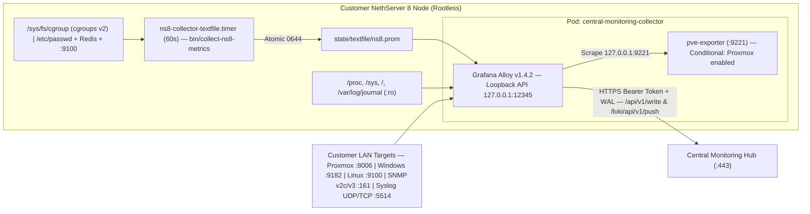

# Central Monitoring Collector (`central-monitoring-collector`)

Developer and operator reference for the **Central Monitoring Collector** NethServer 8 rootless application module (`v1.1.0`).

Central Monitoring Collector is a lightweight, rootless site telemetry and log shipper installed on customer NethServer 8 clusters (`min-core >= 3.0.0`, Rocky Linux 9 and Debian 12). It harvests local NS8 host metrics, Restic backup states, rootless/rootful NS8 pod & container `cgroups v2` resource usage, systemd journal logs, and customer LAN infrastructure (Proxmox VE, Windows Server, Linux, SNMP v2c/v3 appliances, custom exporters, and LAN Syslog), delivering all telemetry outbound over TLS (`HTTPS :443`) to **Central Monitoring Hub** with local disk-backed Write-Ahead Log (WAL) buffering.

- **Monorepo Overview:** [`../README.md`](../README.md)
- **Central Monitoring Hub Reference:** [`../hub/README.md`](../hub/README.md)
- **MSP User Manual (DE):** [`../docs/user-guide.md`](../docs/user-guide.md)
- **End-Customer Portal Guide (DE):** [`../docs/customer-portal-guide.md`](../docs/customer-portal-guide.md)
- **Dashboards, Metrics & 81 Alert Rules Catalog (DE):** [`../docs/dashboards-and-alerts.md`](../docs/dashboards-and-alerts.md)
- **Operations & Runbook Guide (DE):** [`../docs/operations-guide.md`](../docs/operations-guide.md)
- **Architecture & ADRs (DE):** [`../docs/architecture.md`](../docs/architecture.md)

---

## 1. Outbound WAL-Backed Architecture & Pod Layout

`central-monitoring-collector` requires **zero inbound WAN firewall ports** at customer sites (`org.nethserver.tcp-ports-demand` is unset; Alloy's internal reload API `127.0.0.1:12345` is strictly pod-internal and never published to the host). If the WAN connection or Hub is temporarily unreachable, Grafana Alloy buffers metrics and logs locally in `%E/state/alloy-wal` up to `wal_max_disk_mb` and drains automatically once connectivity resumes.



### Container & Systemd `--user` Units (`imageroot/systemd/user/`)

| Unit | Pinned OCI Image / Binary | Network & Mounts | Purpose |
|---|---|---|---|
| `central-monitoring-collector.service` | Podman infra container | `slirp4netns:allow_host_loopback=true` (+ optional `${PODMAN_SYSLOG_ARGS}` publishing `${SYSLOG_PORT}:5514/udp` & `/tcp` when Syslog receiver is enabled) | Manages the shared rootless Podman pod namespace. |
| `alloy.service` | `docker.io/grafana/alloy:v1.4.2` | Internal `127.0.0.1:12345`; mounts `/proc:/host/proc:ro`, `/sys:/host/sys:ro`, `/:/host/root:ro`, `/var/log/journal:/var/log/journal:ro`, and SELinux-shared `:ro,z`/`:z` directories `alloy-conf`, `secrets`, `textfile`, `alloy-wal` | Scrapes local NS8 host + LAN targets, ingests Journald + optional Syslog, stamps `customer`, `site`, `device_role`, and `collector_id`, and pushes via WAL-backed Remote-Write & Loki Write. |
| `pve-exporter.service` | `docker.io/prompve/prometheus-pve-exporter:3.4.5` | Pod-loopback `127.0.0.1:9221`; mounts `%E/state/pve-conf:/etc/prometheus:ro,z` | Started **conditionally** only when at least one enabled `proxmox` LAN target exists; `alloy.service` runs a `:9221` TCP readiness loop when active. |
| `ns8-collector-textfile.service` | `%h/.config/bin/collect-ns8-metrics` | Host network/filesystem (`Type=oneshot`) | Harvests Restic backups, `cgroups v2` NS8 pod/module metrics, containers, and systemd states into `state/textfile/ns8.prom`. |
| `ns8-collector-textfile.timer` | Triggers `ns8-collector-textfile.service` | `OnBootSec=15s`, `OnUnitActiveSec=60s` | Refreshes `ns8.prom` every 60 seconds cleanly on Python 3.9+ without root privileges. |

> **Directory Bind Mounts for Live Reload:** `render_collector_artifacts()` writes `config.alloy` (`0600`) into `%E/state/alloy-conf/config.alloy` and `pve.yml` (`0600`) into `%E/state/pve-conf/pve.yml` (mounted as directories with SELinux lowercase `:ro,z`) so atomic `os.replace()` writes + `POST http://127.0.0.1:12345/-/reload` immediately update running containers without stale unlinked inodes.

---

## 2. Zero-Root NS8 Cluster & Linux `cgroups v2` Harvester (`ns8.prom`)

Running as the unprivileged module user, `bin/collect-ns8-metrics` (`collector_lib.ns8_metrics`) combines four zero-root data sources on Rocky Linux 9 and Debian 12:

1. **Linux `cgroups v2` World-Readable Hierarchy (`/sys/fs/cgroup`, `0444`):**
   - Discovers **rootless NS8 modules** (`module_type="rootless"`) from `/etc/passwd` (`UID >= 1000`, `/home/<mid>`) -> `/sys/fs/cgroup/user.slice/user-<UID>.slice`, plus per-container systemd sub-units under `user@<UID>.service/{app,user}.slice/*.service` (excluding transient `dbus.service`, `dbus-broker.service`, `systemd-*`, `init.scope`, `podman-pause*`, `ns8-collector-textfile.service`, `hub-ns8-metrics.service`).
   - Discovers **rootful NS8 modules** (`module_type="rootful"`, e.g. `samba1`, `crowdsec1`, `nethvoice1`, `ldapproxy1`, plus any custom local rootful module registered in Redis) under `/sys/fs/cgroup/system.slice/<mid>.service` and `<mid>-*.service`.
2. **Local NS8 Redis Replica (`agent.redis_connect(use_replica=True)` or pure-stdlib loopback RESP2 fallback on `127.0.0.1:6379`):** Reads cluster-wide `module/*/backup` Restic status hashes, `module/*/environment` (`NODE_ID == local_node_id`), and `node/<id>/vpn` WireGuard IP.
3. **Local NS8 `node_exporter` (`http://127.0.0.1:9100/metrics` or private WireGuard IP, SSRF-guarded):** Harvests `ns8_container_info`, `ns8_container_start_time_seconds`, and `node_systemd_unit_state`. When `ns8-metrics` is not installed on the node, `collect-ns8-metrics` automatically synthesizes `ContainerRecord` entries from active/stopped `cgroups v2` sub-units so `ns8_container_running` works out-of-the-box.
4. **Local Fallbacks:** `podman ps -a --format json`, `systemctl --user`, and optional JSON fixtures (`ns8-backups.json`, `ns8-containers.json`).

### Emitted `ns8.prom` Metrics (20 Metric Families)

- **Module `cgroups v2` Metrics (`{module_id, module_type}`):** `ns8_module_up`, `ns8_module_cpu_seconds_total`, `ns8_module_cpu_throttled_seconds_total`, `ns8_module_memory_working_set_bytes` (`max(0, memory.current - inactive_file)`), `ns8_module_memory_bytes`, `ns8_module_memory_swap_bytes`, `ns8_module_memory_limit_bytes` (`"max"` -> `0`), `ns8_module_oom_kills_total`, `ns8_module_io_read_bytes_total`, `ns8_module_io_write_bytes_total`, `ns8_module_pids`.
- **Intra-Pod Sub-Unit `cgroups v2` Metrics (`{module_id, unit}`):** `ns8_pod_unit_cpu_seconds_total`, `ns8_pod_unit_memory_working_set_bytes`.
- **Restic Backups, Containers & Systemd:** `ns8_backup_status{module_id}`, `ns8_backup_failed{module_id}`, `ns8_backup_last_success_timestamp_seconds{module_id}`, `ns8_container_info{module_id,container,image}`, `ns8_container_running{module_id,container}`, `ns8_container_restarts_total{module_id,container}`, `ns8_systemd_unit_failed{name}`.

---

## 3. NS8 Module Actions Reference (10 Actions)

`central-monitoring-collector` implements **6 schema-validated NS8 API actions** (backed by byte-identical Draft-07 `validate-input.json` / `validate-output.json` copies from [`../shared/schemas/`](../shared/schemas/)) plus **4 NS8 lifecycle actions** (`actions/get-status` is never overridden):

| Action | Input Properties | Output Properties | Purpose |
|---|---|---|---|
| `configure-module` | `hub_url`, `auth_token`, `auth_token_unchanged`, `customer`, `site`, `collector_id`, `collect_local_ns8`, `enable_syslog_receiver`, `syslog_port`, `wal_max_disk_mb`, `tls_skip_verify` | `status`, `collector_id` | Persists module settings (`agent.dump_env()`) and `0600` Bearer token, syncs `firewalld` Syslog ports (`node:fwadm`), renders `config.alloy` / `pve.yml` / `snmp-auths.yml`, and starts/reloads services. |
| `get-configuration` | *(empty `{}`)* | `configured`, `hub_url`, `has_auth_token`, `auth_token_prefix`, `customer`, `site`, `collector_id`, `collect_local_ns8`, `enable_syslog_receiver`, `syslog_port`, `wal_max_disk_mb`, `tls_skip_verify`, `health` (`alloy_status`, `pve_exporter_status`, `wal_usage_bytes`) | Returns Collector settings (never exposing raw `auth_token`) plus live Alloy, `pve-exporter`, and WAL disk usage health. |
| `test-hub-connection` | `hub_url`, `auth_token`, `tls_skip_verify` | `ok`, `http_status`, `latency_ms`, `verified_customer`, `message` | Probes `GET ${HUB_URL}/api/v1/ingest/verify` using DNS-pinned TLS (`_PinnedHTTPSConnection`) with SSRF protection (rejects loopback/link-local/`10.0.2.0/24` and refuses to send the stored token to a modified `hub_url`). |
| `list-local-targets` | `target_type` *(optional filter)* | `targets` | Lists LAN scrape targets from `state/local-targets.json` with `pve_token_secret`, `snmp_community`, and SNMPv3 passwords redacted (`has_*_secret` booleans + non-secret SNMPv3 metadata preserved). |
| `save-local-target` | `id`, `name`, `enabled`, `target_type`, `device_role`, `host`, `port`, `scrape_interval`, `scheme`, `metrics_path`, `tls_skip_verify`, `secret_unchanged`, `pve_token_id`, `pve_token_secret`, `snmp_module`, `snmp_version`, `snmp_community`, `snmp_v3` | `status`, `id`, `created` | Validates LAN host (blocks loopback/link-local SSRF), saves target under file lock (`.local-targets.lock`), re-renders Alloy/`pve-exporter`/SNMP configs, manages `pve-exporter.service`, and triggers live `POST http://127.0.0.1:12345/-/reload`. |
| `delete-local-target` | `id` | `status`, `id`, `deleted` | Deletes a LAN target under file lock, stops `pve-exporter.service` if no Proxmox targets remain, re-renders `config.alloy`, and hot-reloads Alloy. |
| `create-module` | *(lifecycle)* | *(none)* | Seeds initial environment (`CONFIGURED=0`), empty `local-targets.json`, and bootstrap configs (`20initialize`). |
| `restore-module` | *(lifecycle)* | *(none)* | Restores persisted environment (`06copyenv`), rebuilds `0600` `hub.token`, `pve.yml`, `snmp-auths.yml`, and `config.alloy` from `secrets.env` + `local-targets.json`, and starts services (`50configure`). |
| `clone-module` | *(lifecycle)* | *(none)* | Mints a fresh unique `collector_id` (`50configure`) so cloned NS8 nodes never collide with source time series in Hub. |
| `destroy-module` | *(lifecycle)* | *(none)* | Closes any opened Syslog firewall ports, stops/disables all 5 systemd user units, and removes the Podman pod (`20destroy`). |

---

## 4. Supported Customer LAN Target Types & Syslog

| `target_type` | Default Port | `device_role` Values | Details & Supported Modules |
|---|---|---|---|
| `proxmox` | `8006` (HTTPS API) | `proxmox` | Scraped via pod-internal `pve-exporter` (`127.0.0.1:9221`) using read-only PVE API token (`PVEAuditor`, privilege separation enabled). |
| `windows` | `9182` | `windows` | Scrapes `windows_exporter` (`/metrics`, HTTP or HTTPS). |
| `linux` | `9100` | `linux` | Scrapes `node_exporter` (`/metrics`, HTTP or HTTPS). |
| `snmp` (v2c & v3) | `161` (UDP) | `snmp-network`, `snmp-firewall`, `snmp-ups`, `snmp-nas`, `snmp-printer` | Embedded `prometheus.exporter.snmp` supporting SNMPv2c and SNMPv3 (`noAuthNoPriv`, `authNoPriv`, `authPriv` with `MD5`/`SHA`/`SHA224`/`SHA256`/`SHA384`/`SHA512` & `DES`/`AES`/`AES192`/`AES256`) across 8 MIB profiles: `if_mib`, `apcupsd`, `synology`, `qnap`, `mikrotik`, `fortigate`, `printer` (RFC 3805), and `generic` (`ifHC*`, `ifSpeed`, `ifHighSpeed`, `ifErrors`, `ifDiscards`, `sysUpTime`). |
| `custom-exporter` | Custom (`1`–`65535`) | Any valid role | Scrapes any Prometheus-compatible HTTP/HTTPS `/metrics` endpoint on the customer LAN. |
| **LAN Syslog Receiver** *(optional)* | `5514` UDP & TCP (`1024`–`65535`) | `snmp-firewall` (`job="lan-syslog"`) | Enabled via `enable_syslog_receiver`: `loki.source.syslog` ingests RFC 5424 network/firewall/NAS syslog messages and opens `${SYSLOG_PORT}/udp` + `/tcp` via NS8 `node:fwadm`. |

---

## 5. State, Secrets & Restic Backup (`etc/state-include.conf`)

- **Persisted Configuration (`state/environment`):** `CONFIGURED`, `HUB_URL`, `CUSTOMER`, `SITE`, `COLLECTOR_ID`, `COLLECT_LOCAL_NS8`, `ENABLE_SYSLOG_RECEIVER`, `SYSLOG_PORT`, `WAL_MAX_DISK_MB`, `TLS_SKIP_VERIFY`, `PODMAN_SYSLOG_ARGS`.
- **`0600` Secret Artifacts:** `state/secrets.env` (`HUB_AUTH_TOKEN`), `state/secrets/hub.token` (`bearer_token_file` read by Alloy — never passed on the container command line), `state/secrets/snmp-auths.yml`, `state/pve-conf/pve.yml`, and `state/local-targets.json`.
- **Restic Backup (`etc/state-include.conf`):** Backs up `state/environment`, `state/secrets.env`, and `state/local-targets.json` (`org.nethserver.volumes=""`), intentionally excluding the transient multi-GiB `state/alloy-wal` buffer directory.

---

## 6. Bilingual Cockpit UI, Build & Test Commands

The Collector Cockpit UI (`collector/ui/`) is built with Vue `2.7.16`, `@vue/cli-service ^5.0.8`, Carbon Design System, and `@nethserver/ns8-ui-lib` with 100% EN/DE translation parity across 4 views: *Status*, *Local Targets*, *Settings* (including live *Test Hub Connection*), and *About*.

```bash
# 1. Install & build the Collector Cockpit UI bundle (Node.js 22/26 compatible, 0 warnings)
npm --prefix collector/ui ci
npm --prefix collector/ui run build

# 2. Build the rootless NS8 Collector module OCI image
REPO_OWNER=bls-isp IMAGE_TAG=1.1.0 bash collector/build-images.sh

# 3. Run the Collector unit, security, Python 3.9 AST & UI compliance suite
python3 -B -m pytest tests/site_collector -v
python3 -B scripts/validate-monorepo.py --strict

# 4. Run live NS8 Robot Framework integration tests against an NS8 leader node
bash collector/test-module.sh <NS8_LEADER_FQDN_OR_IP> ghcr.io/bls-isp/central-monitoring-collector:1.1.0 ~/.ssh/id_rsa
```
