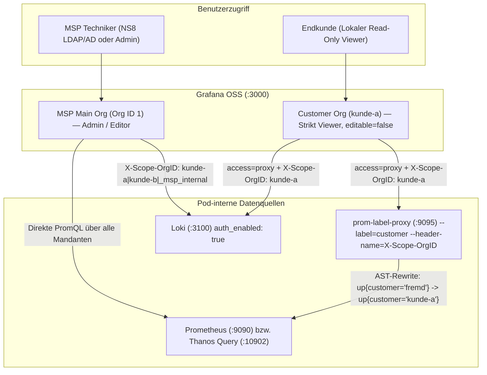

# Architektur- & Sicherheitsreferenz (`NS8-CentralMonitoringService`)

Dieses Dokument beschreibt die technischen Architekturentscheidungen (ADRs), die interne Container- und Netzwerk-Topologie, die mehrschichtige Mandantenisolation (Defense-in-Depth), die Skalierungsarchitektur (`local` vs. `s3` mit Thanos und Loki TSDB v13), die SSRF-Schutzmechanismen sowie das Backup-/Restore-Design auf NethServer 8.

---

## 1. Podman-Pod-Topologie & Port-Map

Sowohl `central-monitoring-hub` als auch `central-monitoring-collector` laufen als dedizierte, unprivilegierte NethServer-8-Benutzer (`rootless` Podman mit `--network=slirp4netns:allow_host_loopback=true`). Innerhalb jedes Pods kommunizieren die Container ausschließlich über das Pod-Loopback (`127.0.0.1`).

### 1.1 Port-Map: `central-monitoring-hub` (`central-monitoring-hub-pod`)

Einzig der Port `8080` des `hub-gateway`-Containers wird über `127.0.0.1:${TCP_PORT}:8080` an den lokalen NS8-Host-Loopback für Traefik gebunden. Kein interner Datenbank-, Query- oder Admin-Port verlässt den Pod direkt.

| Interner Pod-Port | Protokoll | Dienst / Container | Sichtbarkeit | Funktion & Sicherheitsgrenze |
| :--- | :--- | :--- | :--- | :--- |
| `127.0.0.1:8080` | HTTP | `hub-gateway` (`aiohttp`) | Host-Loopback `127.0.0.1:${TCP_PORT}` -> NS8 Traefik (`HTTPS/443`) | Einziger öffentlicher Ingress: Token-Auth + Label-Stamping auf `/api/v1/write` & `/loki/api/v1/push`; Reverse-Proxy auf Grafana (`:3000`) |
| `127.0.0.1:3000` | HTTP / WS | `grafana-oss` | Nur Pod-intern | Multi-Org-UI: Org `1` für MSP-Team (inkl. LDAP/AD), dedizierte Read-Only-Orgs für Endkunden |
| `127.0.0.1:3100` | HTTP | `loki` (`auth_enabled: true`) | Nur Pod-intern | Multi-Tenant-Log-Speicher & LogQL-Engine; trennt Index & Chunks strikt anhand von `X-Scope-OrgID` |
| `127.0.0.1:9096` | gRPC | `loki` | Nur Pod-intern | Interner Loki-gRPC-Endpunkt |
| `127.0.0.1:9090` | HTTP | `prometheus` | Nur Pod-intern | Zeitreihen-TSDB, Remote-Write-Receiver (`--web.enable-remote-write-receiver`), Regel-Engine & `file_sd`-Scraper |
| `127.0.0.1:9093` | HTTP | `alertmanager` | Nur Pod-intern | Deduplizierung, Gruppierung, Wartungsfenster (`/api/v2/silences`) & Multi-Channel-Versand (`--cluster.listen-address=""`) |
| `127.0.0.1:9095` | HTTP | `prom-label-proxy` | Nur Pod-intern | PromQL-AST-Parser für Kunden-Orgs: erzwingt `{customer="<X-Scope-OrgID>"}` auf jedem Selektor |
| `127.0.0.1:9097` | HTTP | `hub-gateway` (Push-Relay) | Nur Pod-intern | Interner Loopback-Adapter für Alertmanager-Webhooks nach **Ntfy** und **Gotify** |
| `127.0.0.1:9115` | HTTP | `blackbox-exporter` | Nur Pod-intern | Aktive HTTP/HTTPS-, TLS-Zertifikats-, DNS-, TCP- und unprivilegierte Datagram-ICMP-Prüfungen |
| `127.0.0.1:9116` | HTTP | `snmp-exporter` | Nur Pod-intern | Zentrale SNMP-v2c/v3-Abfragen (`if_mib`, `apcupsd`, `synology`, `mikrotik`, `fortigate`, `generic`) |
| `127.0.0.1:10902` | HTTP (`:10901` gRPC) | `thanos-query` | Nur Pod-intern (nur bei `storage_mode="s3"`) | Einheitlicher PromQL-Endpunkt über Echtzeit-Head-Daten (`thanos-sidecar`) und historische S3-Blöcke (`thanos-store`) |
| `127.0.0.1:10912` | HTTP (`:10911` gRPC) | `thanos-sidecar` | Nur Pod-intern (nur bei `storage_mode="s3"`) | Liest Echtzeit-Serien aus Prometheus (`:9090`) und lädt abgeschlossene 2h-TSDB-Blöcke nach S3 hoch |
| `127.0.0.1:10922` | HTTP (`:10921` gRPC) | `thanos-store` | Nur Pod-intern (nur bei `storage_mode="s3"`) | Beantwortet historische PromQL-Abfragen direkt gegen S3-/MinIO-Langzeitblöcke mit lokalem Index-Cache |

### 1.2 Port-Map: `central-monitoring-collector` (`central-monitoring-collector-pod`)

Der Standort-Collector benötigt **keine Traefik-Route** und **keine eingehenden WAN-Ports**.

| Port | Protokoll | Dienst / Container | Sichtbarkeit | Funktion |
| :--- | :--- | :--- | :--- | :--- |
| `127.0.0.1:12345` | HTTP | `alloy` | Nur Pod-intern | Interner Readiness- & Hot-Reload-Endpunkt (`POST /-/reload`); niemals nach außen veröffentlicht |
| `127.0.0.1:9221` | HTTP | `pve-exporter` | Nur Pod-intern (aktiv ab >= 1 `proxmox`-Ziel) | Übersetzt Proxmox-VE-API-Abfragen im Kunden-LAN in Prometheus-Metriken für Alloy |
| `${SYSLOG_PORT}:5514` | UDP & TCP | `alloy` (`loki.source.syslog`) | Optional im Kunden-LAN (`enable_syslog_receiver=true`, Standard `5514`, Bereich `1024–65535`) | Empfängt RFC5424/RFC3164-Syslog geschlossener LAN-Appliances (Firewalls, Switches, USVs, NAS) |

---

## 2. Kanonischer Telemetrie-Vertrag (`telemetry-contract`)

Jede Zeitreihe in Prometheus/Thanos und jeder Log-Stream in Loki trägt zwingend vier kanonische Labels. Dadurch lassen sich identische RFC1918-Netze (z. B. zwanzig Kunden mit `192.168.1.0/24` und `192.168.1.1`) jederzeit eindeutig trennen:

| Label | Validierungsmuster / Enum | Durchsetzungspunkt | Zweck |
| :--- | :--- | :--- | :--- |
| `customer` | `^[a-z0-9][a-z0-9-]{1,46}[a-z0-9]$` | **Serverseitig erzwungen** durch `hub-gateway` (Push) bzw. `file_sd`-Generator (Pull) | Harte Sicherheitsgrenze für Mandantentrennung, `prom-label-proxy`, Loki `X-Scope-OrgID` & Kunden-Mail-Routing |
| `site` | `^[a-z0-9][a-z0-9-]{0,46}[a-z0-9]$` | Geprüft gegen erlaubte Standorte des Mandanten (Fallback auf `default_site`) | Trennt Standorte (`hq`, `rz1`, `filiale-nord`) innerhalb eines Mandanten |
| `device_role` | `ns8`, `linux`, `windows`, `proxmox`, `web`, `snmp-network`, `snmp-ups`, `snmp-nas`, `snmp-firewall`, `snmp-printer` | Beim Ingest validiert (`422 VALIDATION_ERROR` bei ungültigen Werten) | Steuert die Selektoren der 6 Standard-Alarmpakete und Starter-Dashboards |
| `collector_id` | `^[a-z0-9][a-z0-9._-]{1,62}[a-z0-9]$` | Beim Ingest validiert (`hub-central` für zentrale Hub-Scrapes) | Nachvollziehbarkeit der Datenquelle, WAL-Überwachung & Collector-Staleness-Erkennung |

> [!WARNING]
> **Aggregations-Invariante für Alarmregeln:** Jede PromQL-Regel mit Aggregationen (`sum`, `avg`, `max`, `min`, `count`, `topk`) **muss** `customer` und `site` in der `by (...)`-Klausel erhalten (bzw. bei `without (...)` unangetastet lassen), damit Alertmanager Alarme mandantenspezifisch zustellen und per Silence stummschalten kann.

---

## 3. Defense-in-Depth Multi-Tenancy (Ingest & Query)

Ein reines Vertrauen auf Agent-Konfigurationen an Kundenstandorten reicht für MSP-Sicherheit nicht aus: Wird ein Server bei Kunde A kompromittiert, darf der Angreifer mit dem dort abgelegten Token weder Metriken/Logs für Kunde B fälschen noch fremde Bestandsdaten lesen können.

### 3.1 Ingest-Pfad: Serverseitiges Wire-Stamping (`hub-gateway`)

Sicherheitskontrollen am Ingest-Gateway:
1. **Gehashte Token-Speicherung:** Bearer-Tokens (`cms_v1_<43 Zeichen>`, 256 Bit Entropie) werden ausschließlich als SHA-256-Prüfsummen in `state/tenants.json` (`chmod 0600`) abgelegt und konstant-zeitlich via `hmac.compare_digest` geprüft. Im Klartext erscheint ein Token nur einmalig bei der Erstellung (`save-tenant`) oder Rotation (`rotate-token`).
2. **Schutz vor Dekompressionsbomben (Zip Bombs):** Komprimierte Requests über `16 MiB` sowie Snappy-Blöcke mit einer deklarierten unkomprimierten Größe über `64 MiB` werden vor der Speicherallokation mit HTTP `413 PAYLOAD_TOO_LARGE` abgewiesen.
3. **Brute-Force-Bremse:** Wiederholte Fehlversuche pro Quell-IP werden mit HTTP `429 RATE_LIMITED` gedrosselt.
4. **Strikte Pfadtrennung:** Öffentliche Aufrufe auf interne Pfade wie `/api/v1/query`, `/-/reload` oder `/metrics` erreichen niemals Prometheus, Loki oder Alertmanager, sondern werden ausschließlich an Grafana (`:3000`) geleitet bzw. abgewiesen.

### 3.2 Query-Pfad: Dreischichtige Kundenportal-Isolation & PromQL-AST-Rewriting

Wenn für einen Mandanten das optionale Read-Only-Kundenportal (`customer_portal_enabled: true`) aktiviert wird, greifen drei voneinander unabhängige Barrieren:
1. **Schicht 1 — Grafana-Organisations- & Rollengrenze:** Der Kundenbenutzer existiert ausschließlich in seiner eigenen Grafana-Organisation mit der Rolle `Viewer` (explizit aus `Org 1` entfernt). Die Datasources sind als Server-Proxy (`access: "proxy"`, `editable: false`) konfiguriert; Zugangsdaten und Header verlassen niemals den Server in Richtung Browser.
2. **Schicht 2 — PromQL-AST-Rewriting (`prom-label-proxy`):** Selbst wenn ein authentifizierter Kundenbenutzer manuell den Grafana-Datasource-Proxy mit einer manipulierten Abfrage wie `node_memory_MemAvailable_bytes{customer="konkurrenz-gmbh"}` oder `up{customer=~".*"}` aufruft, parst `prom-label-proxy` (`:9095`) den vollständigen PromQL Abstract Syntax Tree (AST) und überschreibt den Selektor zwingend auf `{customer="kunde-a"}`.
3. **Schicht 3 — Physische Loki-Index-Isolation:** Loki läuft mit `auth_enabled: true`. Kunden-Datasources injizieren serverseitig `X-Scope-OrgID: kunde-a`, sodass Loki ausschließlich Index-Tabellen und Chunks dieses Mandanten liest. Für die MSP Main Org (`Org 1`) aktualisiert `grafana_sync.py` bei jeder Mandantenänderung automatisch den Pipe-getrennten Multi-Tenant-Header (`X-Scope-OrgID: kunde-a|kunde-b|_msp_internal`), da Loki `querier.multi_tenant_queries_enabled: true` nutzt.

---

## 4. Speicher- & Skalierungsarchitektur (`local` vs. `s3`)

Um sowohl kompakte Installationen (50–300 Systeme auf lokalem NVMe-Speicher) als auch große MSP-Flotten (**> 1.500 Systeme** mit 6–24 Monaten Aufbewahrung) ohne Architekturwechsel abzudecken, unterstützt `central-monitoring-hub` zwei umschaltbare Speichermodi (`storage_mode`):

| Eigenschaft | `storage_mode: "local"` (Standard) | `storage_mode: "s3"` (Skalierungsmodus > 1.500 Systeme) |
| :--- | :--- | :--- |
| **Prometheus TSDB** | Lokales Volume `prometheus-data`; Aufbewahrung gemäß `retention_days` / `retention_size_gb` | Lokales Volume dient als schneller Hot-Cache (feste 2h-Blöcke: `--storage.tsdb.min-block-duration=2h --storage.tsdb.max-block-duration=2h`); `thanos-sidecar` lädt alle 2h-Blöcke nach S3/MinIO hoch |
| **Thanos-Dienste** | Deaktiviert (`thanos-sidecar`, `thanos-store`, `thanos-query` gestoppt -> minimaler RAM-Verbrauch) | Aktiviert: `thanos-query` (`:10902`) vereint nahtlos Echtzeitdaten (`thanos-sidecar` `:10911`) und Langzeitblöcke aus S3 (`thanos-store` `:10921`) inkl. Deduplizierung |
| **PromQL-Upstream (`PROMQL_UPSTREAM_URL`)** | `http://127.0.0.1:9090` (Prometheus direkt) | `http://127.0.0.1:10902` (Thanos Query — transparent für Grafana Org 1 und `prom-label-proxy`!) |
| **Loki Storage** | TSDB Schema `v13` auf lokalem Dateisystem (`loki-data`) + Compactor-Retention | TSDB Schema `v13` nativ gegen S3 (`object_store: s3`); lokal verbleiben lediglich temporäre WAL-/Cache-Daten |
| **Geheimnis-Schutz** | — | S3-Zugangsdaten werden mit `chmod 0600` in `state/secrets.env` und `/etc/thanos/objstore.yml` abgelegt |

---

## 5. SSRF-Schutz & Rootless-Härtung

Da MSP-Administratoren in der Cockpit-UI eigene Scrape-Ziele (`save-target`) sowie externe Alerting-Webhooks (`configure-alerting`) hinterlegen können, verhindert `ssrf_guard.py` Server-Side-Request-Forgery-Angriffe auf Pod-interne Dienste:
- Verboten sind alle Loopback-, Link-Local-, Unspecified- und Cloud-Metadata-Ziele (`127.0.0.0/8`, `::1`, `localhost`, `0.0.0.0`, `169.254.169.254`, `metadata.google.internal`).
- Ebenso blockiert wird das Rootless-Podman-Host-Gateway `10.0.2.2` auf sämtlichen internen Pod-Ports (`3000`, `3100`, `8080`, `9090`, `9093`, `9095`, `9096`, `9097`, `10901–10922`), während die explizit vorgesehenen NS8-Host-Dienste (`ns8-ldapproxy` und NS8-Smarthost) ausschließlich über systemseitig aus Redis ermittelte Ports angesprochen werden.
- Alle Container laufen ohne `CAP_NET_RAW` oder privilegierte Host-Rechte; der Blackbox-Exporter nutzt HTTP/HTTPS, TCP, DNS sowie unprivilegiertes Datagram-ICMP. Sämtliche `systemd --user`-Units adressieren Konfigurations- und Statuspfade über den XDG-Config-Specifier `%E/` (`~/.config`, niemals `%S/`), um volle Kompatibilität mit `systemd >= 252` auf Rocky Linux 9 und Debian 12 sicherzustellen.

---

## 6. Restic-Backup, Restore & Clone-Architektur

NethServer 8 führt tägliche verschlüsselte Cluster-Backups über **Restic** aus. Ein naives Mitsichern mehrerer Hundert Gigabyte TSDB- und WAL-Rohdaten würde jedes nächtliche Backup-Fenster sprengen und inkonsistente Datenbankstände riskieren.

1. **Konsistenter Online-Dump (`hub/imageroot/bin/module-dump-state`):**
   - Vor jedem Restic-Lauf erzeugt der Hook im laufenden Betrieb per `sqlite3 .backup` einen atomaren, WAL-konsistenten Snapshot von `grafana.db` nach `state/grafana.db.bak` sowie einen Snapshot der Alertmanager-Silences.
   - Nach Abschluss des Restic-laufs räumt `module-cleanup-state` temporäre Dump-Dateien wieder auf.
2. **Schlanker Standard-Umfang (`hub/imageroot/etc/state-include.conf`):**
   - Standardmäßig (`backup_include_tsdb: false`) sichert Restic `state/environment`, `state/secrets.env`, `state/tenants.json`, `state/portal-secrets.json`, `state/.portal.key`, `state/targets.json`, `state/alerting.json`, `state/alerting-secrets.json`, `state/silences.json`, `state/grafana.db.bak` sowie eigene Regeln unter `config/custom-rules/`.
   - Im `s3`-Modus liegen die Langzeit-Zeitreihen und Logs ohnehin revisionssicher im S3-/MinIO-Bucket. Wer im `local`-Modus auch die Rohdaten-Volumes (`prometheus-data`, `loki-data`) in Restic einschließen möchte, aktiviert gezielt `backup_include_tsdb: true`.
3. **Collector-Backup (`collector/imageroot/etc/state-include.conf`):**
   - Sichert `state/environment`, `state/secrets.env` und `state/local-targets.json` (< 1 MiB) und schließt das transiente `alloy-wal`-Pufferverzeichnis bewusst aus.
4. **Klon-Sicherheit (`clone-module`):**
   - Beim Klonen eines Hub-Moduls werden instanzspezifische interne Geheimnisse neu generiert und FQDN-Kollisionen abgefangen; beim Klonen eines Collectors wird automatisch eine neue eindeutige `collector_id` erzeugt, damit Klon und Original sich nicht gegenseitig überschreiben.

---

## 7. Architecture Decision Records (ADRs)

### ADR-001: Gemeinsames Monorepo mit striktem `telemetry-contract` (`shared/`)
- **Status:** Akzeptiert (2026-11-20)
- **Kontext:** Hub, NS8-Standort-Collector und Standalone-Alloy-Agenten teilen sich exakt dieselben Label-Konventionen, Alarmregeln, Grafana-Dashboards und JSON-Schemata, müssen im NS8 Software Center jedoch als zwei unabhängig installierbare OCI-Module bereitstehen.
- **Entscheidung:** Ein gemeinsames Monorepo (`hub/`, `collector/`, `shared/`) mit 47 eigenständigen JSON-Schema-Draft-07-Dateien ohne externe `$ref`-Verweise; beim Image-Build (`build-images.sh` / `Containerfile`) werden benötigte Artefakte aus `shared/` deterministisch in das jeweilige Modul-Image übernommen und per `scripts/validate-monorepo.py` auf 100 % Synchronität geprüft.
- **Verworfene Alternativen:** Zwei getrennte Git-Repositories (hohes Risiko für Schema- und Label-Drift zwischen Collector-Versionen und Hub-Regelpaketen).

### ADR-002: Python `aiohttp` Auth-Gateway mit Snappy/Protobuf-Wire-Rewriting statt reinem Reverse-Proxy
- **Status:** Akzeptiert (2026-11-20)
- **Kontext:** Ein einfacher NGINX/Traefik-Proxy mit statischem Basic-Auth oder Header-Weiterleitung kann Snappy-komprimierte Prometheus-`WriteRequest`-Protobuf-Payloads nicht inspizieren; ein kompromittierter Collector könnte `customer="fremdkunde"` einschleusen. Zudem muss die gesamte Security-Suite lokal ohne zusätzliche Compiler-Toolchains per `pytest` ausführbar sein.
- **Entscheidung:** Implementierung von `hub-gateway` in Python 3.12 (`aiohttp`) inklusive reinem Python-Snappy- & Protobuf-Wire-Codec (mit optionalem `python-snappy` C-Fast-Path im Container), der sowohl bei `/api/v1/write` als auch bei `/loki/api/v1/push` (JSON & Protobuf) das `customer`-Label serverseitig anhand des authentifizierten Tokens überschreibt.
- **Konsequenzen:** Kryptografisch durchgesetzte Mandantentrennung beim Ingest und 100 % native Testbarkeit unter Windows und Linux.

### ADR-003: Dreistufige Read-Only-Kundenisolation mit `prom-label-proxy` statt separater Prometheus-Instanzen pro Kunde
- **Status:** Akzeptiert (2026-11-20)
- **Kontext:** Eine eigene Prometheus- und Loki-Containerinstanz pro Kunde skaliert bei 50–200 MSP-Mandanten auf einem NS8-Knoten aufgrund des RAM-Overheads nicht und erschwert ein zentrales MSP-Flotten-Dashboard.
- **Entscheidung:** Eine gemeinsame Prometheus(/Thanos)- und Multi-Tenant-Loki-Instanz im Hub, kombiniert mit Grafana-Organisationen (`Viewer`-Rolle), Server-Proxy-Datasources (`editable: false`), `prom-label-proxy` (`:9095`, AST-basiertes Label-Enforcement) für Metriken und `X-Scope-OrgID` für Loki.
- **Konsequenzen:** Minimaler Ressourcenbedarf bei über 1.500 Systemen, sofortige zentrale Auswertbarkeit in `Org 1` und mathematisch saubere Abfrage-Isolation für Kundenportale.

### ADR-004: Umschaltbarer Langzeitspeicher (`local` vs. `s3` via Thanos + Loki TSDB v13)
- **Status:** Akzeptiert (2026-11-20)
- **Kontext:** Kleinere Systemhäuser starten häufig ohne eigenen S3-Cluster auf lokalem NVMe-Storage, während größere MSPs (> 1.500 Systeme, 12 Monate Historie) unbegrenzten Objektspeicher (MinIO, Ceph, Wasabi, AWS S3) benötigen.
- **Entscheidung:** Konfigurierbarer Schalter `storage_mode` (`local` vs. `s3`). Im `local`-Modus bleiben alle Thanos-Units deaktiviert; im `s3`-Modus starten `thanos-sidecar`, `thanos-store` und `thanos-query` (`:10902`), und `PROMQL_UPSTREAM_URL` schaltet transparent für Grafana und `prom-label-proxy` von `:9090` auf `:10902` um, während Loki nativ TSDB v13 auf S3 nutzt.

### ADR-005: Grafana Alloy + On-Demand `pve-exporter` für den Standort-Collector
- **Status:** Akzeptiert (2026-11-20)
- **Kontext:** Kundenstandorte liegen hinter NAT-Firewalls, besitzen überlappende IP-Bereiche und beherbergen neben NS8 auch Windows-Server, Linux-VMs, Proxmox-VE-Hosts sowie geschlossene Netzwerk-/USV-/NAS-Appliances ohne Agenten-Möglichkeit.
- **Entscheidung:** Einsatz von **Grafana Alloy** als einheitlicher Collector sowohl im NS8-Modul `central-monitoring-collector` als auch für Standalone-Installationen, da Alloy Host-Metriken (`unix`/`windows`), SNMP v2c/v3, Syslog, Journal/EventLog sowie persistente Disk-WALs für Metriken **und** Logs in einer einzigen Binary vereint — ergänzt um ein automatisch zugeschaltetes `prometheus-pve-exporter`-Sidecar im NS8-Collector-Pod, sobald Proxmox-Ziele konfiguriert sind.
