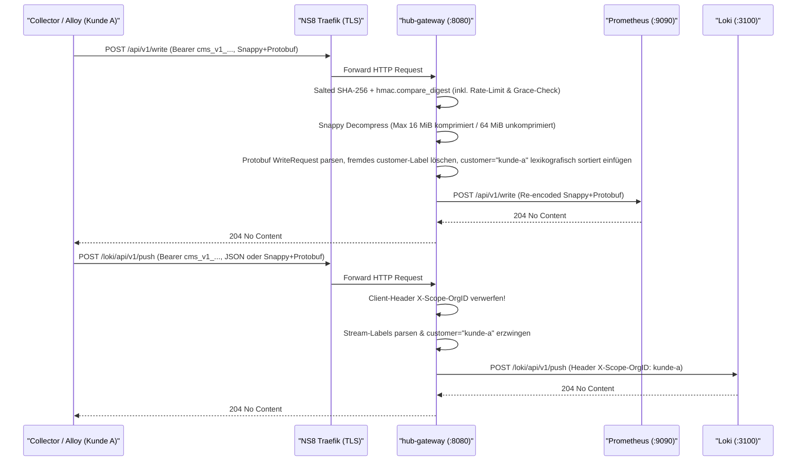
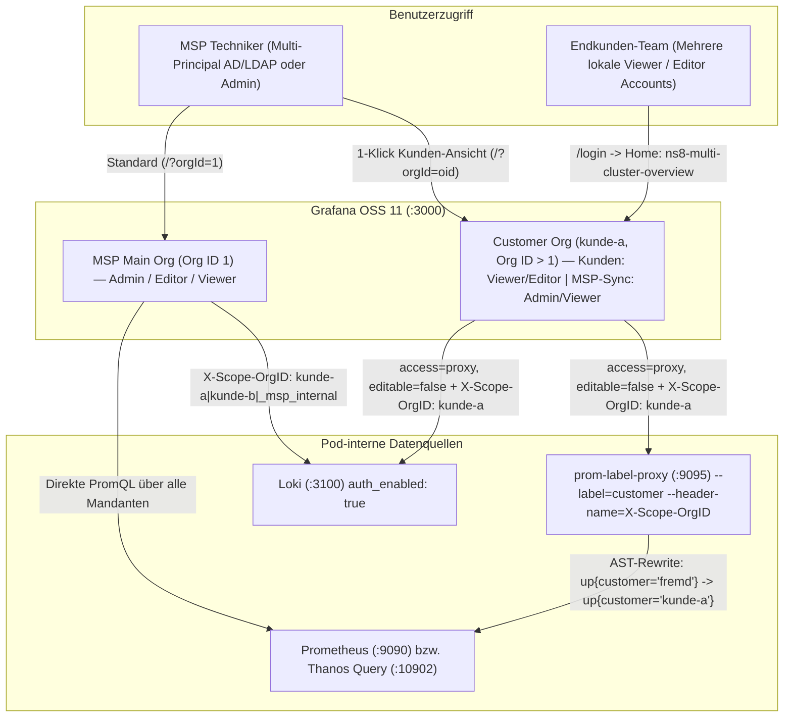

# Architektur- & Sicherheitsreferenz (`NS8-CentralMonitoringService` v1.1.0)

Dieses Dokument beschreibt die technischen Architekturentscheidungen (ADRs `ADR-001` bis `ADR-007`), die interne Container- und Netzwerk-Topologie, die mehrschichtige Mandantenisolation (Defense-in-Depth), die Skalierungsarchitektur (`local` vs. `s3` mit Thanos und Loki TSDB v13), die Rootless-Linux-`cgroups v2`-Telemetrie, die SSRF-Schutzmechanismen sowie das Backup-/Restore-Design auf NethServer 8 (Rocky Linux 9 / Python 3.9 + SELinux Enforcing und Debian 12).

> [!TIP]
> **Verwandte Dokumentation:**
> - Bedienungsanleitung aller UI-Ansichten: **[MSP Benutzerhandbuch (`docs/user-guide.md`)](user-guide.md)**
> - Endkunden-Dokumentation: **[Kundenportal-Handbuch (`docs/customer-portal-guide.md`)](customer-portal-guide.md)**
> - Tag-2-Betrieb & Sizing: **[MSP Betriebshandbuch (`docs/operations-guide.md`)](operations-guide.md)**
> - Alle 6 Dashboards (`117` Panels) & 81 Alarmregeln: **[Dashboard- & Alarmregel-Referenz (`docs/dashboards-and-alerts.md`)](dashboards-and-alerts.md)**

---

## 1. Podman-Pod-Topologie & Port-Map

Sowohl `central-monitoring-hub` (`13` `.service`-Units + `hub-ns8-metrics.timer`) als auch `central-monitoring-collector` (`4` `.service`-Units + `ns8-collector-textfile.timer`, zusammen `17` `.service`-Units + `2` `.timer`-Units im Monorepo) laufen als dedizierte, unprivilegierte NethServer-8-Benutzer (`rootless` Podman mit `--network=slirp4netns:allow_host_loopback=true` und geteilten SELinux-Labels `:z` / `:ro,z` auf Verzeichnismounts). Innerhalb jedes Pods kommunizieren die Container ausschließlich über das Pod-Loopback (`127.0.0.1`).

### 1.1 Port-Map: `central-monitoring-hub` (`central-monitoring-hub-pod`)

Einzig der Port `8080` des `hub-gateway`-Containers wird über `127.0.0.1:${TCP_PORT}:8080` an den lokalen NS8-Host-Loopback für Traefik gebunden. Kein interner Datenbank-, Query-, Metrik- oder Admin-Port verlässt den Pod direkt.

| Interner Pod-Port | Protokoll | Dienst / Container | Sichtbarkeit | Funktion & Sicherheitsgrenze |
| :--- | :--- | :--- | :--- | :--- |
| `127.0.0.1:8080` | HTTP | `hub-gateway` (`aiohttp`, `v1.1.0`) | Host-Loopback `127.0.0.1:${TCP_PORT}` -> NS8 Traefik (`HTTPS/443`) | Einziger öffentlicher Ingress: Token-Auth + Label-Stamping auf `/api/v1/write` & `/loki/api/v1/push`; gehärteter Reverse-Proxy auf Grafana (`:3000`); blockiert `/metrics/*`, `/api/alertmanager*`, `/api/ruler*`, `/api/v1/provisioning*` und mutierende `/api/datasources*`-Aufrufe mit `403 FORBIDDEN` |
| `127.0.0.1:3000` | HTTP / WS | `grafana-oss` (`11.2.2`) | Nur Pod-intern | Multi-Org-UI: `Org 1` für MSP-Team (inkl. Multi-Principal AD/LDAP SSO + Provisioning-Reload), dedizierte Kunden-Orgs (`Viewer` & `Editor`, `[alerting]`/`[unified_alerting]` deaktiviert) |
| `127.0.0.1:3100` | HTTP | `loki` (`3.1.1`, `auth_enabled: true`) | Nur Pod-intern | Multi-Tenant-Log-Speicher & LogQL-Engine; trennt Index & Chunks strikt anhand von `X-Scope-OrgID` |
| `127.0.0.1:9096` | gRPC | `loki` | Nur Pod-intern | Interner Loki-gRPC-Endpunkt |
| `127.0.0.1:9090` | HTTP | `prometheus` (`v2.54.1`) | Nur Pod-intern | Zeitreihen-TSDB, Remote-Write-Receiver (`--web.enable-remote-write-receiver`), Regel-Engine (6 Regelpakete / 81 Regeln) & `file_sd`-Scraper |
| `127.0.0.1:9093` | HTTP | `alertmanager` (`v0.27.0`) | Nur Pod-intern | Deduplizierung, Gruppierung, Wartungsfenster (`/api/v2/silences`) & Multi-Channel-Versand (`--cluster.listen-address=""`) |
| `127.0.0.1:9095` | HTTP | `prom-label-proxy` (`v0.11.0`) | Nur Pod-intern | PromQL-AST-Parser für Kunden-Orgs: erzwingt `{customer="<X-Scope-OrgID>"}` auf jedem Selektor |
| `127.0.0.1:9097` | HTTP | `hub-gateway` (Internes Loopback-Relay) | Nur Pod-intern (`127.0.0.1`) | 1) Push-Relay für Alertmanager-Webhooks nach **Ntfy** und **Gotify**; 2) `GET /metrics/ns8-node` liefert `state/textfile/ns8-hub-node.prom` für die lokale Hub-Knoten-Selbstüberwachung an Prometheus (`:9090`) aus |
| `127.0.0.1:9115` | HTTP | `blackbox-exporter` (`v0.25.0`) | Nur Pod-intern | Aktive HTTP/HTTPS-, TLS-Zertifikats-, DNS- (`dns_tcp`/`dns_udp`), TCP- und unprivilegierte Datagram-ICMP-Prüfungen (8 Module) |
| `127.0.0.1:9116` | HTTP | `snmp-exporter` (`v0.26.0`) | Nur Pod-intern | Zentrale SNMP-v2c/v3-Abfragen (`if_mib` inkl. `ifSpeed`/`ifHighSpeed`, `apcupsd`, `synology`, `qnap`, `mikrotik`, `fortigate`, `printer` RFC 3805, `generic`) |
| `127.0.0.1:10902` | HTTP (`:10901` gRPC) | `thanos-query` (`v0.36.1`) | Nur Pod-intern (nur bei `storage_mode="s3"`) | Einheitlicher PromQL-Endpunkt über Echtzeit-Head-Daten (`thanos-sidecar`) und historische S3-Blöcke (`thanos-store`) |
| `127.0.0.1:10912` | HTTP (`:10911` gRPC) | `thanos-sidecar` (`v0.36.1`) | Nur Pod-intern (nur bei `storage_mode="s3"`) | Liest Echtzeit-Serien aus Prometheus (`:9090`) und lädt abgeschlossene 2h-TSDB-Blöcke nach S3 hoch |
| `127.0.0.1:10922` | HTTP (`:10921` gRPC) | `thanos-store` (`v0.36.1`) | Nur Pod-intern (nur bei `storage_mode="s3"`) | Beantwortet historische PromQL-Abfragen gegen S3-/MinIO-Langzeitblöcke mit lokalem Index-Cache (`thanos-store-data`) |

### 1.2 Port-Map: `central-monitoring-collector` (`central-monitoring-collector-pod`)

Der Standort-Collector benötigt **keine Traefik-Route** und **keine eingehenden WAN-Ports**.

| Port | Protokoll | Dienst / Container | Sichtbarkeit | Funktion |
| :--- | :--- | :--- | :--- | :--- |
| `127.0.0.1:12345` | HTTP | `alloy` (`v1.4.2`) | Nur Pod-intern | Interner Readiness- & Hot-Reload-Endpunkt (`POST /-/reload`) über Verzeichnismount `/etc/alloy/conf/config.alloy`; niemals nach außen veröffentlicht |
| `127.0.0.1:9221` | HTTP | `pve-exporter` (`3.4.5`) | Nur Pod-intern (aktiv ab >= 1 `proxmox`-Ziel) | Übersetzt Proxmox-VE-API-Abfragen im Kunden-LAN in Prometheus-Metriken für Alloy |
| `${SYSLOG_PORT}:5514` | UDP & TCP | `alloy` (`loki.source.syslog`) | Optional im Kunden-LAN (`enable_syslog_receiver=true`, Standard `5514`, Bereich `1024–65535`) | Empfängt RFC5424/RFC3164-Syslog geschlossener LAN-Appliances (Firewalls, Switches, USVs, NAS, Drucker) |

---

## 2. Kanonischer Telemetrie-Vertrag (`telemetry-contract`)

Das Verzeichnis `shared/` bildet den verbindlichen Vertrag über **57 eigenständige JSON-Schema-Draft-07-Dateien** (davon **56** Byte-für-Byte identische Action-Validierungsschemata über 22 schema-validierte Hub-API-Actions [`26` Hub-Actions inkl. Lifecycle] und 6 schema-validierte Collector-API-Actions [`10` Collector-Actions inkl. Lifecycle]), **6 Enterprise-NOC-Grafana-11-Dashboards** (`117` Panels gesamt: `89` Visualisierungen + `28` Reihen), **6 Prometheus-Regelpakete** (`81` Alarmregeln) und **6 Grafana-Alloy-Templates**.

Jede Zeitreihe in Prometheus/Thanos und jeder Log-Stream in Loki trägt zwingend vier kanonische Labels:

| Label | Validierungsmuster / Enum | Durchsetzungspunkt | Zweck |
| :--- | :--- | :--- | :--- |
| `customer` | `^[a-z0-9][a-z0-9-]{1,46}[a-z0-9]$` (plus `_msp_internal` für Hub-Eigenüberwachung) | **Serverseitig erzwungen** durch `hub-gateway` (Push) bzw. `file_sd`- / `hub-ns8-node`-Generator (Pull) | Harte Sicherheitsgrenze für Mandantentrennung, `prom-label-proxy`, Loki `X-Scope-OrgID` & Kunden-Mail-Routing |
| `site` | `^[a-z0-9][a-z0-9-]{0,46}[a-z0-9]$` | Geprüft gegen erlaubte Standorte des Mandanten (Fallback auf `default_site`) | Trennt Standorte (`hq`, `rz1`, `hub`, `filiale-nord`) innerhalb eines Mandanten |
| `device_role` | `ns8`, `linux`, `windows`, `proxmox`, `web`, `snmp-network`, `snmp-ups`, `snmp-nas`, `snmp-firewall`, `snmp-printer` | Beim Ingest validiert (`422 VALIDATION_ERROR` bei ungültigen Werten) | Steuert die Selektoren der 6 Standard-Alarmpakete (81 Regeln) und 6 NOC-Dashboards |
| `collector_id` | `^[a-z0-9][a-z0-9._-]{1,62}[a-z0-9]$` | Beim Ingest validiert (`hub-central` bzw. `hub-ns8-node` für lokale Hub-Scrapes) | Nachvollziehbarkeit der Datenquelle, WAL-Überwachung & Collector-Staleness-Erkennung |

> [!WARNING]
> **Aggregations-Invariante für Alarmregeln:** Jede PromQL-Regel mit Aggregationen (`sum`, `avg`, `max`, `min`, `count`, `topk`) **muss** `customer` und `site` in der `by (...)`-Klausel erhalten (bzw. bei `without (...)` unangetastet lassen), damit Alertmanager Alarme mandantenspezifisch zustellen und per Silence stummschalten kann.

---

## 3. Defense-in-Depth Multi-Tenancy (Ingest, Multi-User-Portale & 1-Way MSP-Simulation)

### 3.1 Ingest-Pfad: Serverseitiges Wire-Stamping (`hub-gateway`)

Sicherheitskontrollen am Ingest- & Reverse-Proxy-Gateway (`:8080`):
1. **Gehashte Token-Speicherung & Versiegelte Portal-Geheimnisse:** Bearer-Tokens (`cms_v1_<43 Zeichen>`, 256 Bit Entropie) werden ausschließlich als gesalzene SHA-256-Prüfsummen in `state/tenants.json` (`0600`) gespeichert und via `hmac.compare_digest` geprüft. Optionale Kundenportal-Passwörter werden pro Benutzer (`<customer>:<username_lower>`) über `state/.portal.key` in `state/portal-secrets.json` (`0600`) versiegelt.
2. **Schutz vor Dekompressionsbomben (Zip Bombs):** Komprimierte Requests über `16 MiB` sowie Snappy-Blöcke mit einer deklarierten unkomprimierten Größe über `64 MiB` werden vor der Speicherallokation mit HTTP `413 PAYLOAD_TOO_LARGE` abgewiesen.
3. **Brute-Force-Bremse:** Wiederholte Fehlversuche pro Quell-IP werden mit HTTP `429 RATE_LIMITED` gedrosselt.
4. **Harte Reverse-Proxy-Pfad- & Methodensperre (`proxy.py`):** Nach normalisierter Pfadauflösung blockiert `:8080` sämtliche externen Zugriffe auf `/metrics` & `/metrics/*` (kein Datenleck von `ns8-hub-node.prom`), `/api/alertmanager*`, `/api/ruler*`, `/api/v1/provisioning*` sowie alle mutierenden HTTP-Methoden (`POST`/`PUT`/`PATCH`/`DELETE`) auf `/api/datasources*` außerhalb des Lese-Proxys `/api/datasources/proxy/*` mit `403 FORBIDDEN`. Zudem sind `[alerting]` und `[unified_alerting]` in `grafana.ini` deaktiviert, sodass auch Kunden-Benutzer mit Rolle `Editor` keine serverseitigen Webhook-Requests aus dem Pod auslösen können.

### 3.2 Query-Pfad: Multi-User-Kundenportale, 1-Wege-MSP-Simulation & PromQL-AST-Rewriting

Drei voneinander unabhängige Barrieren schützen das Kundenportal:
1. **Schicht 1 — Multi-User-Organisationsgrenze & Einseitige MSP-Synchronisation:**
   - Kundenbenutzer (`Viewer` oder `Editor` in `save-portal-user`) existieren ausschließlich lokal in ihrer jeweiligen Kunden-Organisation (`Org ID > 1`, niemals in `Org 1`). Globale Benutzernamen-Eindeutigkeit wird mandantenübergreifend erzwungen.
   - Echte MSP-Mitarbeiter aus `Org 1` (sowie die AD/LDAP-Prinzipale in `/etc/grafana/ldap.toml` mit `member_of = "distinguishedName"` bzw. `"dn"`) werden **streng einseitig (`1-Way`)** in aktive Kunden-Orgs synchronisiert: MSP-Admins als `Admin`, MSP-Techniker/Support (`Editor`/`Viewer`) als Read-Only-`Viewer`, ohne jemals die Standard-Organisation (`Org 1`) des Technikers umzustellen. Sowohl `Org 1` als auch jede Kunden-Org erhalten automatisch `ns8-multi-cluster-overview` als Start-Dashboard (`PUT /api/org/preferences`).
2. **Schicht 2 — PromQL-AST-Rewriting (`prom-label-proxy`):** Selbst bei manuell manipulierten API-Aufrufen über `/api/datasources/proxy/...` parst `prom-label-proxy` (`:9095`) den vollständigen PromQL-AST und erzwingt mathematisch `{customer="kunde-a"}`.
3. **Schicht 3 — Physische Loki-Index-Isolation:** Loki (`auth_enabled: true`) trennt Index-Tabellen und Chunks physisch nach `X-Scope-OrgID`. In `Org 1` hält `grafana_sync.py` den kombinierten Multi-Tenant-Header (`kunde-a|kunde-b|...|_msp_internal`) automatisch aktuell und triggert bei Updates den Grafana-11-Provisioning-Reload (`/api/admin/provisioning/dashboards/reload`), damit aktualisierte JSON-Dashboards auch in `Org 1` sofort sichtbar sind.

---

## 4. Speicher- & Skalierungsarchitektur (`local` vs. `s3`)

| Eigenschaft | `storage_mode: "local"` (Standard) | `storage_mode: "s3"` (Skalierungsmodus > 1.500 Systeme) |
| :--- | :--- | :--- |
| **Prometheus TSDB** | Lokales Volume `prometheus-data`; Aufbewahrung gemäß `retention_days` / `retention_size_gb` | Lokales Volume dient als schneller Hot-Cache (feste 2h-Blöcke: `--storage.tsdb.min-block-duration=2h --storage.tsdb.max-block-duration=2h`); `thanos-sidecar` lädt alle 2h-Blöcke nach S3/MinIO hoch |
| **Thanos-Dienste** | Deaktiviert (`thanos-sidecar`, `thanos-store`, `thanos-query` gestoppt -> minimaler RAM-Verbrauch) | Aktiviert: `thanos-query` (`:10902`) vereint nahtlos Echtzeitdaten (`thanos-sidecar` `:10911`) und Langzeitblöcke aus S3 (`thanos-store` `:10921`, Cache-Volume `thanos-store-data`) inkl. Deduplizierung |
| **PromQL-Upstream (`PROMQL_UPSTREAM_URL`)** | `http://127.0.0.1:9090` (Prometheus direkt) | `http://127.0.0.1:10902` (Thanos Query — transparent für Grafana `Org 1` und `prom-label-proxy`!) |
| **Loki Storage** | TSDB Schema `v13` auf lokalem Dateisystem (`loki-data`) + Compactor-Retention | TSDB Schema `v13` nativ gegen S3 (`object_store: s3`); lokal verbleiben lediglich temporäre WAL-/Cache-Daten |
| **Geheimnis-Schutz** | — | S3-Zugangsdaten werden mit `chmod 0600` in `state/secrets.env` und im Verzeichnismount `/etc/thanos/objstore.yml` abgelegt |

---

## 5. SSRF-Schutz, Rocky Linux 9 / Python 3.9 & SELinux-Härtung

- **SSRF-Schutz (`ssrf_guard.py`):** Blockiert kanonische und verschleierte IPv4/IPv6-Darstellungen (Hexadezimal `0x7f...`, Oktal `0177...`, Kurzformen `127.1`, IPv4-mapped IPv6 `[::ffff:10.0.2.2]`), Loopback-, Link-Local- und Cloud-Metadata-Ziele (`169.254.169.254`) sowie das gesamte Rootless-`slirp4netns`-Subnetz `10.0.2.0/24` für benutzerdefinierte Scrape- und Webhook-Ziele.
- **Verzeichnis-Bind-Mounts & SELinux (`:z` / `:ro,z`):** Da atomare Konfigurationsschreibvorgänge (`os.replace()`) auf XFS/ext4 neue Inodes erzeugen, binden alle `systemd --user`-Units Konfigurationsverzeichnisse statt Einzeldateien ein (z. B. `/etc/grafana`, `/etc/snmp_exporter`, `/etc/alloy/conf`) und nutzen das geteilte SELinux-Label `:z` / `:ro,z`, damit Hot-Reloads unter Rocky Linux 9 (SELinux `Enforcing`) ohne Container-Neustart greifen.
- **Strikte Python-3.9-Host-Kompatibilität (`[PY39-COMPAT]`):** Auf Rocky Linux 9 ist `/usr/bin/python3` **Python 3.9**. Alle `138` Python-Module und `imageroot/`-Skripte werden statisch per `validate-monorepo.py` (`feature_version=(3, 9)` + PEP-701-Scanner) sowie in CI innerhalb eines echten `python:3.9-slim`-Containers gegen alle `261` Tests verifiziert.

---

## 6. Restic-Backup, In-Place-Update, Restore & Clone

1. **Konsistenter Online-Dump (`hub/imageroot/bin/module-dump-state`):** Erzeugt vor jedem Restic-Lauf per `sqlite3 .backup` einen atomaren Snapshot von `grafana.db` nach `state/grafana.db.bak` sowie einen Snapshot aktiver Silences.
2. **Vollständiger State-Umfang (`hub/imageroot/etc/state-include.conf`):** Sichert `state/environment` (inkl. URL-safe Base64-kodierter `LDAP_*_PRINCIPALS_B64`), `state/secrets.env`, `state/tenants.json`, `state/portal-secrets.json`, `state/.portal.key`, `state/targets.json`, `state/alerting.json`, `state/alerting-secrets.json`, `state/silences.json`, `state/grafana.db.bak` und `config/custom-rules/`.
3. **In-Place-Modul-Updates (`hub/imageroot/update-module.d/20pull_images` & `50update`):** Aktualisiert bei einem NS8-Software-Center-Update automatisch gepinnte Container-Image-Referenzen (`hub-gateway:1.1.0`), ergänzt neue Umgebungs-Defaults, rendert alle Konfigurationsdateien neu, gleicht `hub-ns8-metrics.timer` ab, startet die Pod-Dienste sauber durch und synchronisiert alle Grafana-Organisationen inkl. Org-1-Dashboard-Reload.
4. **Cross-Version-Restore & Clone:** `restore-module/06copyenv` & `50configure` sowie `clone-module/50configure` migrieren ältere Snapshots (`v1.0.x` -> `v1.1.0`) verlustfrei, erneuern beim Klonen eindeutige Instanzgeheimnisse/`collector_id` und rekonfigurieren `hub-ns8-metrics.timer`.

---

## 7. Architecture Decision Records (ADRs)

### ADR-001: Gemeinsames Monorepo mit striktem `telemetry-contract` (`shared/`)
- **Status:** Akzeptiert (2026-11-20, aktualisiert v1.1.0)
- **Kontext:** Hub, NS8-Standort-Collector und Standalone-Alloy-Agenten teilen sich exakt dieselben Label-Konventionen, Alarmregeln, Grafana-Dashboards und JSON-Schemata, müssen im NS8 Software Center (`BLS-ISP/ns8-nethforge`) jedoch als zwei unabhängig installierbare OCI-Module bereitstehen.
- **Entscheidung:** Ein gemeinsames Monorepo (`hub/`, `collector/`, `shared/`) mit **57** eigenständigen JSON-Schema-Draft-07-Dateien ohne externe `$ref`-Verweise, **6** NOC-Dashboards und **6** Regelpaketen (**81** Regeln), geprüft durch `scripts/validate-monorepo.py --strict`.

### ADR-002: Python `aiohttp` Auth-Gateway mit Snappy/Protobuf-Wire-Rewriting statt reinem Reverse-Proxy
- **Status:** Akzeptiert (2026-11-20)
- **Entscheidung:** Implementierung von `hub-gateway` in Python (`aiohttp`) inklusive Snappy- & Protobuf-Wire-Codec, der auf `/api/v1/write` und `/loki/api/v1/push` das `customer`-Label serverseitig anhand des authentifizierten Bearer-Tokens überschreibt und auf `:8080` interne Metrik-, Provisioning- und Alerting-Pfade blockiert.

### ADR-003: Dreistufige Kundenisolation mit `prom-label-proxy` & Multi-User-Kunden-Orgs
- **Status:** Akzeptiert (2026-11-20, erweitert v1.0.2)
- **Entscheidung:** Eine gemeinsame Prometheus(/Thanos)- und Multi-Tenant-Loki-Instanz im Hub, kombiniert mit dedizierten Grafana-Organisationen (mehrere lokale `Viewer`-/`Editor`-Accounts bei deaktiviertem Grafana-Alerting und gesperrten Proxy-Datasources), `prom-label-proxy` (`:9095`) für PromQL-AST-Isolation und `X-Scope-OrgID` für Loki.

### ADR-004: Umschaltbarer Langzeitspeicher (`local` vs. `s3` via Thanos + Loki TSDB v13)
- **Status:** Akzeptiert (2026-11-20)
- **Entscheidung:** Live umschaltbarer `storage_mode` (`local` vs. `s3`), wobei `PROMQL_UPSTREAM_URL` transparent für Grafana `Org 1` und `prom-label-proxy` zwischen Prometheus (`:9090`) und `thanos-query` (`:10902`) wechselt.

### ADR-005: Grafana Alloy + On-Demand `pve-exporter` & Gehärtete OS-Installer
- **Status:** Akzeptiert (2026-11-20, erweitert v1.1.0)
- **Entscheidung:** Einheitlicher Einsatz von **Grafana Alloy `v1.4.2`** im NS8-Collector (mit bedarfsgesteuertem `pve-exporter`-Sidecar) sowie in den generierten Standalone-Bundles — unter Windows mit Authenticode-Prüfung, strikten `SYSTEM`/Admin-NTFS-ACLs vor dem Schreiben des Bearer-Tokens und automatischem SCM-Dienst-Recovery.

### ADR-006: Rootless Linux `cgroups v2` NS8-Pod/Modul-Telemetrie & Integrierte Hub-Selbstüberwachung
- **Status:** Akzeptiert (2026-11-23, v1.1.0)
- **Kontext:** Auf NethServer 8 laufen Applikationsmodule als eigene Rootless-Benutzer (`mail1`, `nextcloud1`, ...) oder Rootful-Units (`samba1`, `crowdsec1`). Der lokale NS8-`node_exporter` (`:9100`) liefert zwar Host-Kennzahlen, jedoch keine detaillierten CPU-, Working-Set-RAM-, Swap-, Disk-I/O-, PID- oder OOM-Kill-Metriken pro NS8-Modul und Container — und ein unprivilegiertes Monitoring-Modul darf keine Root-Rechte oder fremde Podman-Sockets anfordern. Zudem soll der zentrale MSP-Hub-Knoten sich selbst ohne zusätzliches Collector-Modul überwachen können.
- **Entscheidung:**
  1. Ein 100 % unprivilegierter Python-3.9-Harvester liest die auf Linux standardmäßig weltlesbaren (`0444`) **cgroups-v2**-Dateien unter `/sys/fs/cgroup/user.slice/user-<UID>.slice/` (inkl. Sub-Units in `app.slice`/`user.slice`) sowie `/sys/fs/cgroup/system.slice/<mid>.service`, kombiniert mit `/etc/passwd` und dem lokalen NS8-Redis-Replikat (`127.0.0.1:6379`), und emittiert `ns8_module_*`- sowie `ns8_pod_unit_*`-Metriken atomar als Textfile.
  2. Auf dem Hub schreibt `hub-ns8-metrics.timer` diese Telemetrie nach `state/textfile/ns8-hub-node.prom`; das interne Loopback-Relay (`127.0.0.1:9097/metrics/ns8-node`) stellt sie ausschließlich für den Pod-internen Prometheus bereit, während `:8080` `/metrics/*` nach außen mit `403` sperrt.
- **Konsequenzen:** Lückenlose Echtzeit-Transparenz und OOM-/Speicherlimit-Alarmierung (`NS8ModuleOOMKilled`, `NS8ModuleMemoryNearLimit`, `NS8ModuleHighSwapUsage`) für sämtliche NS8-Pods ohne Root-Rechte.

### ADR-007: Reiner Python-LDAPv3-Client (RFC 4511) für Gruppen-/Benutzer-Mehrfachauswahl & 1-Wege-MSP-Kundensimulation
- **Status:** Akzeptiert (2026-11-23, v1.0.2–v1.0.4)
- **Kontext:** NS8-Hosts (Rocky Linux 9 Python 3.9 minimal) bringen weder `ldapsearch` noch kompilierte `python-ldap`-Pakete vorinstalliert mit. Gleichzeitig wollen MSP-Administratoren in der Cockpit-UI sowohl AD-/LDAP-Gruppen als auch einzelne Benutzer live durchsuchen, mehrfach auswählen (`NsMultiSelect`) und Kundenportale mit einem Klick exakt aus Kundensicht prüfen können, ohne dass `skip_org_role_sync = false` in Grafana LDAP-Mitgliedschaften beim nächsten Login wieder entfernt.
- **Entscheidung:**
  1. Implementierung eines reinen Python-3.9-Standardbibliotheks-**ASN.1-BER/LDAPv3-Clients** (`ldap_client.py` inkl. RFC 2696 Paging, Referral-Filterung, Frame-Flood-Bremse und RFC 4515 Escaping) direkt gegen den NS8-`Ldapproxy`.
  2. Verlustfreie Speicherung mehrerer Gruppen-/Benutzer-DNs als URL-sicheres Base64 (`LDAP_*_PRINCIPALS_B64`) und Generierung von `/etc/grafana/ldap.toml` mit `member_of = "distinguishedName"` (AD, inkl. `1.2.840.113556.1.4.1941`) bzw. `"dn"` (RFC2307), sodass sowohl Gruppen- als auch Einzelbenutzer-DNs nativ mit Grafanas `ldap.go` harmonieren.
  3. Einseitige (`1-Way`) Synchronisation von MSP-Konten und `ldap.toml`-Mappings aus `Org 1` in aktive Kunden-Organisationen (`Admin` -> `Admin`, `Editor`/`Viewer` -> Read-Only-`Viewer`), erreichbar per 1-Klick über `/?orgId=<id>`.
