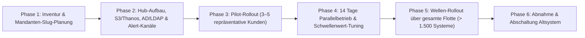

# Migrationsleitfaden: Ablösung von PRTG, Checkmk oder Zabbix (`docs/migration-guide.md`)

Dieser praxisorientierte Leitfaden führt MSP- und Systemhaus-Teams strukturiert von bestehenden Monitoring-Installationen (**Paessler PRTG**, **Checkmk** oder **Zabbix**) auf den **NS8 Central Monitoring Service (`v1.1.0`)** — ohne Überwachungslücken, mit sauberem Parallelbetrieb und klarer Abschalt-Checkliste für das Altsystem.

> [!TIP]
> **Weiterführende Handbücher:**
> - Schritt-für-Schritt-UI-Bedienung: **[MSP Benutzerhandbuch (`docs/user-guide.md`)](user-guide.md)**
> - Sizing, S3/Thanos & Tag-2-Betrieb: **[MSP Betriebshandbuch (`docs/operations-guide.md`)](operations-guide.md)**
> - Vollständiger Katalog aller **6 NOC-Dashboards** & **81 Alarmregeln**: **[Dashboard- & Alarmregel-Referenz (`docs/dashboards-and-alerts.md`)](dashboards-and-alerts.md)**
> - Für Ihre Kunden mit eigenem Portal-Zugang: **[Kundenportal-Handbuch (`docs/customer-portal-guide.md`)](customer-portal-guide.md)**

---

## 1. Migrationsphasen im Überblick

1. **Keine Big-Bang-Umschaltung:** Grafana Alloy und `central-monitoring-collector` arbeiten ressourcenschonend parallel zu bestehenden PRTG Remote Probes, `check_mk_agent` oder `zabbix_agent2`. Das Altsystem bleibt führend, bis die Pilotwelle im 14-Tage-Parallelbetrieb validiert ist.
2. **Einheitliches Namensschema vorab festlegen:** Definieren Sie vor dem ersten Rollout verbindliche Mandanten-Slugs (`customer`, z. B. passend zum Kundenkürzel im ERP/PSA wie `kd-1042-mueller` oder `mueller-logistik`) und Standort-Slugs (`site`: `hq`, `lager`, `rz1`).

---

## 2. Konzept-Übersetzung für das Systemhaus-Team

| Altsystem-Konzept (PRTG / Checkmk / Zabbix) | Entsprechung im NS8 Central Monitoring Service (`v1.1.0`) | Vorteil im MSP-Betrieb |
| :--- | :--- | :--- |
| **Ordnerbaum / Gruppen / Host Groups** | Kanonische Labels `customer`, `site`, `device_role`, `collector_id` | Beliebig kombinierbar in allen **6 NOC-Dashboards**, **81 Alarmregeln** und Silences; kein Duplizieren bei überlappenden IP-Netzen |
| **PRTG Remote Probe / Checkmk Distributed Site / Zabbix Proxy** | `central-monitoring-collector` (auf Kunden-NS8 inkl. cgroups-v2 Pod-Harvester) oder Standalone Alloy (`docker-compose` / OS-Dienst) | Rein ausgehendes HTTPS (`TCP/443`), lokaler Disk-WAL-Puffer bei Internetausfall, kein VPN-Zwang |
| **Einzelsensoren / Services pro Host anlegen** | Automatische Metrik- & Log-Erfassung + **6 zentrale Regelpakete (81 Regeln)** (`shared/rules/*.yml`) | Kein Lizenzlimit pro Sensor; ein neuer Host fällt anhand seines `device_role`-Labels sofort unter alle passenden Standardregeln |
| **Separate Log-Lösung / Windows-Event-Sensoren** | Integrierter Multi-Tenant-**Loki** im selben Hub + **`Zentraler Log- & Security-Explorer`** (`central-log-explorer.json`) | Im Ausfallmoment sieht der Techniker direkt im selben Portal die passenden Journald-, Windows-Event- oder Firewall-Syslog-Zeilen |
| **Kunden-Maps / Read-Only-Kundenkonten** | **Multi-User-Kundenportale** (`Viewer` & `Editor`) + **1-Klick MSP-Kundensimulation (`?orgId=<id>`)** | Kunden erhalten eigene Zugänge ohne Cross-Tenant-Risiko; Support-Techniker prüfen per 1-Klick exakt dieselbe Ansicht |
| **Wartungsmodus / Scheduled Downtime** | **Alertmanager Silences** (`create-silence`) nach `customer`, `site`, `device_role` oder `instance` | Zentrale Patchday-Steuerung (z. B. alle `windows`-Server über alle Mandanten mit einer Regel stummschalten) |

---

## 3. Sensor- & Check-Mapping nach Altsystem

### 3.1 Migration von Paessler PRTG

| PRTG-Sensortyp | Ablösung im NS8 Central Monitoring Service | Zugehöriges Regelpaket & Dashboard |
| :--- | :--- | :--- |
| **Ping / Erreichbarkeit (LAN & WAN)** | `up == 0` + Remote-Write-Staleness-Regeln (LAN via Collector) bzw. Blackbox `http_2xx` / `tcp_connect` / `icmp` (WAN) | Alle `*-node.yml` + `blackbox-web-ssl.yml` |
| **NethServer 8 Applikations-Pods & Backups** | Rootless Linux `cgroups v2` Harvester (`ns8_module_*`, `ns8_pod_unit_*`, `ns8_backup_*`) auf Kunden-NS8 & Hub | `ns8-cluster.yml` (20 Regeln inkl. `NS8ModuleOOMKilled`, `NS8ModuleMemoryNearLimit`, `NS8ModuleHighSwapUsage`) + `ns8-pods-and-modules.json` |
| **Windows CPU / Memory / Disk Free (WMI / PerfCounter)** | Standalone Alloy (`prometheus.exporter.windows`) als geschützter Hintergrunddienst (`SYSTEM`/Admin-ACL) — deutlich geringere Last als WMI! | `windows-node.yml` (12 Regeln, `< 15 %` Warnung, `< 5 %` Kritisch) + `linux-windows-servers.json` |
| **Windows Service Sensor** | Alloy `windows` Collector `service` (überwacht automatisch alle Dienste mit `start_mode="auto"`) | `WindowsAutomaticServiceStopped` in `windows-node.yml` |
| **Windows Event Log Sensor (AD, Logon, Disk, System)** | Alloy `loki.source.windowsevent` (`Application`, `System`, `Security` inkl. EventIDs 4625/4720/4726/4740) -> Hub Loki | `central-log-explorer.json` + Live-Log-Panels in `linux-windows-servers.json` |
| **Linux SSH / SNMP CPU, Mem, Disk, Load** | `central-monitoring-collector` (NS8) bzw. Standalone Alloy (`prometheus.exporter.unix` inkl. `predict_linear` 24h-Vollprognose & Inodes) | `ns8-cluster.yml` / `linux-node.yml` (15 Regeln) |
| **HTTP / HTTP Advanced / SSL Certificate Sensor** | Zentraler Hub `blackbox` (`http_2xx`, `dns_tcp`/`dns_udp`, `tcp_connect`): Statuscode, Antwortzeit `> 3s`, TLS-Restlaufzeit (`< 21d` / `< 7d`) | `blackbox-web-ssl.yml` (8 Regeln) + `web-ssl-uptime.json` |
| **SNMP Traffic / Port Status Sensor** | Lokales oder zentrales SNMP-Ziel (`if_mib` inkl. `ifSpeed`/`ifHighSpeed`, v2c/v3) | `snmp-network-ups.yml` + `proxmox-snmp-infrastructure.json` |
| **APC / Eaton USV Sensor (SNMP)** | SNMP-Ziel (`apcupsd` / RFC 1628 UPS-MIB, `device_role="snmp-ups"`) | `SnmpUpsOnBattery`, `SnmpUpsBatteryLow`, `SnmpUpsReplaceBatteryNeeded` |
| **Synology & QNAP System / RAID / Disk Temp** | SNMP-Ziel (`synology` bzw. `qnap`, `device_role="snmp-nas"`) + Syslog (`5514`) | `SnmpNasVolumeOrDiskDegraded`, `SnmpNasHighDiskTemperature`, `SnmpQnapVolumeDegraded`, `SnmpQnapDiskTemperatureWarning`/`Critical` |
| **SNMP Netzwerkdrucker & Tonerstand (Printer-MIB)** | SNMP-Ziel (`printer` RFC 3805, `device_role="snmp-printer"`) | `SnmpPrinterSupplyLowWarning` (`< 10 %`), `SnmpPrinterSupplyCritical` (`< 3 %`), `SnmpPrinterCriticalAlertActive` |
| **Proxmox VE / Hypervisor Checks** | Proxmox-Ziel im Collector (`pve-exporter` Sidecar via API-Token `PVEAuditor`) | `proxmox-ve.yml` (11 Regeln: Quorum, ZFS, Storage, Auto-Start-VMs/LXCs, IO-Wait) |

### 3.2 Migration von Checkmk (Raw / Enterprise / MSP)

| Checkmk-Komponente | Ablösung im NS8 Central Monitoring Service | Migrationshinweis |
| :--- | :--- | :--- |
| **`check-mk-agent` (Linux & systemd)** | `install-linux.sh` (Grafana Alloy) bzw. `central-monitoring-collector` auf NS8 | Kein offener Port `6556/tcp` auf Zielservern mehr erforderlich; Push über HTTPS |
| **`check_mk_agent.exe` + `mk_logwatch` (Windows)** | `install-windows.ps1` (Grafana Alloy Hintergrunddienst + EventLog-Bookmarks + NTFS-Manipulationsschutz) | Idempotent per GPO/Intune/SoftwareManager verteilbar; Standardnutzer können weder Token lesen noch den Dienst stoppen |
| **Checkmk Special Agent Proxmox VE (Piggyback)** | Collector-Ziel `proxmox` (`pve-exporter`) | Überwacht Node-Status, Cluster-Quorum, ZFS-Pools, Datastores und ungeplant gestoppte `onboot=1`-Gäste |
| **Docker / Podman Container Piggyback auf NS8** | Integrierter Linux `cgroups v2` NS8-Harvester (`ns8_module_*`, `ns8_pod_unit_*`) | Erfasst CPU, Working-Set-RAM, Swap, I/O und OOM-Kills jedes NS8-Pods ohne Root-Rechte |
| **Lokale Skript-Checks (`/usr/lib/check_mk_agent/local/`)** | Prometheus **Textfile Collector** (`/var/lib/alloy/textfile/*.prom`) | Jedes Cron-/Timer-Skript kann eigene `metric_name{label="val"} 1`-Zeilen atomar ablegen |
| **Distributed Monitoring (Livestatus + Config Sync)** | `central-monitoring-hub` + `central-monitoring-collector` | Keine Versionskopplung pro Patchlevel zwischen Zentral-Site und Außenstandort nötig |
| **Host Labels / Service Rules (WATO)** | `device_role` + `shared/rules/*.yml` + `config/custom-rules/*.yml` | Schwellenwerte versionierbar in YAML, geprüft mit `promtool` |

### 3.3 Migration von Zabbix

| Zabbix-Komponente | Ablösung im NS8 Central Monitoring Service | Migrationshinweis |
| :--- | :--- | :--- |
| **Zabbix Server + PostgreSQL/TimescaleDB** | `central-monitoring-hub` (Prometheus + Thanos S3 + Loki) | Deutlich höhere Kompressionsrate für Zeitreihen (~1,3 Byte/Sample) und keine DB-Vacuum-/Partitionierungs-Wartung |
| **Zabbix Proxy + SQLite/MySQL am Kundenstandort** | `central-monitoring-collector` (NS8) oder Docker-Alloy mit Disk-WAL | Kein Datenbank-Pflegeaufwand am Außenstandort; WAL rotiert selbstständig (`wal_max_disk_mb`) |
| **`zabbix_agentd` / `zabbix_agent2` Active Checks** | Grafana Alloy `prometheus.remote_write` & `loki.write` | Gleiches NAT-freundliches Outbound-Prinzip, jedoch standardisiert auf HTTPS/443 über denselben Traefik-FQDN |
| **SNMP Templates & Low-Level Discovery (LLD)** | SNMP Exporter / Alloy `prometheus.exporter.snmp` (`if_mib`, `synology`, `qnap`, `apcupsd`, `fortigate`, `mikrotik`, `printer`) | Interfaces, Volumes, USV-Sensoren und Druckerkassetten werden automatisch ohne manuelle LLD-Regeln erfasst |
| **Zabbix Actions & Media Types** | Alertmanager Routing Tree (`configure-alerting`) | Unterstützt NS8-Smarthost, PSA-Webhooks, MS Teams, Slack, Telegram, Ntfy, Gotify und Kunden-E-Mails |

---

## 4. Schritt-für-Schritt-Vorgehen für die Migration

### Schritt 1: Bestandsaufnahme & Export aus dem Altsystem
Exportieren Sie aus PRTG (CSV-Geräteliste), Checkmk (WATO-Host-Export) oder Zabbix (Host-/Proxy-Export) pro Kunde:
1. Kundenname -> Vergabe des kanonischen `customer`-Slugs (z. B. `baufirma-weber`) und der `site`-Slugs (`hq`, `bauhof`).
2. Standort-Typ: Ist ein **NethServer 8** vorhanden (`central-monitoring-collector`) oder wird ein **Docker-/Windows-/Linux-Alloy-Bundle** ausgerollt?
3. Liste aller agentenlosen Ziele im Kunden-LAN: Proxmox-IPs, Switches, Firewalls, USVs, Synology/QNAP-NAS, Netzwerkdrucker sowie öffentliche Websites/Zertifikate.
4. Sonder-Alarme / individuelle Kundenabsprachen (z. B. abweichende Festplattenschwellenwerte, Kunden-Empfängeradressen `contact_emails` oder gewünschte `Viewer`-/`Editor`-Kundenportal-Accounts).

### Schritt 2: Zentralen Hub produktionsreif aufsetzen
1. `central-monitoring-hub` über das BLS-ISP Software Center (`ns8-nethforge`) auf dem MSP-NS8-Cluster installieren und ab > 500 Zielsystemen direkt mit **S3/MinIO (`storage_mode: "s3"`)** verbinden.
2. **Live AD/LDAP Gruppen- & Benutzer-Mehrfachauswahl** für das Technik-Team aktivieren (und mit `Benutzer testen` prüfen), Hub-Selbstüberwachung (`monitor_local_ns8_node`) aktiv lassen und alle **6 Enterprise-NOC-Dashboards** in Grafana prüfen.
3. Alle **Benachrichtigungskanäle** (PSA-Ticket-Webhook, Bereitschafts-Push, Teams/Slack, Smarthost) einrichten und per `Test-Alarm senden` abnehmen.

### Schritt 3: Pilotphase mit 3–5 repräsentativen Kunden (14 Tage Parallelbetrieb)
Wählen Sie bewusst unterschiedliche Kundentypen für den Piloten:
- **Pilot 1:** Kunde mit NethServer 8 + Proxmox VE + Managed Switches + APC USV + QNAP/Synology NAS (`central-monitoring-collector`).
- **Pilot 2:** Klassische Windows-Server-Umgebung ohne NS8 (Active Directory DC + RDS/Fileserver via `install-windows.ps1` per GPO/SoftwareManager).
- **Pilot 3:** Gemischter Linux-/Docker-Standort inkl. Firewall-Syslog (`docker-compose.yml`-Bundle) + öffentliche Kunden-Webshops (`blackbox`).

### Schritt 4: Validierung & Schwellenwert-Tuning im Parallelbetrieb
Prüfen Sie während der 14 Tage Parallelbetrieb systematisch:
1. **Vollständigkeit über alle 6 Dashboards:** Erscheinen alle erwarteten Systeme in `ns8-multi-cluster-overview.json`, `ns8-pods-and-modules.json`, `linux-windows-servers.json`, `proxmox-snmp-infrastructure.json`, `web-ssl-uptime.json` und `central-log-explorer.json`?
2. **Rauschfreiheit (Alert Fatigue vermeiden):**
   - Kurzzeitige CPU-Spitzen während nächtlicher Backups lösen dank `for: 15m` in den Standardregeln keinen Fehlalarm aus.
   - Sollte auf einem Altsystem dauerhaft wenig freier Plattenplatz auf einer statischen Archivpartition normal sein, hinterlegen Sie eine gezielte Anpassungsregel unter **Alerting & Wartung -> Eigene Regeln** (immer mit `by (customer, site, instance)`!) oder bereinigen Sie das Volume.
3. **Ausfall- & Wiederanlauftest:**
   - Stoppen Sie testweise auf einem Pilotsystem einen nicht-kritischen Auto-Start-Dienst oder simulieren Sie eine kurze WAN-Trennung des Collectors: Prüfen Sie, dass der Ausfall alarmiert wird und gepufferte WAL-Metriken nach Wiederverbindung lückenlos im Graphen erscheinen.

---

## 5. Cutover-Checkliste pro Mandant (Abschaltung im Altsystem)

Erst wenn alle Punkte für einen Mandanten abgehakt sind, werden dessen Sensoren/Hosts in PRTG, Checkmk oder Zabbix deaktiviert und der Altagent deinstalliert:

- [ ] Mandant (`customer`) und alle Standorte (`sites`) sind im Hub angelegt; falls vereinbart, sind `contact_emails` und Kundenportal-Zugänge (`Kunden-Ansicht` + Kunden-Login) getestet und das **[Kundenportal-Handbuch](customer-portal-guide.md)** wurde übergeben.
- [ ] Alle NS8-Knoten des Kunden liefern Host-Metriken, `cgroups v2` Pod-/Modul-Metriken (`ns8_module_*`) und Restic-Backup-Status (`ns8_backup_status`) an den Hub.
- [ ] Alle Windows- und Linux-Server liefern Host-Metriken **und** EventLogs/Journald-Logs nach Loki (`central-log-explorer.json`).
- [ ] Alle Proxmox-VE-Knoten (inkl. ZFS & Quorum), Switches, Firewalls, USVs, Synology/QNAP-NAS und Netzwerkdrucker werden über den Standort-Collector erfasst; Firewall-/NAS-Syslogs laufen in Loki ein.
- [ ] Alle öffentlichen Websites, Portale und TLS-Zertifikate des Kunden sind als zentrale `blackbox`-Ziele im Hub hinterlegt (`web-ssl-uptime.json` zeigt gültige Restlaufzeit).
- [ ] Regelmäßige Wartungsfenster des Kunden (z. B. Patchday) sind als Ablauf/Silence dokumentiert.
- [ ] Mindestens ein Test- oder Echtalarm für diesen Mandanten wurde erfolgreich im Ticketsystem / Bereitschaftskanal zugestellt.
- [ ] Altagenten (`PRTG Probe`, `check_mk_agent`, `zabbix_agent2` / `Zabbix Proxy`) am Kundenstandort gestoppt, deinstalliert und nicht mehr benötigte eingehende Firewall-Portweiterleitungen (z. B. TCP `6556`, `10050`, `161` von außen) geschlossen.
