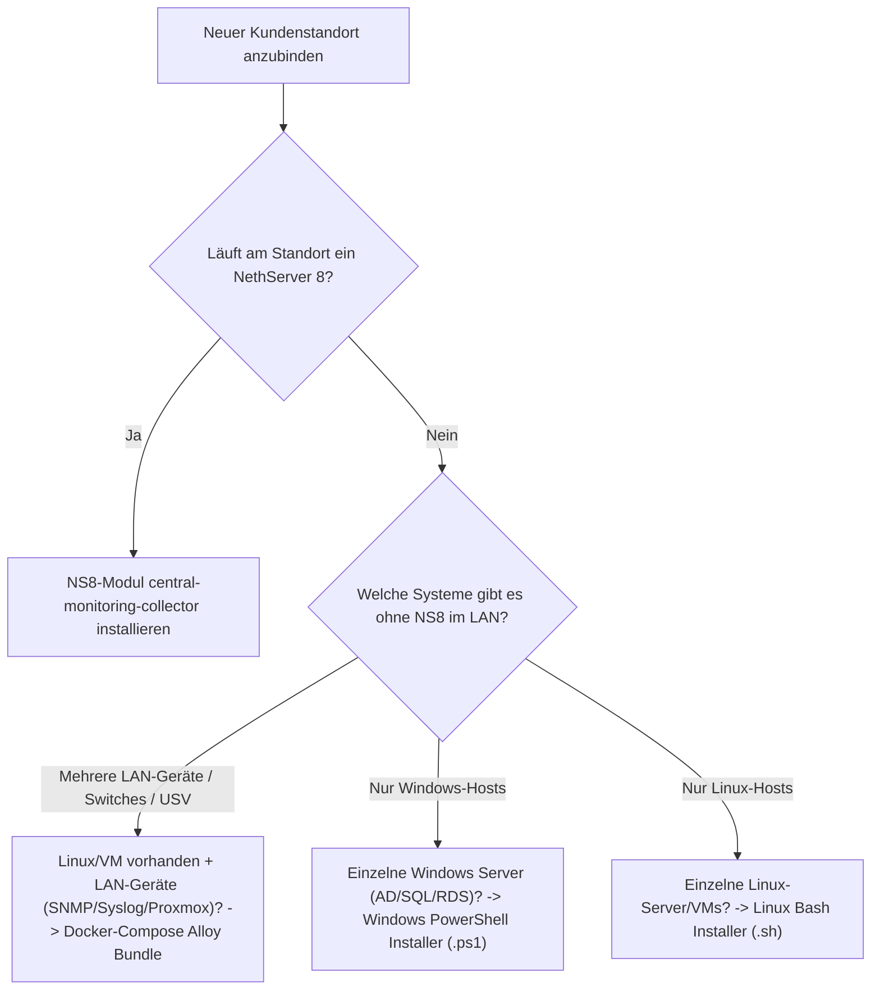

# MSP Betriebshandbuch (`docs/operations-guide.md`)

Dieses Day-2-Administrationshandbuch begleitet Systemhaus- und MSP-Techniker durch Planung, Dimensionierung, S3/Thanos-Einrichtung, LDAP/AD-Anbindung, Standort-Onboarding, SNMP-/Proxmox-Integration, Multi-Channel-Alarmierung, Wartungsfenster (Silences) sowie Backup und Disaster Recovery für den **NS8 Central Monitoring Service**.

---

## 1. Dimensionierung & Sizing (bis > 1.500 Systeme)

Der Ressourcenbedarf von `central-monitoring-hub` richtet sich primär nach der Anzahl aktiver Zeitreihen (Active Series) in Prometheus sowie dem täglichen Log-Volumen in Loki. Ein typischer Host liefert ca. 600–1.200 aktive Zeitreihen und 20–80 MiB komprimierte Logs pro Tag.

### 1.1 Empfohlene Ressourcen für `central-monitoring-hub`

| Ausbaustufe | Überwachte Systeme | Aktive Zeitreihen (ca.) | vCPU (NS8 Node) | RAM (für Hub-Pod) | Lokaler NVMe-Speicher | Empfohlener `storage_mode` |
| :--- | :--- | :--- | :--- | :--- | :--- | :--- |
| **Kompakt (Starter)** | bis 150 Systeme | ~150.000 | 4 vCPU | 8 GiB | 120 GiB NVMe | `local` (`retention_days: 30`) |
| **Mittelstand (MSP)** | 150 – 600 Systeme | ~600.000 | 8 vCPU | 16 GiB | 300 GiB NVMe | `local` oder `s3` |
| **Große MSP-Flotte** | **600 – 2.000+ Systeme** | **1,5 – 2,5 Mio.** | **12 – 16 vCPU** | **32 – 48 GiB** | **250 GiB NVMe** (Hot-Cache) + **S3/MinIO** | **`s3`** (`retention_days: 14` lokal, 180–365 Tage in S3) |

> [!IMPORTANT]
> **Swap & Dateisystem auf dem NS8-Host:** Richten Sie auf jedem NethServer-8-Knoten mindestens **4 GiB Swap** ein (wird von `NS8SwapMissing` in `ns8-cluster.yml` überwacht) und legen Sie das Podman-Speicherverzeichnis des Hub-Benutzers auf schnellen lokalen **SSD/NVMe-Speicher** (keine hochlatenten NFS-Shares für die lokale Prometheus-WAL!).

### 1.2 Ressourcen für `central-monitoring-collector` (pro Kundenstandort)

- **Kleiner bis mittlerer Kundenstandort (NS8 + 5–25 LAN-Ziele):** 1–2 vCPU, ~250–400 MiB RAM, `wal_max_disk_mb: 2048` (2 GiB lokaler Ausfallpuffer überbrückt ca. 24–48 Stunden Internetausfall).
- **Großer Kundenstandort (NS8 + Proxmox-Cluster + > 50 Switches/Server + hoher Firewall-Syslog-Durchsatz):** 2–4 vCPU, ~600–900 MiB RAM, `wal_max_disk_mb: 4096` bis `8192`.

---

## 2. S3 / MinIO & Thanos Langzeitspeicher einrichten

Ab ca. 500 Systemen oder bei mehr als 60 Tagen Aufbewahrung empfiehlt sich der Wechsel auf `storage_mode: "s3"`. Dabei speichert **Loki** Index und Chunks nativ im S3-Bucket (TSDB Schema v13), während **Thanos Sidecar** alle 2 Stunden abgeschlossene Prometheus-Blöcke nach S3 hochlädt und **Thanos Query (`:10902`)** Echtzeit- und Langzeitdaten nahtlos zusammenführt.

### 2.1 S3-Bucket & IAM-Berechtigungen (MinIO / Ceph / AWS / Wasabi / Hetzner)

1. Legen Sie einen dedizierten Bucket an, z. B. `ns8-central-monitoring-prod` (ohne öffentliche Lesezugriffe, Versionierung optional).
2. Erstellen Sie einen Service-Benutzer / Access-Key mit folgender minimaler S3-Policy:

```json
{
  "Version": "2012-10-17",
  "Statement": [
    {
      "Effect": "Allow",
      "Action": ["s3:ListBucket", "s3:GetBucketLocation"],
      "Resource": ["arn:aws:s3:::ns8-central-monitoring-prod"]
    },
    {
      "Effect": "Allow",
      "Action": ["s3:PutObject", "s3:GetObject", "s3:DeleteObject"],
      "Resource": ["arn:aws:s3:::ns8-central-monitoring-prod/*"]
    }
  ]
}
```

### 2.2 Aktivierung im Hub (Cockpit UI)

Öffnen Sie **Central Monitoring Hub -> Einstellungen (Settings)** und setzen Sie:
- **Speichermodus (`storage_mode`):** `S3 / MinIO (Thanos + Loki S3)`
- **S3-Endpunkt (`s3.endpoint`):** Host[:Port] **ohne** `https://`-Präfix, z. B. `minio.rz.msp-beispiel.de:9000` oder `fsn1.your-objectstorage.com`
- **Bucket (`s3.bucket`):** `ns8-central-monitoring-prod`
- **Region (`s3.region`):** z. B. `eu-central-1` oder `us-east-1` (Standard bei MinIO)
- **Path-Style (`s3.path_style`):** Aktiviert (`true`) für MinIO / Ceph RGW; bei AWS S3 Virtual-Hosted-Style deaktivieren (`false`)
- **Unverschlüsseltes HTTP (`s3.insecure`):** Nur aktivieren (`true`), wenn MinIO in einem isolierten internen Storage-VLAN ohne TLS betrieben wird
- **Lokale Prometheus-Retention (`retention_days`):** Im S3-Modus genügen lokal `7` bis `14` Tage als schneller Hot-Cache
- **Restic-TSDB-Backup (`backup_include_tsdb`):** Im S3-Modus **deaktiviert** (`false`) lassen!

Beim Speichern aktiviert `configure-module` automatisch `thanos-sidecar.service`, `thanos-store.service` und `thanos-query.service` und stellt `PROMQL_UPSTREAM_URL` unterbrechungsfrei auf `http://127.0.0.1:10902` um.

---

## 3. NS8 LDAP / Active Directory SSO für MSP-Techniker

Damit sich Techniker des Systemhauses mit ihrem zentralen NethServer-8-Benutzerkonto (OpenLDAP oder Samba Active Directory) in Grafana anmelden können:

1. Stellen Sie sicher, dass auf dem MSP-NS8-Cluster eine Benutzerdomäne unter **Domänen und Benutzer** eingerichtet ist.
2. Navigieren Sie zu **Central Monitoring Hub -> Einstellungen -> LDAP / Active Directory SSO**:
   - **LDAP-Anmeldung aktivieren (`ldap_enabled`):** `Ein`
   - **NS8-Benutzerdomäne (`ldap_domain`):** Gewünschte Domäne auswählen (z. B. `ad.msp-beispiel.de`)
   - **MSP-Admin-Gruppe (`ldap_admin_group`):** z. B. `Domain Admins` oder `monitoring-admins` (erhält Rolle `Admin` in Grafana **Org 1**)
   - **MSP-Techniker-Gruppe (`ldap_editor_group`):** z. B. `Techniker` oder `monitoring-ops` (erhält Rolle `Editor` in Grafana **Org 1**)

> [!NOTE]
> LDAP-Gruppen-Mappings werden in `/etc/grafana/ldap.toml` hart auf `org_id = 1` (MSP Main Org) gebunden. Wenn sich NS8-LDAP-Proxy-Ports ändern, aktualisiert der Event-Handler `events/user-domain-changed/10handler` die Konfiguration automatisch. Optionale Endkunden-Zugänge nutzen davon strikt getrennte lokale Read-Only-Viewer-Konten in ihrer jeweiligen Kunden-Organisation.

---

## 4. Onboarding von Kundenstandorten



### 4.1 Schritt 1 (immer zuerst am Hub): Mandant & Standorte anlegen

1. Im Hub unter **Mandanten (Tenants) -> Mandant hinzufügen**:
   - **Mandanten-Slug (`customer`):** Kleinbuchstaben, Ziffern und Bindestriche (`3–48` Zeichen), z. B. `autohaus-schmidt`. **Wichtig:** Der Slug ist nach Anlage unveränderlich, da er als Mandantenschlüssel in Prometheus und Loki dient.
   - **Anzeigename (`display_name`):** `Autohaus Schmidt GmbH`
   - **Standorte (`sites`):** z. B. `hq`, `filiale-sued` (Standard-Standort: `hq`)
   - **Kunden-Kontaktadressen (`contact_emails`, optional):** z. B. `it@autohaus-schmidt.de` für mandantenbezogene E-Mail-Alarme
   - **Read-Only-Kundenportal (`customer_portal_enabled`, optional):** Bei Bedarf aktivieren und Benutzernamen + starkes Passwort vergeben. Der Kunde kann sich danach direkt unter `https://monitoring.msp-beispiel.de` anmelden und sieht ausschließlich seine eigenen Systeme.
2. Kopieren Sie das nach dem Speichern **einmalig eingeblendete Bearer-Token (`cms_v1_...`)** direkt in Ihren Passwort-Tresor.

### 4.2 Variante A: Kundenstandort MIT eigenem NethServer 8

1. **Installation per 1-Klick im NS8 Software Center (`BLS-ISP/ns8-nethforge`) oder per CLI:**
   - **Software Center (empfohlen für Flotten-Updates, identisch für Hub & Collector):** Im NS8 Cluster-Admin unter **Einstellungen -> Software-Repositorys -> Repository hinzufügen** einmalig das zentrale BLS-ISP-Repository eintragen:
     - **Name:** `bls-isp`
     - **URL:** `https://raw.githubusercontent.com/BLS-ISP/ns8-nethforge/repomd/ns8/updates/`
     Danach **Central Monitoring Collector** (bzw. auf dem zentralen MSP-Cluster **Central Monitoring Hub**) direkt über das Software Center installieren.
   - **Alternativ per CLI:**
     ```bash
     add-module ghcr.io/bls-isp/central-monitoring-collector:latest 1
     ```
2. Im Kunden-Cockpit unter **Central Monitoring Collector -> Einstellungen**:
   - **Hub-URL:** `https://monitoring.msp-beispiel.de`
   - **Bearer-Token:** `cms_v1_...`
   - **Mandant (`customer`):** `autohaus-schmidt`
   - **Standort (`site`):** `hq`
   - **Lokalen NS8 überwachen (`collect_local_ns8`):** `Aktiviert`
   - **Syslog-Empfänger (`enable_syslog_receiver`):** Optional aktivieren (Standardport `5514` UDP/TCP), falls Firewalls/Switches/NAS im Kunden-LAN Logs einsenden sollen
3. Klicken Sie auf **Verbindung testen** (`test-hub-connection` prüft `/api/v1/ingest/verify` inkl. TLS-Zertifikat und Token-Zugehörigkeit) und anschließend auf **Speichern**.

> [!NOTE]
> **Zero-Root Cluster-Wide NS8-Sichtbarkeit (`bin/collect-ns8-metrics`):** Obwohl der Collector zu 100 % unprivilegiert als eigener Rootless-Benutzer läuft, erfasst `ns8-collector-textfile.timer` (im Host-Netzwerk-Namespace) automatisch **alle** auf dem Knoten laufenden Rootless-NS8-Module (`mail1`, `nextcloud1`, `samba1`, `traefik1` usw.) über den lokalen NS8-`node_exporter` (`127.0.0.1:9100` bzw. WireGuard-IP) sowie den **clusterweiten Restic-Backup-Status aller Module** lesend über das lokale NS8-Redis-Replikat (`127.0.0.1:6379`) und schreibt diese atomar nach `ns8.prom`.

### 4.3 Variante B: Kundenstandort OHNE NethServer 8 (Windows, Linux, Docker)

1. Öffnen Sie im Hub **Mandanten -> Agent-Onboarding (1-Klick-Bundle)** beim gewünschten Mandanten.
2. Wählen Sie Standort (`site`), Plattform (`windows`, `linux` oder `docker`) und eine sprechende `collector_id` (z. B. `autohaus-hq-dc01`).
3. Laden Sie die generierten Dateien herunter und führen Sie sie auf dem Zielsystem aus:
   - **Windows Server (2016/2019/2022/2025) — als Administrator in PowerShell:**
     ```powershell
     Set-ExecutionPolicy -Scope Process -ExecutionPolicy Bypass
     .\install-windows.ps1
     ```
     *Hinweis für Domain Controller / Dateiserver:* Ergänzen Sie in `C:\Program Files\GrafanaLabs\Alloy\config.alloy` im Block `prometheus.exporter.windows "local_windows"` die Collector `"ad"`, `"dns"` und `"smb"` und starten Sie den Dienst `Restart-Service Alloy` neu, um auch AD-Replikations-, DNS- und SMB-Alarme aus `windows-node.yml` zu aktivieren.
   - **Linux Server (Debian 11/12+, Ubuntu 20.04–24.04+, RHEL/Rocky/AlmaLinux 8/9+):**
     ```bash
     sudo bash install-linux.sh
     ```
   - **Docker-Host als Standort-Gateway (Linux VM / Docker Engine):**
     Legen Sie die gerenderte `config.alloy` und `docker-compose.yml` in `/opt/ns8-alloy/` ab und starten Sie:
     ```bash
     docker compose up -d
     ```
     Dieser Stack überwacht Host + Container, empfängt LAN-Syslog auf Port `5514` (UDP/TCP) und enthält vorbereitete Blöcke für LAN-SNMP und Proxmox VE.

---

## 5. Proxmox VE, SNMP v2c/v3 & Blackbox-Web-Prüfungen

### 5.1 Proxmox VE (Einzelknoten & Cluster)

Damit keine Root-Passwörter hinterlegt werden müssen, nutzt der Collector API-Tokens mit minimalen Leserechten:

1. In der **Proxmox VE Web-UI** unter **Datacenter -> Permissions -> API Tokens -> Add**:
   - **User:** `root@pam` (oder dedizierter Monitoring-Benutzer `monitoring@pve`)
   - **Token ID:** `ns8mon`
   - **Privilege Separation:** Aktiviert lassen (`☑`)
2. Unter **Datacenter -> Permissions -> Add -> API Token Permission**:
   - **Path:** `/`
   - **API Token:** `root@pam!ns8mon`
   - **Role:** `PVEAuditor`
3. Im Kunden-NS8 unter **Central Monitoring Collector -> Lokale Ziele -> Ziel hinzufügen**:
   - **Typ:** `proxmox`
   - **Adresse:** IP oder Hostname des PVE-Knotens (z. B. `192.168.10.10`, Port `8006`)
   - **Token-Name / User:** `root@pam!ns8mon` + kopiertes Token-Secret
   - Nach dem Speichern startet der Collector automatisch das interne `pve-exporter`-Sidecar (`127.0.0.1:9221`) und lädt Alloy per Hot-Reload (`/-/reload`) ohne Unterbrechung neu.

### 5.2 Netzwerk-Switches, Firewalls, USVs, NAS & Netzwerkdrucker per SNMP v2c/v3 & Syslog

Geschlossene Appliances benötigen keinen Agenten, sondern werden vom lokalen `central-monitoring-collector` (oder bei VPN-Anbindung zentral vom Hub) abgefragt:

| Geräteklasse | `device_role` | Empfohlenes SNMP-Modul | Überwachte Kernmetriken & Alarme (`snmp-network-ups.yml`) |
| :--- | :--- | :--- | :--- |
| **Managed Switches** | `snmp-network` | `if_mib` | Erreichbarkeit, Port-Status (`ifAdminStatus=1` & `ifOperStatus=2`), Paketfehler & Discards, Bandbreite (`ifHCInOctets`/`ifHCOutOctets`) |
| **Firewalls (FortiGate, MikroTik, OPNsense)** | `snmp-firewall` | `fortigate` / `mikrotik` / `if_mib` | WAN/VPN-Interfaces, 64-Bit-Durchsatz, Fehlerzähler + Firewall-Logs über Syslog (`5514`) |
| **USV-Anlagen (APC, Eaton, RFC 1628)** | `snmp-ups` | `apcupsd` / `generic` | Batteriebetrieb aktiv, Restladung < 30 %, Ausgangslast (%), Restlaufzeit, Batterietausch fällig (`replace battery`) |
| **Synology NAS** | `snmp-nas` | `synology` | RAID-/Volume-Degradierung, Festplattentemperatur, Speicherbelegung + Syslog |
| **QNAP NAS** | `snmp-nas` | `qnap` | QNAP RAID-/Volume-Status (`qnapVolumeStatus`), Festplattentemperatur (`> 55 °C` Warnung / `> 62 °C` Kritisch) + Syslog |
| **Netzwerkdrucker & MFPs (RFC 3805)** | `snmp-printer` | `printer` | Toner-/Verbrauchsmaterialstand (`< 10 %` Warnung / `< 3 %` Kritisch bei realen Kapazitätswerten `>= 0`) & kritische Gerätealarme (`prtAlertSeverityLevel == 3`) |

**Empfehlung für SNMPv3 (`authPriv`):** Bevorzugen Sie in produktiven Kunden-LANs SNMPv3 mit `security_level: "authPriv"`, Authentifizierungsprotokoll `SHA256` und Verschlüsselung `AES`. Zusätzlich tragen Sie auf Firewall, Switch und NAS als Remote-Syslog-Ziel `<IP-des-Kunden-NS8>:5514` (UDP oder TCP, RFC5424) ein (in der Collector-Firewall ggf. Port `5514` nur für das Management-VLAN freigeben).

### 5.3 Öffentliche Websites, SSL-Zertifikate, DNS & TCP (Zentraler Blackbox-Exporter)

Öffentlich erreichbare Kundendomains, Webshops, Mailserver-Ports oder VPN-Gateways legen Sie zentral im Hub unter **Ziele & Probes (Targets) -> Ziel hinzufügen** mit Typ `blackbox` an:
- `http_2xx`: Prüft HTTP/HTTPS-Erreichbarkeit, Statuscode, Antwortzeit (`> 3s` Warnung) sowie **TLS-Zertifikatsablauf** (`< 21 Tage` Warnung, `< 7 Tage` Kritisch).
- `tcp_connect`: Prüft z. B. SMTP/IMAPS/VPN-Ports (`mail.kunde.de:993`).
- `dns_tcp` / `dns_udp`: Prüft autoritative DNS-Auflösung.

---

## 6. Multi-Channel-Alerting & Kunden-Benachrichtigungen

Unter **Central Monitoring Hub -> Alarmierung (Alerting)** konfigurieren Sie die Zustellwege:

1. **E-Mail (NS8-Smarthost oder eigener SMTP):**
   - Mit aktiviertem Schalter `use_ns8_smarthost: true` übernimmt das Modul automatisch die zentralen Mail-Relay-Einstellungen des NS8-Clusters (`discover-smarthost` + automatischer Reload bei Smarthost-Änderungen).
2. **Ticketsystem / PSA-Webhook (`webhook_psa`):**
   - Übergibt strukturierte Alertmanager-v4-JSON-Ereignisse (`firing` & `resolved` inkl. `customer`, `site`, `device_role`, `severity`, `summary`) per HTTPS `POST` und `Authorization: Bearer <secret>` an Ihr PSA-/Ticketsystem (z. B. TANSS, Autotask, Zammad, HaloPSA, n8n-Dispatcher).
3. **Team-Chat (`MS Teams` & `Slack`):**
   - Direkte Zustellung über Incoming-Webhook-URLs in den Bereitschafts- oder Operations-Kanal.
4. **Mobile Push-Alarmierung (`Ntfy`, `Gotify`, `Telegram`):**
   - Über `min_severity: "critical"` steuern Sie, dass nachts nur kritische Ausfälle (z. B. Host/Cluster offline, USV auf Batterie, Storage > 95 %, Quorum-Verlust) auf Bereitschafts-Smartphones gepusht werden, während `warning`-Meldungen als Ticket/E-Mail einlaufen.
5. **Mandantenbezogenes Kunden-E-Mail-Routing (`customer_email_routing`):**
   - Wenn aktiviert, sendet Alertmanager Alarme für Mandanten mit gepflegten `contact_emails` automatisch zusätzlich an die hinterlegten IT-Ansprechpartner des jeweiligen Kunden (empfohlene Einstellung: `min_severity: "critical"`).

Nutzen Sie nach jeder Änderung die Schaltfläche **Test-Alarm senden** (`test-alert`), um die gesamte Zustellkette Ende-zu-Ende zu prüfen.

---

## 7. Geplante Wartungsfenster (Silences) für Patchdays

Um bei geplanten Wartungen (z. B. monatlicher Microsoft Patch Tuesday, Proxmox-Kernel-Upgrade oder nächtlicher Router-Neustart) Fehlalarme und unnötige Bereitschafts-Pushes zu vermeiden, erstellen Sie unter **Alarmierung -> Wartungsfenster (Silences)** eine geplante Stummschaltung:

| Wartungsszenario | `customer` | `site` | `device_role` | `extra_matchers` (optional) | Wirkung |
| :--- | :--- | :--- | :--- | :--- | :--- |
| **Wartung eines einzelnen Kundenstandorts** | `autohaus-schmidt` | `hq` | *(leer = alle)* | — | Unterdrückt alle Alarme für Standort `hq` dieses Kunden im gewählten Zeitfenster |
| **Globaler Windows-Patchday über alle Kunden** | `*` | *(leer)* | `windows` | — | Unterdrückt während des Wartungsfensters Alarme aller `windows`-Systeme mandantenübergreifend |
| **Geplanter Neustart eines einzelnen Hypervisors** | `muster-gmbh` | `rz1` | `proxmox` | `instance="pve-02.lan"` | Unterdrückt nur Alarme für genau diesen Proxmox-Knoten |

Alle aktiven und zukünftigen Silences werden zusätzlich in `state/silences.json` gesichert, sodass sie auch Container-Neustarts und Restic-Restores überstehen.

---

## 8. Token-Rotation, Backup, Restore & Troubleshooting

### 8.1 Unterbrechungsfreie Token-Rotation (`rotate-token`)
Beim Personalwechsel oder gemäß Sicherheitsrichtlinie rotieren Sie ein Mandanten-Token unter **Mandanten -> Token rotieren** mit einer Übergangsfrist (`grace_period_minutes`, z. B. `1440` für 24 Stunden):
1. Neues Token kopieren und in den Collectoren / Alloy-Agenten des Kunden hinterlegen.
2. Während der Grace-Period akzeptiert `hub-gateway` sowohl das alte als auch das neue Token.
3. Nach Ablauf der Frist (oder sofort bei `grace_period_minutes: 0` im Kompromittierungsfall) wird das alte Token automatisch mit `401 UNAUTHORIZED` abgewiesen.

### 8.2 Backup & Disaster Recovery (`restore-module`)
- **Tägliches Backup:** Aktivieren Sie im NS8 Cluster-Admin unter **Backup** die Sicherung für `central-monitoring-hub1` (und auf Kundenclustern für `central-monitoring-collector1`).
- **Wiederherstellung nach Hub-Totalausfall:**
  1. Auf einem frischen oder bestehenden NS8-Cluster im Cluster-Admin **Backup -> Wiederherstellen -> `central-monitoring-hub`** auswählen.
  2. `restore-module` spielt Umgebungsvariablen, alle Mandanten-Tokens (`tenants.json`), Scrape-Ziele, Alarmkanäle, Silences sowie den konsistenten SQLite-Stand von `grafana.db` zurück und registriert die Traefik-Route neu.
  3. Im `s3`-Modus bindet Thanos Store sofort wieder den bestehenden S3-Bucket ein — sämtliche historischen Metriken und Loki-Logs sind unmittelbar wieder abfragbar.
  4. Sobald der DNS-Eintrag des Hub-FQDNs auf den wiederhergestellten Knoten zeigt, leeren alle draußen laufenden `central-monitoring-collector`- und Standalone-Alloy-Instanzen automatisch ihren lokalen **Write-Ahead-Log (WAL)** und liefern sämtliche während des Ausfalls aufgelaufenen Metriken und Logs lückenlos nach!

### 8.3 Kurz-Troubleshooting im Alltag

| Symptom | Ursache prüfen | Lösung |
| :--- | :--- | :--- |
| Collector meldet `401 UNAUTHORIZED` beim Verbindungstest | Token falsch kopiert, abgelaufen oder Mandant gelöscht | Unter **Hub -> Mandanten** Token-Präfix (`cms_v1_xxxx`) abgleichen oder per **Token rotieren** neu ausstellen |
| Collector meldet `422 VALIDATION_ERROR` | `site`-Name im Collector ist beim Mandanten am Hub nicht hinterlegt oder `customer`-Format ungültig | Unter **Hub -> Mandanten -> Bearbeiten** den Standort zur `sites`-Liste des Mandanten hinzufügen |
| Windows AD/DNS-Alarme feuern nicht trotz DC-Ausfall | Standard-Windows-Template sammelt nur Basis-Collectoren | In `config.alloy` auf dem DC `"ad"`, `"dns"`, `"smb"` zu `enabled_collectors` hinzufügen & Dienst `Alloy` neu starten |
| Keine Syslog-Einträge von Firewall in Loki sichtbar | Syslog-Empfänger im Collector deaktiviert oder NS8-Host-Firewall blockiert Port `5514` | Im Collector `enable_syslog_receiver: true` aktivieren und LAN-Firewall-Regel auf UDP/TCP `5514` prüfen |

### 8.4 Eigener Software-Center-Katalog (GitHub Pages) & Live-VM-Abnahmetests (Robot Framework)

- **Eigenes NS8 Software-Center-Repository bereitstellen:**
  Beim Push eines Release-Tags (`v*`) oder auf `main` generiert `.github/workflows/publish-repomd.yml` über `scripts/generate-repomd.py` vollautomatisch ein NethServer-8-kompatibles Software-Repository (`repodata.json`, `repomd.json` und App-Icons) auf **GitHub Pages**. MSPs, die einen eigenen Fork unter `ghcr.io/<msp-org>` betreiben, binden einfach `https://<msp-org>.github.io/<repo>/` unter **Einstellungen -> Software-Repositorys** in ihren NS8-Clustern ein.
- **Automatisierte End-to-End-Abnahme gegen eine echte NS8-Test-VM:**
  Vor dem Rollout neuer Modulversionen können beide Module analog zum offiziellen NethServer-8-QA-Prozess per Robot Framework über SSH/`api-cli` gegen einen dedizierten NS8-Testknoten geprüft werden:
  ```bash
  bash hub/test-module.sh <ns8-test-leader-ip>
  bash collector/test-module.sh <ns8-test-leader-ip>
  ```
