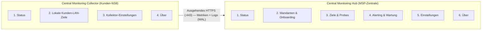

# Benutzerhandbuch für MSP-Administratoren & Support-Techniker (`docs/user-guide.md`)

Dieses Handbuch führt Systemhaus-Administratoren, NOC-Techniker und First-/Second-Level-Support-Mitarbeiter Schritt für Schritt durch alle Ansichten und Arbeitsabläufe des **Central Monitoring Hub** (`central-monitoring-hub`) und des **Central Monitoring Collector** (`central-monitoring-collector`) in NethServer 8 (`v1.1.0`).

> [!TIP]
> **Weiterführende Dokumente:**
> - Für Dimensionierung (> 1.500 Systeme), S3-/MinIO-Policies, SNMPv3-Best-Practices und Disaster Recovery siehe das **[MSP Betriebshandbuch (`docs/operations-guide.md`)](operations-guide.md)**.
> - Für die Weitergabe an Endkunden mit eigenem Portal-Zugang steht das **[Handbuch für Endkunden im Monitoring-Portal (`docs/customer-portal-guide.md`)](customer-portal-guide.md)** bereit.
> - Eine vollständige Referenz aller 6 NOC-Dashboards, Metriken und 81 Alarmregeln finden Sie im **[Dashboard-, Metrik- & Alarmregel-Referenzhandbuch (`docs/dashboards-and-alerts.md`)](dashboards-and-alerts.md)**.

---

## 1. Übersicht der Navigation in NethServer 8 Cockpit

Nach der Installation öffnen Sie die Module im **NethServer 8 Cluster-Admin** unter **Anwendungen (Applications)**:

---

## 2. Central Monitoring Hub — Seite für Seite

### 2.1 Seite „Status“

Die Startseite liefert auf einen Blick den Betriebszustand der gesamten Monitoring-Plattform sowie Schnellzugriffe für das Tagesgeschäft:

1. **Schnellstart-Schaltflächen (oben rechts):**
   - **`Grafana öffnen`:** Öffnet das zentrale Grafana-Portal explizit in der MSP-Hauptorganisation (`https://<hub-fqdn>/?orgId=1`), sodass Sie nach einem Ausflug in eine Kunden-Ansicht sofort wieder alle Mandanten sehen.
   - **`NS8-Pods`:** Springt direkt in das NOC-Dashboard **`NethServer 8 Pods, Module & Container`** (`/d/ns8-pods-and-modules?orgId=1`) zur Live-Analyse von Rootless-/Rootful-Pod-CPU, RAM, Disk-I/O und OOM-Kills.
   - **`Log-Explorer`:** Öffnet direkt den **`Zentralen Log- & Security-Explorer`** (`/d/central-log-explorer?orgId=1`) für mandantenübergreifende Volltext- und Security-Event-Recherchen.
2. **Zentrale Monitoring-Kennzahlen (KPI-Kacheln):**
   - **Aktive Zeitreihen & Speichermodus:** Zeigt die aktuelle Anzahl aktiver Prometheus-Serien sowie das aktive Backend (`Lokale Volumes` vs. `S3 + Thanos`).
   - **Kundenmandanten:** Anzahl angelegter Mandanten und wie viele davon ein aktives Kundenportal besitzen.
   - **Zentrale Pull- / Probe-Ziele:** Anzahl der direkt vom Hub geprüften Websites, Zertifikate, SNMP- und Exporter-Ziele.
   - **Aktive Alarme & Wartungsfenster:** Aufschlüsselung feuernder Alarme (`kritisch` / `Warnung`) sowie laufender Alertmanager-Silences.
3. **Speicherbelegung & HTTPS-Ingest-Endpunkte:**
   - Lokale Datenträgerauslastung für Prometheus-TSDB, Loki-Speicher und Grafana-Datenbank.
   - Kopierbare HTTPS-Endpunkte für **Grafana-Portal**, **Prometheus Remote-Write** (`/api/v1/write`) und **Loki Push-Ingest** (`/loki/api/v1/push`).
4. **Zustand der Hub-Pod-Komponenten:**
   - Echtzeit-Gesundheitsstatus aller Container in `central-monitoring-hub-pod` (`hub-gateway`, `prometheus`, `loki`, `grafana`, `alertmanager`, `prom-label-proxy`, `blackbox-exporter`, `snmp-exporter` sowie im S3-Modus `thanos-sidecar`, `thanos-store` und `thanos-query`).

---

### 2.2 Seite „Einstellungen“

Hier richten Sie Erreichbarkeit, Langzeitspeicher, die integrierte Hub-Selbstüberwachung, das Active-Directory-/LDAP-Single-Sign-On sowie das Restic-Backup-Verhalten ein:

1. **Traefik-HTTPS-Ingress & Domain:**
   - **Hub-FQDN (`host`):** Öffentlicher DNS-Name des Hubs, z. B. `monitoring.msp-beispiel.de`.
   - **Let's-Encrypt-ACME-Zertifikat (`lets_encrypt`)** und **HTTP -> HTTPS Weiterleitung (`http2https`)**: Für produktive Umgebungen beide Optionen aktivieren, da alle Außenstandort-Collectoren TLS-Zertifikate strikt validieren.
2. **Aufbewahrung & Speicherarchitektur (`local` vs. `s3`):**
   - **Lokale Podman-Volumes (`local`):** Kompakte Einzelknoten-Speicherung ohne externen Objektspeicher; steuerbar über `retention_days` (z. B. `30` Tage), `retention_size_gb` (z. B. `50` GiB) und `loki_retention_days`.
   - **S3- / MinIO-Objektspeicher + Thanos Query (`s3`):** Empfohlen ab ca. 500 Systemen oder > 60 Tagen Historie. Hinterlegen Sie `s3.endpoint` (ohne `https://`), `s3.bucket`, `s3.region`, Access-/Secret-Key sowie `s3.path_style` (`true` für MinIO/Ceph).
3. **Lokale NS8-Knoten- & Pod-Überwachung (`monitor_local_ns8_node`):**
   - Standardmäßig **aktiviert (`Ein`)**: Der Hub überwacht seinen eigenen NethServer-8-Host inklusive aller dort laufenden Rootless- und Rootful-Module (cgroups-v2 CPU, Working-Set-RAM, Swap, Disk-I/O, PIDs, OOM-Kills und Restic-Backups) völlig ohne separaten Collector über den internen Loopback-Endpunkt `127.0.0.1:9097/metrics/ns8-node`.
   - **Mandanten-Zuordnung (`local_node_customer`) & Standort (`local_node_site`):**
     - Standardwert `_msp_internal` (Standort `hub`): Hält die Eigenüberwachung des MSP-Rechenzentrums sauber getrennt von Endkunden-Mandanten; sichtbar für alle MSP-Techniker in `Org 1`.
     - Alternativ können Sie einen regulären Mandanten-Slug (z. B. `bls-isp`, Standort `rz1`) eintragen, wenn der Hub-Cluster unter Ihrem eigenen internen Mandanten geführt werden soll.
4. **MSP-Techniker-SSO mit Live AD/LDAP Gruppen- & Benutzer-Mehrfachauswahl:**
   - Aktivieren Sie **LDAP-Anmeldung (`ldap_enabled`)** und wählen Sie Ihre **NS8-Benutzerdomäne (`ldap_domain`)** (Samba Active Directory oder OpenLDAP).
   - Klicken Sie auf **Gruppen & Benutzer aus AD/LDAP laden** (`discover-ldap-groups`): Der Hub fragt den NS8-`Ldapproxy` live per RFC 4511 LDAPv3 ab (inkl. Paging über große Verzeichnisse; Computerkonten `$` und `krbtgt` werden automatisch ausgeblendet).
   - Nutzen Sie den **Auswahlfilter (`Alle` / `Nur Gruppen` / `Nur Benutzer`)** und wählen Sie über die Mehrfachauswahl (`NsMultiSelect`) beliebig viele AD-/LDAP-Gruppen **und/oder einzelne Benutzerkonten** pro Grafana-Rolle aus:
     - **MSP-Admins (`ldap_admin_principals`):** Voller `Admin`-Zugriff (`grafana_admin = true` in `Org 1` sowie `Admin` in allen aktiven Kundenportalen), z. B. Gruppe `Domain Admins` plus Einzelkonto `Genera`.
     - **MSP-Techniker (`ldap_editor_principals`):** Rolle `Editor` in `Org 1` und automatisch Read-Only-`Viewer` in aktiven Kundenportalen.
     - **MSP-Read-Only (`ldap_viewer_principals`):** Rolle `Viewer` (reiner Lesezugriff, ideal für Service-Desk/Disposition) in `Org 1` und aktiven Kundenportalen.
   - **Schnelltest (`Benutzer testen` / `test-ldap-user`):** Wählen Sie vor dem Speichern einen gefundenen Domänenbenutzer per Schnellauswahl aus (oder tippen Sie den Anmeldenamen ein) und klicken Sie auf **Benutzer testen**. Die UI zeigt sofort den gefundenen `DN`, alle direkten und verschachtelten AD-Gruppen (`1.2.840.113556.1.4.1941`) sowie die resultierende Grafana-Rolle (`Admin`, `Editor`, `Viewer` oder `None`).
5. **NS8-Restic-Backup:**
   - Steuert über `backup_include_tsdb`, ob neben Mandanten, Tokens, Kunden-Accounts, Zielen, Alarmregeln, Silences und dem Online-SQLite-Backup von `grafana.db` auch die großen Rohdaten-Volumes (`prometheus-data`, `loki-data`) gesichert werden sollen (im S3-Modus stets deaktiviert lassen).

---

### 2.3 Seite „Mandanten & Onboarding“

Diese Ansicht ist die tägliche Schaltzentrale für Kundenanlage, Kundenportal-Accounts, 1-Klick-Support-Ansichten, Agent-Rollouts und Token-Rotation:

#### A. Mandant & Standorte anlegen (`Mandant anlegen`)
1. Klicken Sie auf **`Mandant anlegen`** und vergeben Sie:
   - **Kunden-Slug (`customer`):** Unveränderlicher technischer Schlüssel (`3–48` Kleinbuchstaben, Ziffern, Bindestriche, z. B. `autohaus-schmidt`).
   - **Anzeigename (`display_name`):** Klartextname für Tabellen und Kunden-Org (z. B. `Autohaus Schmidt GmbH`).
   - **Kundenstandorte (`sites`):** Kommagetrennte Standort-Kürzel, z. B. `hq, filiale-sued, lager` (erster Eintrag bzw. `default_site` dient als Standard).
   - **Kunden-Kontaktadressen (`contact_emails`, optional):** Kommagetrennte E-Mail-Adressen des Kunden, falls kritische Alarme zusätzlich direkt an die Kunden-IT geroutet werden sollen.
2. Nach dem Speichern erscheint ein **einmaliges Banner mit dem Bearer-Token (`cms_v1_...`)**. Kopieren Sie es über **`Bearer-Token kopieren`** sofort in Ihre Passwortverwaltung — auf dem Hub verbleibt aus Sicherheitsgründen ausschließlich der SHA-256-Hash.

#### B. Kunden-Zugänge verwalten (Multi-User-Kundenportal)
Klicken Sie in der Zeile eines Mandanten auf **`Kunden-Zugänge`**:
1. **Inline-Portal-Aktivierung:** Ist das Kundenportal für diesen Mandanten noch deaktiviert, können Sie es direkt oben im Dialog per 1-Klick aktivieren, ohne vorher das Mandanten-Formular öffnen zu müssen. Dabei wird sofort die isolierte Grafana-Organisation des Kunden inklusive gesperrter Proxy-Datasources und aller 6 NOC-Dashboards provisioniert.
2. **Mehrere Kundenbenutzer anlegen (`Viewer` & `Editor`):**
   - Vergeben Sie `Benutzername`, `Anzeigename`, optional `E-Mail` sowie die Rolle:
     - **`Viewer` (Standard, empfohlen):** Reiner Lesezugriff auf alle Dashboards, Metriken und Logs des eigenen Unternehmens.
     - **`Editor`:** Darf innerhalb der isolierten Kunden-Organisation eigene Dashboards/Panels anpassen, während Datenquellen, Provisioning und Grafana-Alerting serverseitig durch `hub-gateway` hart gesperrt bleiben.
   - **Passwort-Generator / Reset:** Erzeugen Sie mit einem Klick ein kryptografisch starkes Passwort oder setzen Sie ein vergessenes Passwort zurück (`password_unchanged: false`).
   - **1-Klick Zugangsdaten kopieren:** Kopiert Login-URL (`https://<hub-fqdn>/login`), Benutzername und Passwort formatiert in die Zwischenablage zur sicheren Übergabe an den Kunden.
   - **Kontosperre (`disabled`):** Einzelne Kunden-Accounts lassen sich jederzeit vorübergehend sperren und wieder freigeben oder endgültig löschen.

#### C. 1-Klick MSP-Support-Simulation („Kunden-Ansicht“ vs. „MSP-Filteransicht“)
Wenn ein Kunde anruft, sehen Support-Techniker mit einem einzigen Klick in der Mandantenzeile exakt dessen Daten:
- **Bei aktiviertem Kundenportal -> Schaltfläche `Kunden-Ansicht` (`/?orgId=<id>`):**
  Öffnet Grafana in einem neuen Tab direkt innerhalb der echten Grafana-Organisation des Kunden (`?orgId=<grafana_org_id>`) auf dem Start-Dashboard **`NS8 & MSP Gesamtübersicht`**. Dank automatischer einseitiger MSP-Synchronisation erhalten MSP-Admins dort `Admin`-Rechte, während MSP-Techniker/Support (`Editor`/`Viewer`) automatisch als Read-Only-`Viewer` eingestuft werden — versehentliche Änderungen am Kunden-Dashboard sind damit ausgeschlossen.
- **Bei deaktiviertem Kundenportal -> Schaltfläche `MSP-Filteransicht`:**
  Öffnet direkt `/d/ns8-multi-cluster-overview?orgId=1&var-customer=<slug>` vorgefiltert auf diesen Kunden innerhalb der MSP-Hauptorganisation.
- **Rückkehr in die Gesamtflotte:** Klicken Sie im Hub-Status-Tab einfach auf **`Grafana öffnen`** (`/?orgId=1`) oder wechseln Sie oben links in Grafana die Organisation auf `Main Org.`.

#### D. Alloy-Onboarding-Generator (Windows, Linux & Docker Compose)
Für Kundenstandorte **ohne eigenen NethServer 8** klicken Sie beim Mandanten auf **`Alloy-Onboarding`**:
1. Wählen Sie den **Standort (`site`)**, die **Plattform (`windows`, `linux` oder `docker`)** und optional eine sprechende **`collector_id`** (z. B. `autohaus-hq-dc01`).
2. Laden Sie das fertig konfigurierte Skript bzw. Archiv herunter:
   - **Windows (`install-windows.ps1` + `config.alloy`):**
     - Installiert Grafana Alloy als permanenten **Windows-Hintergrunddienst (`Alloy`, Starttyp `Automatic`)** ohne sichtbares Konsolenfenster oder Tray-Icon.
     - **Manipulations- & Geheimnisschutz für Standardbenutzer (Terminalserver / Workstations):** Vor dem Schreiben des Bearer-Tokens sperrt `Set-StrictAdminAcl` die NTFS-Berechtigungen auf `C:\Program Files\GrafanaLabs\Alloy\config.alloy` und `C:\ProgramData\GrafanaLabs\Alloy\data` exklusiv auf `NT AUTHORITY\SYSTEM` (`S-1-5-18`) und lokale `Administratoren` (`S-1-5-32-544`) bei deaktivierter Vererbung. Normale Domänen-/RDS-Benutzer können weder das Token auslesen noch den Windows-Dienst beenden oder deinstallieren.
     - **Selbstheilung & Softwareverteilung (GPO / Intune / NS8 SoftwareManager):** Das Skript prüft vor der Installation die digitale Authenticode-Signatur der MSI/EXE, ist vollständig idempotent und konfiguriert über `sc.exe failure "Alloy"` einen automatischen Neustart nach `5s / 15s / 30s`. Damit eignet es sich direkt für unbeaufsichtigte Computer-Startskripte per **Active Directory GPO**, **Microsoft Intune** oder den **BLS-ISP NS8 SoftwareManager** (Ausführung als `SYSTEM`).
   - **Linux (`install-linux.sh`):** Richtet Grafana Alloy als gehärteten `systemd`-Dienst inkl. lokalem Journald- und Host-Metrik-Export (`chmod 0640` auf `/etc/alloy/config.alloy`) auf Debian, Ubuntu, RHEL, Rocky Linux und AlmaLinux ein.
   - **Docker Compose (`docker-compose.yml` + `config.alloy`):** Startet einen kompletten Standort-Collector-Container inkl. Host-/Container-Überwachung, LAN-Syslog-Empfänger (`5514`) und vorbereiteten Blöcken für SNMP/Proxmox.

#### E. Unterbrechungsfreie Token-Rotation (`Token rotieren`)
Über **`Token rotieren`** erzeugen Sie ein neues Bearer-Token mit frei wählbarer **Übergangsfrist (`grace_period_minutes`, z. B. `1440` = 24 Stunden)**: Während dieser Frist akzeptiert `hub-gateway` parallel sowohl das alte als auch das neue Token (`Übergangsfrist nach Rotation aktiv`), sodass Sie Außenstandorte ohne eine einzige Sekunde Datenverlust umstellen können. Bei Verdacht auf Kompromittierung setzen Sie `grace_period_minutes: 0` für die sofortige Sperrung des Alt-Tokens.

---

### 2.4 Seite „Ziele & Probes“

Hier verwalten Sie alle Systeme, die **zentral vom Hub aus** aktiv geprüft oder abgefragt werden (ohne Collector vor Ort):

1. **`blackbox` (Websites, HTTPS, SSL-Zertifikate, DNS & TCP-Ports):**
   - Module: `http_2xx` (prüft HTTP-Status 2xx, Antwortzeit und TLS-Zertifikatsablauf), `http_2xx_insecure` (selbstsignierte Zertifikate), `http_post_2xx`, `tcp_connect` (z. B. `mail.kunde.de:993`), `dns_tcp` / `dns_udp` und `icmp`.
2. **`snmp` (Per VPN / Management-Netz direkt erreichbare Netzwerkgeräte):**
   - Unterstützt SNMP `v2c` und `v3` (`noAuthNoPriv`, `authNoPriv`, `authPriv` mit `SHA`/`SHA224`/`SHA256`/`SHA384`/`SHA512` und `AES`/`AES192`/`AES256`) sowie die Profile `if_mib`, `apcupsd`, `synology`, `qnap`, `fortigate`, `mikrotik`, `printer` (RFC 3805) und `generic`.
3. **`exporter` & `federation`:**
   - Direkte HTTP/HTTPS-Abfrage externer Prometheus-Exporter (mit optionalem Basic-Auth oder Bearer-Token) bzw. selektive `/federate`-Übernahme bestehender Prometheus-Instanzen.

Alle Änderungen werden atomar als `file_sd`-Dateien geschrieben und ohne Neustart von Prometheus übernommen. Interne Loopback-, Link-Local- und Pod-Adressen werden durch den integrierten SSRF-Schutz automatisch abgewiesen.

---

### 2.5 Seite „Alerting & Wartung“

Die Seite gliedert sich in zwei Registerkarten sowie die Schaltfläche **`Test-Alarm senden`** oben rechts:

#### Registerkarte 1: „Benachrichtigungskanäle & Regelpakete“
- **Gruppierung & Wiederholungsintervalle:** Steuert `group_wait` (z. B. `30s`), `group_interval` (`5m`) und `repeat_interval` (`4h`) — gebündelt nach `customer`, `site` und `alertname`, damit bei einem Standortausfall kein Ticket-Sturm entsteht.
- **E-Mail (`NS8-Smarthost` oder eigener SMTP):** Übernimmt bei aktiviertem Schalter `NS8-Cluster-Smarthost-Relay verwenden` automatisch das zentrale Mail-Relay des NS8-Clusters.
- **PSA- / Ticketsystem-Webhook:** Sendet strukturierte Alertmanager-v4-JSON-Payloads (inkl. `firing` und `resolved`, `customer`, `site`, `device_role`, `severity`, `summary`) mit optionalem `Authorization: Bearer <secret>` an TANSS, Autotask, Zammad, HaloPSA oder n8n.
- **Team-Chat (`Microsoft Teams` & `Slack`):** Echtzeit-Benachrichtigungen per Incoming-Webhook.
- **Mobile Rufbereitschafts-Push (`Ntfy`, `Gotify`, `Telegram`):** Über `min_severity: "critical"` stellen Sie sicher, dass nachts nur echte Kritikalitäten auf Bereitschafts-Smartphones gepusht werden.
- **Mandantenbezogenes Kunden-E-Mail-Routing:** Leitet Alarme ab gewähltem Schweregrad automatisch zusätzlich an die beim jeweiligen Mandanten hinterlegten `contact_emails` weiter.
- **Standard-Regelpakete & Eigene Regeln:** Einzelnes Zu-/Abschalten der 6 mitgelieferten Regelpakete (81 Regeln gesamt) sowie Pflege eigener YAML-Alarmregeln, die vor der Aktivierung automatisch syntaxgeprüft werden.
- **`Test-Alarm senden`:** Feuert einen synthetischen Prüf-Alarm durch Alertmanager über alle aktivierten Kanäle, um die Zustellkette Ende-zu-Ende zu verifizieren.

#### Registerkarte 2: „Wartungsfenster (Silences)“
- Planen Sie Wartungsfenster gezielt für einen einzelnen Host (`instance`), einen Kundenstandort (`customer` + `site`) oder **mandantenübergreifend** für einen ganzen Gerätetyp (z. B. `customer="*"` + `device_role="windows"` am monatlichen Microsoft Patch Tuesday). Alle Silences werden zusätzlich Restic-fest in `state/silences.json` persistiert.

---

## 3. Central Monitoring Collector — Seite für Seite

Der `central-monitoring-collector` läuft unprivilegiert direkt auf dem NethServer-8-Cluster Ihres Kunden und benötigt keinerlei eingehende Firewall-Freigaben aus dem Internet.

### 3.1 Seite „Status“
- Zeigt den **Hub-Verbindungsstatus** (Ziel-URL, Mandanten-Slug, Standort, eindeutige `collector_id`), die Auslastung des lokalen **Offline-WAL-Puffers**, den Zustand von `alloy.service` und `pve-exporter.service` sowie die Anzahl erfasster lokaler NS8-Module und LAN-Ziele.

### 3.2 Seite „Kollektor-Einstellungen“
1. Tragen Sie **Hub-URL** (`https://monitoring.msp-beispiel.de`), das vom Hub kopierte **Bearer-Token (`cms_v1_...`)**, **Mandant (`customer`)** und **Standort (`site`)** ein.
2. **Lokalen NS8 überwachen (`collect_local_ns8`):** Aktiviert lassen — erfasst alle auf dem Knoten laufenden Rootless- und Rootful-NS8-Module per Linux `cgroups v2` (`ns8_module_*`, `ns8_pod_unit_*`), Host-Metriken (`:9100`), Restic-Backup-Status aus Redis sowie Systemd-Journal-Logs.
3. **Syslog-Empfänger (`enable_syslog_receiver`):** Optional aktivieren (Standardport `5514` UDP/TCP; `node:fwadm` öffnet den Port kontrolliert in der lokalen Firewall), damit Firewalls, Managed Switches und NAS-Systeme im Kunden-LAN ihre RFC5424/RFC3164-Logs an den Collector senden können.
4. **WAL-Puffergröße (`wal_max_disk_mb`):** Begrenzt den lokalen Ausfallpuffer auf Disk (Standard `2048` MiB = ca. 24–48 Stunden Internetausfall ohne Datenverlust).
5. Klicken Sie vor dem Speichern auf **`Hub-Verbindung testen`** (`test-hub-connection`), um DNS, TLS-Zertifikatskette und Token-Gültigkeit live gegen `/api/v1/ingest/verify` zu prüfen.

### 3.3 Seite „Lokale Kunden-LAN-Ziele (Scrape Targets)“
Hier fügen Sie Server, Hypervisoren und Netzwerkgeräte im internen Kunden-LAN hinzu, die der Collector lokal abfragt und verschlüsselt an den Hub weiterleitet:
- **`proxmox`:** Abfrage von Proxmox-VE-Einzelknoten oder -Clustern per `PVEAuditor`-API-Token (`root@pam!ns8mon` + Secret, Port `8006`). Ab dem ersten Proxmox-Ziel startet der Collector automatisch das lokale `pve-exporter`-Sidecar (`127.0.0.1:9221`).
- **`windows` / `linux`:** Lokale Abfrage vorhandener `windows_exporter` (`:9182`) oder `node_exporter` (`:9100`) im LAN.
- **`snmp` (`v2c` & `v3`):** Überwachung geschlossener Appliances über die Profile `if_mib` (Switches), `fortigate` / `mikrotik` (Firewalls), `apcupsd` (USV), `synology` / `qnap` (NAS), `printer` (Netzwerkdrucker gemäß Printer-MIB RFC 3805 inkl. Tonerfüllstand) und `generic`.
- **`custom-exporter`:** Beliebige HTTP/HTTPS-Prometheus-Endpunkte im Kunden-LAN.

Jede Zieländerung aktualisiert die Verzeichnismount-Konfiguration und lädt Grafana Alloy unterbrechungsfrei per Hot-Reload (`/-/reload`) neu.

---

## 4. Mehrsprachigkeit (`Deutsch` & `Englisch`)

Sowohl die NethServer-8-Cockpit-Oberflächen als auch Grafana unterstützen gemischtsprachige Teams vollständig:
1. **NS8 Cluster-Admin (Hub & Collector UI):** Beide Oberflächen sind zu 100 % zweisprachig (`Deutsch` und `Englisch` mit vollständiger Übersetzungsparität). Die Sprache richtet sich automatisch nach der gewählten Anzeigesprache in Ihren **NS8 Cluster-Admin Benutzereinstellungen**.
2. **Grafana-Portal (`https://<hub-fqdn>`):** Jeder angemeldete MSP-Techniker und jeder Kundenbenutzer kann oben rechts über sein **Profilbild -> Profile -> Preferences -> Language** individuell zwischen **Deutsch (`Deutsch`)** und **Englisch (`English`)** sowie seiner bevorzugten Zeitzone wählen, ohne die Einstellung anderer Benutzer zu beeinflussen. Die 6 mitgelieferten Enterprise-NOC-Dashboards sind für den deutschsprachigen Systemhaus- und Kundenbetrieb optimiert betitelt.
