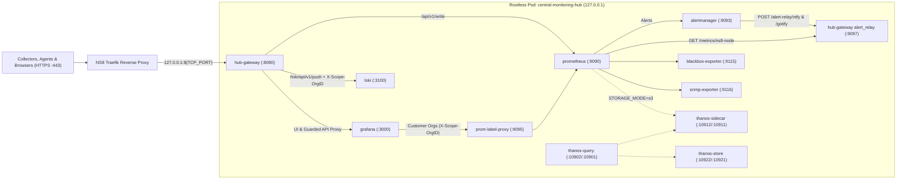

# Central Monitoring Hub (`central-monitoring-hub`)

Developer and operator reference for the **Central Monitoring Hub** NethServer 8 rootless application module (`v1.1.0`).

Central Monitoring Hub provides a turnkey, multi-tenant MSP observability, logging, alerting, and customer portal platform running inside a single rootless Podman pod on NethServer 8 (`min-core >= 3.0.0`, Rocky Linux 9 and Debian 12).

- **Monorepo Overview:** [`../README.md`](../README.md)
- **Site Collector Module Reference:** [`../collector/README.md`](../collector/README.md)
- **MSP User Manual (DE):** [`../docs/user-guide.md`](../docs/user-guide.md)
- **End-Customer Portal Guide (DE):** [`../docs/customer-portal-guide.md`](../docs/customer-portal-guide.md)
- **Dashboards, Metrics & 81 Alert Rules Catalog (DE):** [`../docs/dashboards-and-alerts.md`](../docs/dashboards-and-alerts.md)
- **Operations & Runbook Guide (DE):** [`../docs/operations-guide.md`](../docs/operations-guide.md)
- **Architecture & ADRs (DE):** [`../docs/architecture.md`](../docs/architecture.md)

---

## 1. Rootless Pod Architecture & Port Map

All Hub containers share a single rootless Podman pod (`central-monitoring-hub`) using `slirp4netns:allow_host_loopback=true`. **Only one port** (`127.0.0.1:${TCP_PORT}:8080`) is published to the NethServer 8 host loopback and exposed externally via NS8's node Traefik reverse proxy with automatic Let's Encrypt TLS. All other ports exist exclusively on pod-internal `127.0.0.1` loopback and are unreachable from the host network or WAN.



### Container & Port Inventory

| Container / Service | Pinned OCI Image | Pod Loopback Port(s) | Role & Security Boundary |
|---|---|---|---|
| `hub-gateway` (Public Listener) | `ghcr.io/bls-isp/central-monitoring-hub-gateway:1.1.0` | `0.0.0.0:8080` -> Host `127.0.0.1:${TCP_PORT}` | Validates per-tenant `cms_v1_*` Bearer tokens (`SHA-256`), enforces tenant labels on Remote-Write & `X-Scope-OrgID` on Loki push, reverse-proxies Grafana UI while blocking `/metrics`, `/metrics/*`, mutating `/api/datasources`, `/api/alertmanager`, `/api/ruler`, and `/api/v1/provisioning` (`403 FORBIDDEN`). |
| `hub-gateway` (`alert_relay`) | *(same container, internal listener)* | `127.0.0.1:9097` *(pod-only)* | Handles Ntfy/Gotify push notification relay (`POST /alert-relay/ntfy` & `POST /alert-relay/gotify`), health probe (`GET /-/healthy`), and local Hub NS8 host + `cgroups v2` pod metrics (`GET /metrics/ns8-node`). |
| `grafana` | `docker.io/grafana/grafana-oss:11.2.2` | `127.0.0.1:3000` | Multi-Org visualization portal (`Org 1` MSP NOC view + isolated Customer Organizations `oid > 1` with 6 locked Enterprise NOC dashboards and AD/LDAP SSO). |
| `loki` | `docker.io/grafana/loki:3.1.1` | `127.0.0.1:3100` | Multi-tenant log storage (`auth_enabled: true`) isolating every customer stream into its own `X-Scope-OrgID` tenant index. |
| `prometheus` | `quay.io/prometheus/prometheus:v2.54.1` | `127.0.0.1:9090` | Central TSDB (`--web.enable-remote-write-receiver`, `--web.enable-lifecycle`), evaluates 6 fleet rule packs (81 rules) + custom rules, scrapes Blackbox, SNMP, Federation, and optional `hub-ns8-node`. |
| `alertmanager` | `quay.io/prometheus/alertmanager:v0.27.0` | `127.0.0.1:9093` | Deduplicates, groups, silences (v2 API), and routes alerts directly to NS8 Smarthost SMTP, customer contacts, PSA webhooks, MS Teams, Slack, Telegram, and `:9097` push relays (`--cluster.listen-address=` disabled). |
| `prom-label-proxy` | `quay.io/prometheuscommunity/prom-label-proxy:v0.11.0` | `127.0.0.1:9095` | Rewrites every Customer Org PromQL AST query (`--label=customer --header-name=X-Scope-OrgID`) so customers can never query another tenant's metrics. |
| `blackbox-exporter` | `quay.io/prometheus/blackbox-exporter:v0.25.0` | `127.0.0.1:9115` | Executes external HTTP/HTTPS (`http_2xx`, `http_post_2xx`, `*_insecure`), TLS expiry, DNS (`dns_tcp`, `dns_udp`), TCP (`tcp_connect`), and `icmp` probes. |
| `snmp-exporter` | `quay.io/prometheus/snmp-exporter:v0.26.0` | `127.0.0.1:9116` | Polls central SNMP v2c/v3 targets across `if_mib`, `apcupsd`, `synology`, `qnap`, `mikrotik`, `fortigate`, `printer` (RFC 3805), and `generic` MIB profiles. |
| `thanos-query` *(S3 mode)* | `quay.io/thanos/thanos:v0.36.1` | `127.0.0.1:10902` (HTTP), `127.0.0.1:10901` (gRPC) | Unified PromQL query layer spanning real-time `thanos-sidecar` and historical S3 `thanos-store` blocks when `STORAGE_MODE=s3`. |
| `thanos-sidecar` *(S3 mode)* | `quay.io/thanos/thanos:v0.36.1` | `127.0.0.1:10912` (HTTP), `127.0.0.1:10911` (gRPC) | Uploads compacted 2-hour Prometheus TSDB blocks to S3-compatible object storage (MinIO, Ceph RGW, Wasabi, AWS S3). |
| `thanos-store` *(S3 mode)* | `quay.io/thanos/thanos:v0.36.1` | `127.0.0.1:10922` (HTTP), `127.0.0.1:10921` (gRPC) | Serves long-term historical TSDB blocks from S3 with local index caching (`thanos-store-data` volume). |

> **SELinux & Live-Reload Mount Design:** Every container config mount in `imageroot/systemd/user/*.service` mounts parent directories with lowercase shared SELinux labels (`:ro,z` or `:z`, never single-file mounts or exclusive `:Z`). Atomic `os.replace()` config updates immediately propagate into running containers on live reload without stale unlinked inodes or MCS category denials on Rocky Linux 9.

---

## 2. NS8 Module Actions Reference

`central-monitoring-hub` implements **22 schema-validated NS8 API actions** (each backed by byte-identical Draft-07 `validate-input.json` / `validate-output.json` schemas from [`../shared/schemas/`](../shared/schemas/)) plus **4 NS8 lifecycle actions**, **2 cluster event handlers**, and **2 module update hooks**. In strict compliance with NS8 architecture rules, `actions/get-status` is never overridden.

### 2.1 Core Configuration & Status Actions

| Action | Input Properties | Output Properties | Purpose |
|---|---|---|---|
| `configure-module` | `host`, `lets_encrypt`, `http2https`, `retention_days`, `retention_size_gb`, `loki_retention_days`, `backup_include_tsdb`, `storage_mode` (`local`\|`s3`), `s3`, `ldap_enabled`, `ldap_domain`, `ldap_{admin,editor,viewer}_principals` (+ legacy `*_group`), `grafana_admin_password`, `monitor_local_ns8_node`, `local_node_customer`, `local_node_site` | `status`, `grafana_url`, `ingest_metrics_url`, `ingest_logs_url`, `storage_mode` | Validates Traefik FQDN collisions (`01hostname-validation`), configures Traefik route, renders all pod configs, syncs Grafana Orgs/dashboards & LDAP, reconciles Hub self-monitoring, and starts services (`80start_services`). |
| `get-configuration` | *(empty `{}`)* | Full persisted configuration, `available_ldap_domains`, `has_grafana_admin_password`, `monitor_local_ns8_node`, `local_node_customer`, `local_node_site`, URLs, `health` | Reads current Hub configuration with secrets redacted for the Cockpit *Settings* view. |
| `get-overview` | *(empty `{}`)* | `configured`, `grafana_url`, `ingest_metrics_url`, `ingest_logs_url`, `storage_mode`, `s3_bucket`, `components`, `counts`, `storage_usage_bytes` | Supplies real-time pod component states, tenant/target/alert/silence KPIs, and per-volume byte usage for the Cockpit *Status* view. |

### 2.2 Multi-Tenancy, Customer Portals, Onboarding & AD/LDAP Actions

| Action | Input Properties | Output Properties | Purpose |
|---|---|---|---|
| `list-tenants` | `search`, `page`, `page_size` | `tenants`, `pagination` | Lists configured customer tenants, sites, token prefixes, Grafana Org IDs, and portal user counts. |
| `save-tenant` | `customer`, `display_name`, `sites`, `contact_emails`, `customer_portal_enabled`, `portal_viewer_username`, `portal_viewer_password`, `notes` | `status`, `customer`, `created`, `token_prefix`, `auth_token` *(on create)*, `grafana_org_id`, `grafana_org_name`, `grafana_login_url`, `portal_users_count` | Creates or updates a tenant, mints its initial `cms_v1_*` ingest token (`SHA-256` hashed at rest), and provisions/locks its dedicated Grafana Organization + 6 dashboards. |
| `delete-tenant` | `customer`, `delete_central_targets` | `status`, `customer`, `deleted` | Revokes tenant tokens, deletes its Grafana Organization & portal accounts, and optionally removes associated central probe targets. |
| `rotate-token` | `customer`, `grace_period_minutes` | `status`, `customer`, `auth_token`, `token_prefix`, `previous_token_expires_at` | Issues a new `cms_v1_*` Bearer token while keeping the previous token valid during the configurable zero-downtime grace window. |
| `generate-agent-bundle` | `customer`, `site`, `platform` (`linux`\|`windows`\|`docker`), `collector_id`, `issue_dedicated_token`, `syslog_port` | `status`, `customer`, `site`, `platform`, `collector_id`, `hub_url`, `token_prefix`, `config_filename`, `config_content`, `installer_filename`, `installer_content`, `instructions` | Generates ready-to-run Grafana Alloy River configs and unattended installers (including hardened Windows background service scripts with non-admin stop protection & GPO/Intune deployment instructions). |
| `list-portal-users` | `customer` | `customer`, `display_name`, `customer_portal_enabled`, `grafana_org_id`, `grafana_login_url`, `grafana_org_name`, `users` | Lists all end-customer Grafana portal accounts (`Viewer` / `Editor`, enabled/disabled state) for a tenant. |
| `save-portal-user` | `customer`, `username`, `full_name`, `email`, `role` (`Viewer`\|`Editor`), `disabled`, `password`, `password_unchanged` | `status`, `customer`, `grafana_org_id`, `grafana_login_url`, `grafana_org_name`, `grafana_synced`, `user` | Creates, updates, resets password, changes role (`Viewer`/`Editor`), or disables/unlocks a customer portal user and syncs Grafana immediately. |
| `delete-portal-user` | `customer`, `username` | `status`, `customer`, `username`, `grafana_synced`, `deleted` | Removes a customer portal account from encrypted state and the tenant's Grafana Organization. |
| `discover-ldap-groups` | `domain` | `ok`, `domain`, `schema` (`ad`\|`rfc2307`), `base_dn`, `groups`, `users`, `error` | Queries NS8's `cluster:accountconsumer` user domain via pure-Python RFC 4511 LDAPv3 to list human groups and users (strictly excluding AD `computer`/`$` and `krbtgt` accounts) for `NsMultiSelect` role mapping. |
| `test-ldap-user` | `domain`, `username`, `ldap_{admin,editor,viewer}_principals` (+ legacy `*_group`) | `ok`, `found`, `username`, `user_dn`, `display_name`, `email`, `member_of`, `matched_role`, `grafana_admin`, `message` | Live-tests an AD/OpenLDAP user against configured group & direct-user principals (including AD nested `LDAP_MATCHING_RULE_IN_CHAIN` `1.2.840.113556.1.4.1941`). |

### 2.3 Central Probes, Alerting & Maintenance Window Actions

| Action | Input Properties | Output Properties | Purpose |
|---|---|---|---|
| `list-targets` | `customer`, `target_type`, `page`, `page_size` | `targets`, `pagination` | Lists central Hub scrape/probe targets (`ns8-federation`, `exporter`, `blackbox`, `snmp`) with credentials redacted. |
| `save-target` | `id`, `name`, `enabled`, `target_type`, `customer`, `site`, `device_role`, `scrape_interval`, `endpoints`, `scheme`, `metrics_path`, `tls_skip_verify`, auth/SNMP/Blackbox fields, `secret_unchanged` | `status`, `id`, `created` | Saves a central target, re-renders `file_sd/*.json`, `federation_jobs.yml`, `blackbox.yml`, and `snmp.yml`, and reloads Prometheus. |
| `delete-target` | `id` | `status`, `id`, `deleted` | Deletes a central target and updates Prometheus `file_sd` / SNMP configuration live. |
| `get-alerting` | *(empty `{}`)* | `group_wait`, `group_interval`, `repeat_interval`, `ns8_smarthost_available`, `ns8_smarthost_host`, `smarthost_email`, `webhook_psa`, `chat`, `push`, `customer_email_routing`, `rule_packs` | Reads Alertmanager notification channels, per-customer email routing toggles, and the 6 fleet rule packs (81 rules total). |
| `configure-alerting` | `group_wait`, `group_interval`, `repeat_interval`, `smarthost_email`, `webhook_psa`, `chat`, `push`, `customer_email_routing`, `enabled_rule_packs` | `status`, `reloaded` | Updates Alertmanager routes/receivers, syncs enabled Prometheus rule packs, and hot-reloads Prometheus & Alertmanager (`POST /-/reload`). |
| `test-alert` | `channel` (`all`\|`smarthost_email`\|`webhook_psa`\|`teams`\|`slack`\|`push`\|`customer_email`), `customer` | `status`, `delivered`, `message` | Dispatches a synthetic verification notification through the selected alerting channel. |
| `list-silences` | `customer`, `include_expired` | `silences` | Lists active, pending, and optionally expired Alertmanager v2 maintenance silences. |
| `create-silence` | `customer`, `site`, `device_role`, `extra_matchers`, `starts_at`, `ends_at`, `created_by`, `comment` | `status`, `silence_id` | Creates a tenant-scoped or site/device-scoped maintenance silence in Alertmanager v2. |
| `delete-silence` | `silence_id` | `status`, `silence_id`, `deleted` | Expires an active maintenance window in Alertmanager v2 immediately. |

### 2.4 Lifecycle Actions, Cluster Events & Update Hooks

- **Lifecycle Actions:**
  - `actions/create-module/20initialize`: Generates initial `0600` cryptographic secrets, seeds `state/environment` (`agent.dump_env()`), and renders bootstrap container configurations.
  - `actions/restore-module/{06copyenv,50configure}`: Restores Restic snapshot environment (including legacy `v1.0.x` -> `v1.1.0` `LDAP_*_PRINCIPALS_B64` and `MONITOR_LOCAL_NS8_NODE` backfills), restores Grafana SQLite DB & Alertmanager state, re-renders all configs, and reconciles services + `hub-ns8-metrics.timer`.
  - `actions/clone-module/50configure`: Regenerates instance-unique `GRAFANA_SECRET_KEY` and `HUB_INTERNAL_SECRET`, guards against Traefik FQDN collisions, re-renders probe/alerting configs, and reconciles services.
  - `actions/destroy-module/20destroy`: Stops/disables all 13 `.service` units + `hub-ns8-metrics.timer`, removes the Traefik route, removes the Podman pod, and cleans up named volumes (`podman volume rm -f`).
- **Cluster Event Handlers (`imageroot/events/`):**
  - `smarthost-changed/10reload_services`: Updates `state/smarthost.env`, re-renders Alertmanager & Grafana SMTP configs, and reloads Alertmanager automatically when NS8 cluster mail relay settings change.
  - `user-domain-changed/10handler`: Re-queries NS8 user domains and updates `config/grafana/ldap.toml` atomically when AD/LDAP domain endpoints change.
- **Module Update Hooks (`imageroot/update-module.d/`):**
  - `20pull_images`: Pulls updated container images and backfills new `v1.1.0` environment defaults without overwriting existing user settings.
  - `50update`: Re-renders configurations, refreshes all 6 Enterprise NOC dashboards + rule packs, runs `collect_hub_ns8_metrics` if enabled, and restarts pod services cleanly.

---

## 3. Systemd `--user` Units & Helper Binaries

All units live in `imageroot/systemd/user/` and strictly use `%E/` (`~/.config`) and `%t/` (`$XDG_RUNTIME_DIR`) specifiers (never `%S/`):

- **Pod & Core Services:** `central-monitoring-hub.service`, `prometheus.service`, `loki.service`, `alertmanager.service`, `grafana.service`, `prom-label-proxy.service`, `blackbox-exporter.service`, `snmp-exporter.service`, `hub-gateway.service`.
- **Optional S3/Thanos Tier (`STORAGE_MODE=s3`):** `thanos-sidecar.service`, `thanos-store.service`, `thanos-query.service`.
- **Host Self-Monitoring (`MONITOR_LOCAL_NS8_NODE=true`):**
  - `hub-ns8-metrics.service` (`Type=oneshot`, runs `%h/.config/bin/collect-hub-ns8-metrics` on the NS8 host without root privileges to harvest `/proc`, `/sys`, `os.statvfs`, Restic backups, and `cgroups v2` NS8 pod/module metrics into `state/textfile/ns8-hub-node.prom`).
  - `hub-ns8-metrics.timer` (`OnBootSec=10s`, `OnUnitActiveSec=30s`).
- **Helper Binaries (`imageroot/bin/`):** `collect-hub-ns8-metrics`, `discover-smarthost`, `render-hub-configs`, `wait-pod-endpoints`, `module-dump-state`, `module-cleanup-state`.

---

## 4. State, Environment Variables, Secrets & Restic Backup

### Key `state/environment` Variables (`~/.config/state/environment`)

| Variable | Default | Description |
|---|---|---|
| `CONFIGURED` | `false` | Set to `true` after `configure-module` succeeds. |
| `TRAEFIK_HOST` | `""` | Public HTTPS FQDN (e.g. `monitoring.msp.example.com`). |
| `TRAEFIK_LETS_ENCRYPT` / `TRAEFIK_HTTP2HTTPS` | `true` / `true` | Automatic ACME certificate and HTTP->HTTPS redirect flags. |
| `STORAGE_MODE` | `local` | `local` (local Prometheus TSDB) or `s3` (Prometheus + Thanos S3 tier). |
| `RETENTION_DAYS` / `RETENTION_SIZE_GB` | `30` / `50` | Local Prometheus TSDB retention window and disk cap. |
| `LOKI_RETENTION_DAYS` | `30` | Grafana Loki log retention window in days. |
| `BACKUP_INCLUDE_TSDB` | `false` | Whether NS8 Restic backups include raw TSDB/Loki volumes in addition to metadata/configs. |
| `S3_ENDPOINT`, `S3_BUCKET`, `S3_REGION`, `S3_ACCESS_KEY`, `S3_INSECURE`, `S3_PATH_STYLE` | *(empty / `us-east-1`)* | S3-compatible object storage parameters for Thanos (`S3_SECRET_KEY` is stored in `0600` `secrets.env`). |
| `LDAP_ENABLED`, `LDAP_DOMAIN` | `false`, `""` | Enables MSP technician SSO against an NS8 AD / OpenLDAP user domain. |
| `LDAP_{ADMIN,EDITOR,VIEWER}_PRINCIPALS_B64` | `["Domain Admins"]`, `[]`, `[]` | URL-safe Base64 JSON arrays of AD/LDAP group & user principals mapped to Grafana `Admin` (`grafana_admin=true` in Org 1), `Editor`, and `Viewer`. |
| `MONITOR_LOCAL_NS8_NODE` | `true` | Enables built-in local NS8 host + `cgroups v2` pod self-monitoring (`job_name: hub-ns8-node`). |
| `LOCAL_NODE_CUSTOMER` / `LOCAL_NODE_SITE` | `_msp_internal` / `hub` | Tenant slug (`_msp_internal` for MSP Org 1 only, or any tenant slug such as `bls-isp`) and site label stamped onto local Hub NS8 telemetry. |

### `0600` Secret Files & Restic Backup (`etc/state-include.conf`)

- `state/secrets.env` (`0600`): `GRAFANA_ADMIN_PASSWORD`, `GRAFANA_SECRET_KEY`, `GF_SECURITY_ADMIN_PASSWORD`, `GF_SECURITY_SECRET_KEY`, `HUB_INTERNAL_SECRET`, and `S3_SECRET_KEY`.
- `state/portal-secrets.json` & `state/.portal.key` (`0600`): Encrypted customer portal account credentials for multi-org Grafana reconciliation.
- `state/alerting-secrets.json` (`0600`): Webhook tokens, chat bot secrets, Telegram/Ntfy/Gotify credentials, and SNMPv2c/v3 target secrets.
- **Restic Backup (`etc/state-include.conf` + `bin/module-dump-state`):** Safely snapshots `grafana.db` (`sqlite3 .backup` -> `state/grafana.db.bak`), Alertmanager silences/nflog (`state/alertmanager-state.tar.gz`), all JSON registries, `0600` secret files, and `config/custom-rules/`. Named Podman volumes declared in `org.nethserver.volumes` (`prometheus-data`, `loki-data`, `alertmanager-data`, `grafana-data`, `thanos-store-data`) are managed by NS8 volume lifecycle rules.

---

## 5. Bilingual Cockpit UI, Build & Test Commands

The Cockpit UI (`hub/ui/`) is built with Vue `2.7.16`, `@vue/cli-service ^5.0.8`, Carbon Design System (`@carbon/vue`), and `@nethserver/ns8-ui-lib` with 100% EN/DE translation key parity (`public/i18n/en/translation.json` & `public/i18n/de/translation.json`) across 6 views: *Status*, *Tenants*, *Targets & Probes*, *Alerting & Silences*, *Settings*, and *About*.

```bash
# 1. Install & build the Hub Cockpit UI bundle (Node.js 22/26 compatible, 0 warnings)
npm --prefix hub/ui ci
npm --prefix hub/ui run build
npm --prefix hub/ui test

# 2. Build both OCI images (central-monitoring-hub-gateway + central-monitoring-hub)
REPO_OWNER=bls-isp IMAGE_TAG=1.1.0 bash hub/build-images.sh

# 3. Run unit, contract, gateway, alerting, UI & E2E test suites (Python 3.9–3.14 compatible)
python3 -B -m pytest tests/hub_core tests/hub_tenancy_gateway tests/hub_probes_alerting tests/hub_ui -v
python3 -B scripts/validate-monorepo.py --strict

# 4. Run live NS8 Robot Framework integration tests against an NS8 leader node
bash hub/test-module.sh <NS8_LEADER_FQDN_OR_IP> ghcr.io/bls-isp/central-monitoring-hub:1.1.0 ~/.ssh/id_rsa
```
